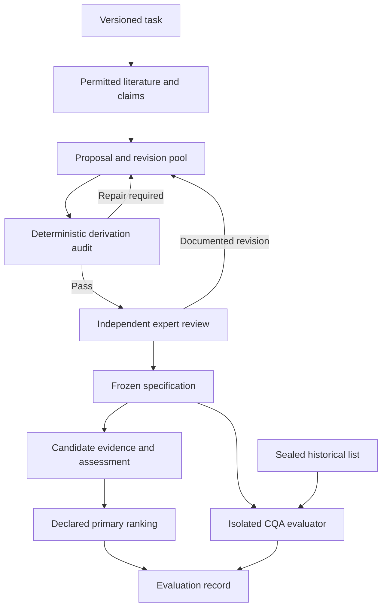

# MAS System Revision Master Handoff

## FINAL GOAL — THE HIGHEST PRIORITY

**Build an agent that can reconstruct a defensible scientific selection process from a task statement, the literature, and public databases: deriving its own screening criteria, grounding every scientific threshold in quoted evidence, and producing a reasoned, sourced, ranked answer whose entire derivation can be audited afterwards.**

**This goal governs every implementation decision in this document.** The bug fixes, data contracts, review mechanisms, ranking policies, and evaluation infrastructure are the means of establishing this capability. Completing those engineering tasks alone does not establish the methods claim.

### The capability we must demonstrate

The agent must search the literature, propose its own criteria, justify their thresholds, refine and consolidate them through deduplication, merging, and proposer/critic debate, and apply the resulting frozen criteria to candidate evidence. Its answer must expose per-candidate reasons, evidence coverage, uncertainty, conflicts, and missing information. Every material proposal, revision, merge, exclusion, and scoring decision must remain traceable.

**Criteria generation is the core competence and the first priority.** The scientific criteria must be derived from evidence rather than supplied as the authors' historical filter list or adjusted to manufacture a preferred answer. Task requirements and domain scaffolding must be identified honestly, with no answer-specific scoring exception.

### What the surufatinib case is for

**We are not claiming to discover surufatinib.** It is the known reference answer. The case tests whether the agent can reconstruct the reasoning that leads to it for an approved or Phase III oral compound engaging **CSF1R, VEGFR1, VEGFR2, VEGFR3, and FGFR1**, over a declared universe of approximately **3,177 compounds**.

There are two formal measurements, in this order of importance:

1. **PRIMARY — Criteria recovery.** Compare the frozen agent-derived criteria with the authors' sealed **eleven critical quality attributes**, reporting **exact / near-equivalent / missed / extra**. This directly tests the agent's central capability. The historical list remains outside the derivation agents' and coordinator's context and is opened only by an isolated evaluator after the intended freeze.
2. **SECONDARY — Rank of the known answer.** Test whether the frozen method places **surufatinib in the Top 5** on the prospectively declared primary board. Report the actual ranking population, eligibility state, ties, coverage, and unresolved evidence gaps.

**Both are one-shot evaluations of the designated frozen experiment.** Preserve development history and the registered outcome; do not select a more favorable criterion set or ranking method after seeing the evaluation result.

### What must remain true

Known-answer-assisted debugging is legitimate. A repair is acceptable when it has an independent technical or scientific justification and applies consistently, even if only one candidate benefits. The prohibited shortcut is choosing scientific criteria or evidence substitutions simply because they improve the reference rank.

**A high rank alone does not establish success.** Unsupported thresholds, criteria copied from an exposed historical list, or an incomplete and unauditable derivation defeat the methods claim regardless of the final position. A negative evaluation must remain a reported result, not a reason to tune the experiment until it passes.

### Governing instruction to the development agent

**Prioritize autonomous criterion derivation, source-grounded reasoning, faithful application, and auditability. For every proposed change, state which part of this final goal it enables and what observable evidence will demonstrate that improvement. Keep additional models, sources, ranking complexity, and interface features subordinate to this goal.**

---

**Purpose:** Give the development agent one complete specification for what the system is trying to prove, what the reviewed implementation currently establishes, what must change, and how to demonstrate completion.

**Date:** 14 October 2026, Asia/Shanghai  
**Repository:** <https://github.com/YWDDLiang03/mas>  
**Reviewed commit:** `aec82a6aea0ecfa5a3b7b3a13802d662d27a823f`  
**Freshness check:** The remote `HEAD` still matched this commit when this Markdown handoff was prepared. The private live store was not available, so its latest execution state remains unverified.  
**Audience:** Development agent, project owner, domain reviewer, and systems reviewer.  
**Status:** Consolidated review and proposed implementation specification. The changes described below have not been implemented by this review.

This document consolidates the agent's original questions, the previous English review, the owner's final goal, the owner's clarification that known-answer debugging is legitimate, the non-CQA manuscript context, and the code findings. It expands the earlier report into a module-level system revision plan. It also adds one newly reproduced assessment-explanation defect, **F8**.

The owner's instructions govern this handoff. Recommendations and proposed schemas below are prospective implementation choices, not claims that an earlier run already followed them.

## Contents

- **[FINAL GOAL — THE HIGHEST PRIORITY](#final-goal--the-highest-priority)**

1. [Executive instructions](#1-executive-instructions)
2. [Final goal and claim boundaries](#2-final-goal-and-claim-boundaries)
3. [Current state and evidence limits](#3-current-state-and-evidence-limits)
4. [Answers to the agent's original review questions](#4-answers-to-the-agents-original-review-questions)
5. [Target architecture and data contracts](#5-target-architecture-and-data-contracts)
6. [Verified findings and required repairs](#6-verified-findings-and-required-repairs)
7. [Evidence policy and task semantics](#7-evidence-policy-and-task-semantics)
8. [Ranking and uncertainty](#8-ranking-and-uncertainty)
9. [Implementation work packages](#9-implementation-work-packages)
10. [Answers to all eighteen owner decisions](#10-answers-to-all-eighteen-owner-decisions)
11. [Criteria export and expert review package](#11-criteria-export-and-expert-review-package)
12. [Freeze and one-shot evaluation protocol](#12-freeze-and-one-shot-evaluation-protocol)
13. [Regression and integration acceptance checks](#13-regression-and-integration-acceptance-checks)
14. [Execution sequence and required deliverables](#14-execution-sequence-and-required-deliverables)
15. [Instructions for the receiving agent](#15-instructions-for-the-receiving-agent)
16. [References and exposure declaration](#16-references-and-exposure-declaration)

## 1 Executive instructions

**The governing objective is the final goal stated at the beginning of this document.** Execute the work below to demonstrate that capability; do not substitute a checklist of completed fixes or a favorable reference rank for the complete methods result.

Continue the project on its existing architecture. The immediate work is to make criterion derivation, evidence interpretation, and evaluation claims enforceable and inspectable.

1. **Export the existing criteria immediately.** Preserve the historical run and label it accurately. Experts cannot meaningfully review criteria hidden in the ignored live store.
2. **Repair the shared contracts before another acceptance-bearing derivation.** Address persisted refinement state, numerical support, transform authority, revision validation, semantic deduplication, and assessment explanations. Do not rely on prompts to enforce these invariants.
3. **Make evidence compatibility explicit.** A shared logarithmic unit or receptor name does not establish that two observations can enter one median.
4. **Validate the whole generator on controlled cases, then re-derive in a fresh registry.** Preserve the same task specification and the old run. Record legitimate no-ops rather than requiring arbitrary merges.
5. **Review and freeze the exact experiment.** Bind criteria, evidence policy, scoring, candidate scope, primary board, matching rubric, and authority records before the designated evaluation.
6. **Report the two endpoints once for that frozen experiment.** Preserve negative outcomes and any later corrections. The sealed historical list must not become a development feedback source.

Retain the useful foundations: the journal, content-addressed artifacts, criterion lineage, explicit missing values, pure assessment logic, source adapters, and the separate recording of machine adjudication. A wholesale rewrite, additional model providers, and more ranking complexity are not the immediate solution.

The practical order is **reviewability → correctness → scientific evidence policy → complete derivation → review → freeze → evaluation**. A favorable reference rank is not a substitute for any preceding gate.

## 2 Final goal and claim boundaries

### 2.1 The methods claim

The project is not claiming to discover surufatinib. Its identity and published target profile are known. The claim is that an agent can reconstruct a defensible selection process from literature and public databases:

- Receive a task statement.
- Search permitted literature and collect attributable claims.
- Propose screening criteria, including scientifically justified thresholds when the evidence supports them.
- Refine and consolidate criteria through deterministic checks, critique, merging, and bounded adjudication.
- Apply the frozen criteria to candidate evidence.
- Return a reasoned ranking with coverage, uncertainty, conflicts, and missing evidence visible.
- Preserve enough records for a later reviewer to reconstruct every material decision.

The acceptance task concerns an **approved or Phase III oral compound engaging CSF1R, VEGFR1, VEGFR2, VEGFR3, and FGFR1**, using a project-reported universe of approximately 3,177 compounds. The five targets are supplied task requirements. Their selection is not itself an agent discovery.

### 2.2 What each measurement establishes

| Requirement | Measurement or evidence | What it does not establish by itself |
|---|---|---|
| Derive useful criteria | Primary comparison against the sealed eleven historical CQAs, reported as exact, near-equivalent, missed, and extra | That the historical list is scientifically complete or infallible |
| Reconstruct the known selection | Surufatinib's rank on one registered primary board; target is Top 5 | Novel drug discovery, clinical efficacy, or generalization to new tasks |
| Produce sourced reasoning | Each scientific screening bound has a supporting quotation, locator, applicability argument, and executable interpretation | That a quotation merely containing a number justifies that number as a cutoff |
| Execute the declared method | Complete stage records, persisted state, meaningful regression checks, and replay | That passing unit tests proves pharmacological adequacy |
| Remain auditable | Versioned criteria, source evidence, decisions, exclusions, reasons, and freeze records | An authenticated authority boundary merely because a journal is append-only |

The owner has specified Top 5 as a rank target. The owner has not specified a minimum number of recovered CQAs constituting a binary primary success. Report the recovery counts and rates descriptively unless a pass threshold is registered before unsealing.

### 2.3 Known-answer debugging is legitimate

The owner explicitly clarified that developers using the known answer's rank to investigate problems is **not itself a problem**. Preserve this instruction throughout the documentation.

A repair is defensible when it corrects an independently identifiable implementation or measurement error and is applied consistently to all relevant candidates. For example, applying the declared median instead of the maximum restores the existing specification.

The number of candidates benefiting from a repair is not the validity test. A correct repair can affect one candidate. Conversely, a change affecting many candidates can still be scientifically unjustified.

Record the defect, independent rationale, implementation change, regression evidence, and full candidate impact. Do not characterize ordinary debugging as misconduct or retroactively disqualify the project because a known answer helped reveal a defect.

The boundary is answer-directed adjustment without independent justification: choosing a scientific cutoff, evidence substitution, weight, or board because it delivers the desired reference rank. The designated one-shot result belongs to the frozen experiment; earlier diagnostic ranks remain development records.

### 2.4 Criteria origin and expert contributions

Distinguish these origins in the registry and evaluation:

| Origin | Appropriate description |
|---|---|
| Task-mandated constraint | A requirement supplied by the user, linked to the task field and version |
| Adapter template | Domain scaffolding that expresses a measurement or retrieval route |
| Literature-derived criterion | A criterion proposed from independently retrieved supporting evidence |
| Direct expert modification | A human change to a definition, threshold, applicability, or decision role |

Independent expert criticism is legitimate feedback. Record direct field modifications so their contribution remains visible. Preserve the agent-produced snapshot before direct manual edits and any later reviewed snapshot. Do not silently attribute expert-supplied values to autonomous derivation.

Two provenance dimensions must remain separate: **who produced or modified the criterion** and **whether that contributor saw the historical CQA list**. Human feedback is not automatically historical-list exposure. Follow the existing protocol's independent/assisted exposure rules, and separately disclose intervention origin.

The drug adapter contains task-derived templates. Therefore, replace the overly broad phrase “nothing about the drug case is hard-coded” with a testable commitment: **no answer-specific runtime rule, threshold, weight, eligibility exception, or rank bonus; task targets and constraints are configured; domain templates are disclosed.** In the inspected source, references to the known answer appeared in explanatory comments or docstrings rather than an identified answer-specific scoring branch. This is not an exhaustive proof of noninterference.

### 2.5 Relationship to the original manuscript

The supplied manuscript, *Multi-target TME Reprogramming Awakens TLS driven Immunity in Ovarian Cancer*, motivates intervention in the tumor microenvironment through CSF1R, VEGFR, and FGFR pathways. Its non-CQA sections discuss surufatinib, pamiparib, preclinical work, and the PASSION clinical study. Those results supply the biological setting; they do not validate MAS criterion generation. [P1]

The owner's stated original workflow is:

> Literature-selected targets → trained DTI predictor → 3,171 compounds → 140 passing predicted probability greater than 0.9 on all five targets → eleven-CQA binary gate → one final compound.

These counts and the probability threshold are attributed to the owner's brief and repository descriptions. The CQA-bearing screening pages were deliberately excluded from this review. Do not claim that this review independently verified their contents, or that the original study had no scientific reasoning or threshold support anywhere.

MAS adds explicit criterion derivation, threshold provenance, per-candidate reasons, ranked output, and a reviewable derivation history. It need not reproduce the predictor's probability filter or treat predicted probability as experimental potency.

Use a **present-day retrospective reconstruction with a declared evidence cutoff** as the proposed scope. A claim to reconstruct only knowledge available at the original study date would require an appropriate historical cutoff and historical source snapshots.

## 3 Current state and evidence limits

### 3.1 Evidence labels used in this document

- **Verified code behavior:** Inspected at the pinned commit and, where stated, reproduced using synthetic inputs.
- **Project-reported run result:** Stated in `design_audit/situation_report.md`; the private store was unavailable for independent reproduction.
- **Recommendation:** A proposed change or scientific policy, not an implemented capability.
- **Unknown:** Evidence needed to determine the current live state was unavailable.

The earlier review ran the offline suite at this same commit: **237 passed, 11 deselected, Python 3.12.14**. The deselected tests require live services. No full live sweep, clean real derivation, or sealed CQA comparison was performed by this review. A further targeted synthetic check reproduced F8 while preparing this document.

### 3.2 What is already useful

The repository implements event records, artifact hashes, criterion lineage, read-only store access, explicit unknown assessments, preference coverage, and distinct machine-adjudication records. It has an actual screening implementation, not only a design specification. Preserve these components.

The reported live store is at `var/primary/store`, under ignored `var/`. A public checkout does not include the criterion records, latest board, source cache, or complete execution history needed for scientific review.

### 3.3 Historical defects already repaired in code

| Historical defect | Verified code state | Remaining work |
|---|---|---|
| Ordering ignored the declared median | The ordering path now applies the declared median/minimum/maximum | Attach the corresponding corrected live replay; maintain numerical regression checks |
| Merge ran before refinement | `DEFAULT_STAGES` is now `filter`, `distill`, `refine`, `merge` | Correct stale prose and prove reachability after persistence and on a clean pool |
| Database routes created duplicate scoring criteria | Multiple routes and collapse support exist | Finish semantic identity and scientific compatibility checks |
| Derived quantities were scored as raw values | `value_transform` exists and runs before aggregation | Validate bound support and authority; fix transformed counter-evidence bookkeeping |

Do not present these four repairs as missing features. Do not treat their presence as proof that the complete corrected generator has already succeeded on the live case. [R1–R7]

### 3.4 What the situation report says about the live run

| Reported quantity | Meaning and limitation |
|---|---|
| 72 proposals in the last described derivation setup | Generated under four dimensions and three inner iterations; not a target that future runs must reproduce |
| 34 promoted criteria | Output of the historically incomplete derivation; nine proposer/critic disputes remained open in that history |
| Zero merges across the described historical rounds | The old stage-order defect prevented useful merge participation; not evidence that today's code must still have that order |
| Ten receptor rules for five quantities | A historical duplication issue; current pooling/collapse support addresses part of it |
| 40 criteria in another accounting view | Must be reconciled with the 34 promoted pool items and later registered rule versions |
| 26 of 40 criteria deferred | Literature-bound criteria were not evaluated in the described database sweeps |
| 3,177 candidates | Current project's reported universe; reconcile with the manuscript's reported 3,171 |
| 229 candidates with an approval-record gap | Project-reported source disagreement or incompleteness; not proof that all 229 are approved |
| Nine scoring rules in `rules@v3` | Reported live configuration after changes; distinct from the eight-rule offline experiment |

Historical ranking comparisons from the report:

| Scenario | Scoring rules | Ranked candidates | Surufatinib rank |
|---|---:|---:|---:|
| Originally published board | 13 | 34 | 10 |
| Add declared transforms | 13 | 34 | 7 |
| Delete five duplicate IUPHAR rules | 8 | 96 | 6 |
| Pool both sources per receptor | 8 | 99 | 8 |
| Pool both sources and apply transforms | 8 | 99 | 4 |

These are **project-reported diagnostic comparisons**, not newly measured results or the designated final experiment. Rank 4 was an offline recomputation; the report said its confirming pipeline sweep was still running when written. Its completion status now is unknown to this review. Do not choose a policy by selecting the best row. [R1]

### 3.5 Statements that must be corrected or narrowed

| Existing statement or inference | Required correction |
|---|---|
| Known-answer-directed debugging is itself the methodological defect | The owner explicitly accepts it; assess the repair's independent rationale and consistent application |
| A change benefiting only surufatinib must be tuning | Beneficiary count is not a scientific test; inspect semantics and evidence |
| `verification_status: unverified` means no quotation was checked | Quote matching and semantic verification are separate fields and operations |
| Every stage must change the pool | Every configured stage must execute correctly or explain a valid no-op; zero legitimate merge opportunities is acceptable |
| No agent can create an expert decision | True only under a declared and enforced caller/process boundary; core API string fields do not authenticate a human |
| Rank 4 demonstrates success on the full universe | It was an offline result on 99 rankable candidates, not a frozen, evidence-complete result on all 3,177 |
| A second provider can be evaluated independently after unsealing | Any planned sealed comparison must freeze all intended arms before opening the reference list |

## 4 Answers to the agent's original review questions

### 4.1 Should the criteria be exported before sending the repository to an expert?

**Yes. Export them now**, with a clear historical status. The ignored store contains the artifact most relevant to the domain expert. Exporting it is useful before the implementation repairs, and a corrected export plus diff is required afterward. Section 11 specifies the fields and files.

### 4.2 Are the 34 criteria appropriate, measurable, and sensibly thresholded?

This cannot be answered criterion by criterion without the records. Do not infer adequacy from count, plausible names, a passing suite, or reference rank.

The review should examine operational definition, task relevance, applicability, available measurement, threshold support, direction, aggregation, redundancy, conflict handling, and decision role. Ask which essential evidence is missing and which proxies are too weak. Do not ask an expert to reconstruct the sealed historical list.

### 4.3 Is a median combining ChEMBL and IUPHAR defensible?

**Potentially, within explicitly compatible measurement strata and after experiment deduplication. An unrestricted median is not yet justified.** Both sources can contribute evidence without receiving separate decision weights. A common logarithmic scale does not make IC50, Ki, Kd, EC50, biochemical assays, and cellular assays interchangeable. See Section 7. [S1–S3]

### 4.4 Should orthologue or cellular potency count toward a human-target criterion?

Only if it matches that criterion's declared meaning and evidence policy. Nonhuman orthologue activity must not silently fill a human biochemical potency cell. Human cellular engagement can support a separately defined cellular criterion. Downstream phenotypic effects do not automatically demonstrate direct target binding.

Declining the described mouse cellular substitution is defensible on species and endpoint grounds. The fact that it would improve one candidate is not the scientific reason to reject it.

### 4.5 Is the no-tuning discipline enforced?

The intent is documented, and useful source-exclusion and provenance mechanisms exist. The full claim still requires a validated freeze record, a named primary board, controlled evaluator access, retained development history, and prevention of silent policy changes. A `prespecified` label with no registration reference does not establish that discipline.

### 4.6 Is the authority model sound?

The distinction between machine adjudication and human approval is useful. Its enforcement currently depends on trusted callers. If an agent can invoke Python APIs or write the approval journal directly, self-declared `human` and `interactive` strings are inadequate. Enforce the actual deployment boundary or explicitly limit the claim to restricted model outputs mediated by a trusted controller.

### 4.7 Is one-shot validation credible after development iterations?

Yes, as a clearly designated post-freeze evaluation of a developed known-case method, with the history disclosed and the CQA list still sealed. Do not describe it as a first-ever view of the known compound's rank. Do not replace the registered outcome after inspecting it.

### 4.8 What should reviewers read and return?

Read the corrected situation report and criterion export first, then the README and architecture decisions. Design reviewers should continue to the protocol and evaluation plan; code reviewers should follow the modules in Sections 6 and 9. Skip `rebuttal_alignment.md` and the stale `suggestions.md` for this task.

Return criterion-specific or code-specific feedback with identifiers, evidence, proposed field changes, severity, and a completion test. General praise or broad skepticism is less actionable than a demonstrable mismatch.

## 5 Target architecture and data contracts

### 5.1 End-to-end control flow



There is no evaluation-to-derivation feedback edge for the designated frozen experiment. Legitimate later development creates a new version and retains the previous result.

### 5.2 Separate three identities

The existing design sometimes confuses where evidence comes from with what is measured. Implement three explicit identities:

| Identity | Includes | Used for |
|---|---|---|
| Retrieval identity | Provider/capability, query parameters, requested subject, source version | Caching and retrieval reuse |
| Measurement identity | Quantity, subject, exact target, target species/construct, endpoint, assay context, normalized unit, transform and aggregation semantics | Comparing whether observations estimate the same defined quantity |
| Decision identity | Measurement reference, applicability, direction, predicate, cutoff, rule kind, weight group, missing/conflict policy | Detecting duplicate scoring, incompatible decisions, and changes to the rule set |

Two attributes may share a retrieval identity and measure different derived quantities. Two sources may provide compatible evidence for one measurement. Two decisions may use one measurement in different ways; that requires a redundancy or conflict review rather than automatic deletion.

An empty subject plus unit and direction must never be enough to establish equivalence. Direction conflicts should be surfaced, not hidden by a route-key match.

### 5.3 Minimum criterion contract

The following are **proposed logical fields**, not a claim that a particular JSON schema or CLI already exists. Fit them to the current event model without silently discarding existing fields.

| Field group | Required content |
|---|---|
| Identity | Criterion id/version, attribute id/version, rule id/version, task version, origin |
| Meaning | Operational definition, dimension, applicability, measurement identity, decision identity |
| Computation | Source unit, normalized unit, direction, transform expression and bound support, aggregation, conflict policy |
| Rule | Hard constraint/preference/contextual role, predicate, cutoff or explicit absence, cutoff basis, weight and weight-group provenance |
| Source support | Supporting and conflicting claims, quoted spans, document identities/hashes, locators, normalization/derivation steps, applicability rationale |
| Verification | Quote-integrity result, numerical-consistency result, semantic-support result, verifier identity/version |
| Authority | Required authority, machine decision references, human decision references, contributor exposure declarations |
| Lifecycle | Pool state, refinement state, parents/children, merge/withdrawal reasons, dispute status |
| Use | Rule-set inclusion, scoring eligibility, deferral/exclusion reason, evidence coverage |

Every field that can change the result must survive proposal normalization, pool persistence, revision, promotion, collapse, rule-set confirmation, assessment, export, and replay. A field accepted by the schema but ignored downstream is an implementation failure.

### 5.4 Bound support contract

Treat every scientific cutoff and every scientific bound inside a transform as a separately supported parameter.

A support record must identify:

1. The parameter path it supports, such as a rule cutoff or a transform bound.
2. The original claim, document, exact quotation, locator, and document hash.
3. The original number, unit, comparator, range/censoring information, and measurement context.
4. Any unit conversion or explicit derivation producing the executable parameter.
5. Whether the passage states a decision threshold, reports a measurement, or provides a heuristic.
6. Why applying it to this task and candidate population is justified.
7. Separate quote, arithmetic, semantic-support, and authority outcomes.

For example, a passage containing a measurement of 30 does not support a cutoff of 90 merely because both are numeric. Even a perfectly matched number is insufficient if it was measured under an inapplicable condition or was never proposed as a screening requirement.

A source can justify an explicitly derived bound, but both the calculation and its scientific interpretation must be recorded. Expert approval alone does not turn an unsupported number into a literature-sourced threshold.

Methodological settings such as retrieval budgets, coverage floors, and ranking weights need registration and rationale. Do not mislabel them as experimentally established biological thresholds.

### 5.5 Evidence and assessment contracts

For an observation, preserve the original source value and relation, normalized value, target species, assay host, endpoint, assay context, source record/version, publication, and underlying experiment identity.

For an assessment, preserve:

- All admitted, excluded, conflicting, and unavailable claims, with typed reasons.
- The exact normalized and transformed value used for each claim.
- The compatible evidence stratum and independent experiment count.
- Aggregation and its input claim/experiment references.
- Final value, verdict, applicability, missingness category, and authority basis.
- Source determination basis separately from computational derivation. A transformed value may be derived from measured source evidence.
- A reason generated from the same evaluated values and predicates as the verdict.

An explanation must not recalculate the decision using raw values, a different unit, another aggregation, or an implicit alternative predicate.

### 5.6 Derivation audit contract

Add a machine-readable audit that can block promotion, freeze, or publication according to finding severity. Integrate it into the trusted orchestration path; a manually invoked report alone is insufficient.

Each finding should carry a stable code, object/version, evidence references, severity, required action, and resolution record. Proposed codes include:

| Code | Meaning |
|---|---|
| `BOUND_SUPPORT_MISMATCH` | Numeric support or applicability does not justify an executable scientific bound |
| `TRANSFORM_NOT_EXECUTABLE` | Definition requires a transform absent from the executable contract |
| `AUTHORITY_MISSING` | A decision-bearing parameter lacks its required authority |
| `REFINEMENT_STATE_LOST` | Replay changes the effective repair limit or state |
| `DUPLICATE_DECISION` | Equivalent quantity and decision are scored more than once without justification |
| `MEASUREMENT_INCOMPATIBLE` | Evidence admitted to a quantity violates its declared stratum |
| `STAGE_UNREACHABLE` | A configured stage cannot consume items it is expected to process |
| `MATERIAL_DISPUTE_OPEN` | An unresolved scientific dispute prevents validated scoring |
| `EXPLANATION_VALUE_MISMATCH` | Counter-evidence or explanation used values different from the assessment |
| `FREEZE_BINDING_MISMATCH` | Actual inputs or policy differ from the registered experiment |

A stage report must distinguish executed-with-changes, executed-with-no-opportunity, unresolved work, capability error, and budget termination. Do not infer success merely from an outer run reaching a terminal state.

## 6 Verified findings and required repairs

**P0:** Repair before relying on the affected scientific scoring or explanation.  
**P1:** Repair before the clean derivation, freeze, or corresponding capability claim.  
These priorities describe gates, not a requirement to discard all existing infrastructure.

### F1 Refinement counts disappear during persistence

**Priority:** P1, blocks trustworthy bounded derivation.  
**Modules:** `core/pool.py`, `core/derivation_stages.py`, `core/derivation_run.py`.  
**Evidence:** `ITEM_FIELDS` omits `refine_count`; `_record` persists only the listed fields. `filter_stage` and `refine_stage` read the missing counter. A synthetic item with count 2 returned no counter after add/revise and fold. [R5, R6]

**Change:** Persist refinement state in a versioned contract. Define whether the limit is per lineage, per round, or both; preserve both counters if needed. Record reset events explicitly. Specify how a merged child inherits parent repair history rather than accidentally resetting its budget.

Do not backfill historical events with invented counts. Reconstruct from genuine recorded transitions where possible; otherwise mark historical values unknown and keep the old run exploratory.

**Acceptance:** The same item reaches the same defer/withdraw/continue decision before and after reopening the store and across supported round continuations. The outer iteration limit already bounds execution; this finding is not an infinite-loop claim.

### F2 Citation presence does not establish threshold support

**Priority:** P0.  
**Modules:** `core/derivation.py`, `core/reading.py`, `core/criteria.py`, `core/adjudication.py`.  
**Evidence:** `validate_proposal` accepted a source-stated cutoff of 90 when its cited synthetic numeric claim stated 30. The current check establishes the presence of a numeric claim rather than support for the parameter. [R4]

**Change:** Implement one reusable bound-support validator. Invoke it for initial proposals, revisions, promotion, collapse-generated versions, and confirmation. Validate unit normalization and explicit derivations mechanically; record scientific applicability and threshold interpretation separately. A model critic can contribute semantic review but cannot substitute for deterministic consistency checks.

**Acceptance:** Unsupported 30-to-90 substitution is rejected or withheld from scoring. Supported unit conversion passes. A correctly quoted observation cannot silently become a decision threshold. Missing or invalid support remains visible and non-scoring in the primary sourced set.

### F3 Transform parameters can bypass expert-authority checks

**Priority:** P0.  
**Modules:** `core/criteria.py`, `core/adjudication.py`, `core/collapse.py`.  
**Evidence:** `check_value_transform` accepts `basis = expert_set`, while `needs_expert` considers the rule kind and rule cutoff basis. A synthetic ordering preference with an expert-set transform bound created zero review items and obtained `trigger_table` authority. [R3]

**Change:** Compute authority requirements from the complete decision-bearing object: rule, attribute, transform parameters, and relevant weighting policy. Moving a number into another field must not change its authority requirement. Update every call site, including collapse and confirmation. Other transform bases must resolve actual support records rather than merely contain a nonempty source-reference list.

**Acceptance:** An expert-set bound cannot contribute to a score without a valid decision. Approval of one version does not approve materially changed parameters in another. Source support and expert authority remain separate requirements.

### F4 Adjudicator revisions bypass their promised semantic restrictions

**Priority:** P0.  
**Modules:** `core/adjudication.py`, shared rule/support validation.  
**Evidence:** `_apply_revision` accepted a synthetic preference change from `>= 30` to `>= 90` with no refusal. Its schema and authority checks did not establish numeric support or enforce the documented restriction to weaker revisions. [R7]

**Change:** Revalidate the complete revised object. Define permitted revision relations for each supported comparator, predicate, unit, and rule kind. If “weaker” is not decidable under that contract, require the appropriate explicit review. Do not rely on the adjudicator's natural-language instruction. Preserve both versions and a field-level diff.

**Acceptance:** Tightening, comparator reversal, unit changes, transform changes, and cutoff-basis relabelling cannot bypass support or authority checks. Existing hard-rule demotion remains recorded as a machine action, not human approval.

### F5 Duplicate detection confuses retrieval identity and quantity identity

**Priority:** P1, blocks defensible clean derivation.  
**Modules:** `core/criteria.py`, `core/derivation_stages.py`, `core/collapse.py`.  
**Evidence:** For non-literature attributes, `evidence_key` depends on routes. `duplicate_of_registered` can accept key equality before comparing transform, direction, or definition. A raw synthetic measurement and its excess-above transform were treated as duplicates despite different meanings and directions. [R3, R6]

**Change:** Introduce the three identities in Section 5.2. Use shared retrieval only as a comparison hint. Require semantic compatibility before dropping or merging. Refuse equivalence when subject information is absent. Preserve claim and lineage provenance through cross-source consolidation.

Different derived quantities can share evidence; retain them where scientifically justified and review their correlated weight. Conversely, equivalent measurements obtained through different providers should not receive duplicate decision weight merely because their routes differ.

**Acceptance:** Raw and transformed quantities survive appropriately; equivalent cross-source quantities consolidate; unrelated safety outcomes sharing a unit remain separate; conflicting directions trigger review.

### F6 Prespecified labels are not bound to validated registration

**Priority:** P1, blocks the corresponding evaluation claim.  
**Modules:** `core/criteria.py`, `core/controller.py`, run bindings and proposed freeze support.  
**Evidence:** `confirm_rule_set` emitted `acceptance_label = prespecified` with `preregistration_ref = null` in a synthetic case. Controller binding fields can also be null. [R3, R11]

**Change:** Make status labels checkable. If “prespecified” represents a registered experiment, require a valid prior record matching the governed policy. Otherwise use an accurately named technical or exploratory state. Add a complete experiment manifest and validate it on run start, resume, and publication.

The existing `evidence_admission_predicate_hash` intentionally covers a limited policy subset. Its unchanged value after altering a cutoff is not a cryptographic collision. Preserve its narrow purpose and add a complete experiment digest.

**Acceptance:** Missing registration, mismatched versions, or policy drift cannot obtain a valid prespecified label. A new version can be created, but it cannot overwrite the identity of the old experiment.

### F7 Human approval depends on trusted callers

**Priority:** P1; severity depends on actual agent capabilities.  
**Modules:** `core/review.py`, `core/journal.py`, CLI, deployment permissions.  
**Evidence:** The CLI uses `/dev/tty`, but a noninteractive direct call to `review.decide` with caller-supplied `actor.kind = human` and `entry = interactive` created a synthetic human-scientific-approval record. This demonstrates a trust-boundary limitation, not a real forged approval. [R8, R9]

**Change:** First document the deployed threat model. If model agents only return restricted data to a trusted controller, enforce and test that interface. If agents have Python, shell, or store-write access, place human approval behind an authenticated separate service or principal; prevent direct agent creation of valid approval records. A signed approval reference must be verified against a signer the agent cannot impersonate. A signature whose private key is available to the agent adds no boundary.

Keep evaluator material outside the agent-readable store or enforce a demonstrably separate readable principal. Do not assume a context label or process name alone supplies isolation.

**Acceptance:** Test the actual permitted agent routes. They cannot mint valid human approval or read evaluator-only artifacts. Machine resolutions remain machine-labelled. Restrict the public claim if the stronger deployment boundary is out of scope.

### F8 Counter-evidence explanations use raw values after transformed scoring

**Priority:** P0 for trustworthy explanations.  
**Module:** `core/assessor.py`, especially the non-consensus conflicting-claim calculation.  
**Newly reproduced in this consolidation.** [R14]

Synthetic reproduction:

| Input or result | Value |
|---|---|
| Raw observations | 20 and 50 |
| Transform | Excess above 30 |
| Values actually assessed | 0 and 20 |
| Aggregation and predicate | Median 10; pass if `>= 10` |
| Correct cell verdict | Pass |
| Claim contradicting that aggregate verdict | The observation transformed to 0 |
| Actual `conflicting_claim_refs` | Empty |
| Actual counter-evidence disposition | `found_and_outweighed` |

The code detects different sides using transformed values but identifies conflicting claims by comparing raw values with the transformed-quantity cutoff. The score may be correct while its audit explanation omits the relevant counter-evidence.

**Change:** Compute a normalized, transformed evaluation object once per claim or interval. Reuse it for aggregation, predicates, conflict attribution, and reasons. Preserve the raw observation alongside it. Record source evidence basis separately from the derivation applied to the assessed value; do not lose computation provenance when the source itself is measured.

**Acceptance:** The fixture above identifies the low transformed claim as conflicting. Test monotone and nonmonotone transforms, units, and supported intervals. Explanation generation must consume the same evaluation results used for the verdict.

All numerical examples in F1–F8 are software fixtures or state counters. They are not proposed pharmacological thresholds. The frequency and ranking impact of these behaviors in the unavailable live store are unknown.

## 7 Evidence policy and task semantics

### 7.1 Preserve the quote-verification distinction

`reading.extract_claims` checks quotation presence, records `quote_verified`, and sets `location.span_checked_against_source`. It separately sets `verification_status = unverified`. These refer to different checks. [R12]

Audit the actual source-span flags, hashes, locators, and admission reasons in the live export. Separately assess whether each passage supports the threshold and its applicability. Do not claim either that all quotations are unverified or that quotation matching establishes scientific entailment.

### 7.2 Pooling ChEMBL and IUPHAR

ChEMBL's pChEMBL convention puts several activity endpoints on a common negative-log scale and describes them as roughly comparable. IUPHAR exposes affinity-parameter and species distinctions. Neither fact establishes unconditional assay equivalence. Primary methodological work also documents substantial variation when activity values are combined across sources. [S1–S3]

Required changes:

1. Retain exact target identity/construct, target species, assay host, endpoint, assay format, material conditions, compound form, original unit/relation, and source version.
2. Define compatible strata before aggregation. Keep incompatible biochemical, binding, cellular, and phenotypic measurements separate unless a justified transformation is explicitly registered.
3. Deduplicate underlying experiments across databases. Two curations of one publication or assay are not two independent experiments. If provenance is insufficient to establish independence, report that uncertainty.
4. Treat ranges and censored values under an interval policy. A range's two endpoints are not two independent replicate measurements. Do not turn a censored limit into an exact value.
5. Aggregate compatible evidence under a declared rule, retaining study counts, dispersion, contradictions, and source-specific summaries.
6. Apply the same policy to every candidate. Source-specific sensitivity results must not become a menu for selecting the preferred reference rank.

`assessor.usable_claims` currently checks admission, evidence kind, determination basis, and units, but not a complete assay-compatibility contract. The database gathering path appends claims without cross-database experiment deduplication. `GtoPdbAffinity` defaults an empty species field to Human. Replace that default with unknown and an explicit admission decision. [R10, R12, R14]

### 7.3 Human targets, orthologues, and cellular evidence

Keep target species separate from assay-host species. A human protein expressed in a nonhuman host is not the same case as measuring a nonhuman orthologue.

Use separate evidence roles for human biochemical potency, human cellular engagement, downstream phenotype, and orthologue support. A criterion may legitimately ask about one of these, but its evidence must answer that question. Do not use an unsupported cross-species or cross-endpoint substitution to fill an otherwise missing human biochemical cell.

The all-five-target task requires explicit coverage of each required receptor. A good aggregate preference score cannot imply five-target engagement when one target remains unknown. Derive and source the meaning of “engaging” where a numerical threshold is needed; do not invent it to obtain a desired board.

### 7.4 Approved or Phase III and oral route

The adapter currently maps an oral constraint to **Approved oral route on record**. That can be stronger than the requested task, which permits a Phase III oral compound without an approved product. [R10]

Separate three decisions:

| Decision | Required evidence |
|---|---|
| Development eligibility | Approved status or the accepted Phase III status, with date, jurisdiction and indication scope where relevant |
| Oral administration | Suitable product or trial evidence for the route, under a declared acceptance policy |
| Target engagement | Evidence appropriate to each required target criterion |

An IUPHAR approval flag can contribute status information but does not independently establish an oral route. ATC classification alone is not a jurisdiction-specific authorization record. Conflicting or absent source fields should trigger reconciliation or unknown status, not automatic approval, rejection, or promotion to `recommended`. [S4]

Do not add a special exception for the reference compound. A second source should resolve the general predicate for all candidates under the same policy.

### 7.5 Missingness and deferred literature

Keep at least these situations distinguishable: not searched, searched with no usable evidence, provider failure, identity unresolved, incompatible evidence, unresolved contradiction, deferred capability, inapplicable criterion, and adequate evidence of failure.

The reported 26 deferred literature criteria are a missing execution stage, not evidence that those criteria failed or were scientifically irrelevant. Run a literature pass under a registered scope and budget. If it covers only a shortlist, publish it as a conditional second-stage board with its parent snapshot and selection rule. A small prespecified sample outside the shortlist can assess selection effects, but does not turn that stage into a full-universe literature screen.

### 7.6 Independent medicinal chemistry review

Without the criterion export, no specific missing dimension is asserted. Ask reviewers whether the set addresses task-relevant target engagement, achievable unbound exposure and duration, administration/formulation, metabolism and interaction liabilities, and safety at the intended regimen. These are independent review prompts, not a reconstruction of the sealed eleven CQAs.

Distinguish heuristics from necessary conditions. A general property guideline does not automatically justify excluding an approved or late-stage compound. Require a task-specific argument for hard exclusions, monotonic preferences, and duplicated proxies.

## 8 Ranking and uncertainty

### 8.1 State the current estimator accurately

The current weighted preference score averages observed contributions. Threshold rules contribute pass/fail values, and ordering rules contribute empirical percentiles. Missing values leave the score numerator and denominator; preference coverage is reported separately. [R14]

With equal weights, a hypothetical candidate observed on four of eight rules with perfect contributions scores 1.0, while one observed on all eight at 0.8 scores 0.8. A coverage floor of 0.5 admits both. This is a property of the estimator, not a claim about a real compound.

Retain the weighted baseline for diagnostic continuity. Make comparability and evidence coverage visible rather than presenting a high score as comprehensive support.

### 8.2 Required board fields

Every published board must identify:

- Universe definition, source date/version, identity-normalization policy, and candidate-set hash.
- Number enumerated, resolved, attempted, eligible, rankable, ranked, and withheld, with reasons.
- Sweep completeness separately from measurement coverage.
- Hard-rule coverage, weighted preference coverage, and per-target coverage.
- Rule-set and criterion versions; number of active, contextual, deferred, disputed, and excluded items.
- Raw score, final position, ties, state, blocking unknowns, and per-criterion reason references.
- The primary or diagnostic status of the board and the frozen experiment it belongs to.

The existing leaderboard already accounts for member-set comparability in part. Extend and test that behavior; do not describe it as entirely absent. Percentile scores depend on the comparison set, so the full-universe pass and a shortlist pass cannot silently share one numerical interpretation. [R19]

### 8.3 Rank is separate from recommendation

Current ranking can include `provisional` candidates. Decide and register whether the primary Top 5 metric uses this diagnostic ranking or requires fully demonstrated task eligibility. Do not change that choice after observing the reference outcome.

Recommended reporting is to publish the named rank endpoint and, separately, whether all task requirements are established. An unknown hard predicate must remain visible. A top-ranked provisional compound is not automatically a scientifically confirmed recommendation.

If the primary endpoint requires verified task eligibility, an ineligible or unrankable reference cannot pass. If a provisional board is the registered endpoint, label its result accordingly rather than claiming completed task satisfaction.

### 8.4 Coverage sensitivity and uncertainty

Use coverage profiles and comparisons within similar evidence patterns or declared coverage strata. Optional best/worst score bounds for missing contributions are sensitivity analyses, not measurements. Shrinkage requires an explicit statistical model and missingness assumptions; it is not a neutral patch.

Report assay heterogeneity, experiment independence, unresolved conflicts, and data gaps. A count of usable claims alone is not calibrated uncertainty. Do not label sensitivity ranges as confidence intervals unless a model supports that interpretation.

Coverage floors and any alternative scoring method must be fixed before the designated evaluation. Keep 0.5 as the current diagnostic baseline, not as a scientifically validated universal threshold.

### 8.5 Defer symbolic regression for the primary case

In `leaderboard_score` mode, the symbolic-regression target is derived from the weighted score. `adoption_check` recomputes the baseline on holdout members, whose percentile context differs from the full-set target. An apparent gain in reproducing that target can reflect this difference rather than improved pharmacological reasoning. Adoption is possible in the implementation; it is not independent scientific validation. [R18]

Keep symbolic regression as a separate, optional research track after the core evidence semantics are stable. Do not use the known answer's rank to choose between learned and weighted scoring for the primary result.

## 9 Implementation work packages

**Goal alignment is required for every work package:** identify the contribution to autonomous criterion derivation, quoted-source support, faithful screening, or auditability, and attach evidence of that contribution. Engineering completion is a gate toward the final experiment; the final claim still depends on the derived criteria, their support, and the two registered measurements.

File paths below identify existing integration points unless explicitly marked **proposed**. New command names, schemas, and helper modules must be implemented and documented before being advertised as available.

| Package | Main integration points | Concrete work | Completion artifact |
|---|---|---|---|
| WP0 Preserve and expose the baseline | `core/pool.py`, `criteria.py`, `ledger.py`, `leaderboard.py`, `artifacts.py`; CLI | Export one pinned read-only snapshot; include full lifecycle and score eligibility; reconcile counts | Historical Markdown/JSON export and manifest |
| WP1 Persist and execute the generator correctly | `pool.py`, `derivation_stages.py`, `derivation_run.py` | Fix F1; make stage inputs/outputs and valid no-ops explicit; integrate bounded dispute resolution; validate clean replay | Complete generator fixture and stage audit |
| WP2 Enforce support and authority consistently | `derivation.py`, `reading.py`, `criteria.py`, `adjudication.py`, `collapse.py` | Fix F2–F4; shared support validator; parameter-level authority; complete revision validation | Bound audit and regression evidence |
| WP3 Separate retrieval, measurement and decision identity | `criteria.py`, `derivation_stages.py`, `collapse.py` | Fix F5; refuse under-specified equivalence; preserve multi-source provenance; review duplicate weights | Typed identity contract and merge/dedup tests |
| WP4 Normalize and admit scientifically compatible evidence | Drug adapters, `evidence.py`, `assessor.py`, `identity.py` | Endpoint/species/host metadata; experiment dedup; unknown species; intervals and source versions | Compatibility policy and evidence audit |
| WP5 Make assessment reasons use the evaluated values | `assessor.py`, reason projection/export | Fix F8; reuse normalized/transformed evaluations; separate source and computation provenance | Conflict-attribution and reason-consistency tests |
| WP6 Match task eligibility faithfully | `adapters/drug/registration.py`, `universe.py`, status sources, `assessor.py` | Separate development status, oral route, and engagement; retain unknowns; reconcile universe identities | Eligibility audit and 3,171/3,177 reconciliation |
| WP7 Enforce deployment authority and source exclusion | `review.py`, `journal.py`, CLI, source broker/uploads, deployment configuration | Resolve F7 for actual capabilities; verify protected-source identities and evaluator separation | Threat model and permission tests |
| WP8 Add automatic scientific-contract gates | Orchestration, pool promotion, confirmation, publication; **proposed** cohesive audit helper | Audit stage reachability, bound support, field use, duplicate decisions, disputes and reason consistency | Audit report with resolved/blocking findings |
| WP9 Register, freeze and report the experiment | `criteria.py`, `controller.py`, `leaderboard.py`, `staging.py`; **proposed** freeze helper | Fix F6; validate policy binding; capture source snapshots; define primary board and reporting scope | Freeze manifests and final board bundle |
| WP10 Complete derivation, review and evaluation | Existing derivation/controller paths; isolated evaluator; design documentation | Clean derivation; independent review; freeze; registered screen; one-time CQA intake; honest outcome report | Reproducibility and evaluation package |

Avoid scattering the same validation across modules with slightly different meanings. Small shared helpers for support validation, semantic identity, auditing, and freeze verification are reasonable. Preserve the existing separation between pure computation and orchestration.

### 9.1 Generator state transitions

Maintain the corrected `filter → distill → refine → merge` loop, but validate the output of refinement and merging before promotion. A last-iteration repair or merge must not skip the final contract checks merely because there is no next filter iteration.

Dispute handling should classify the issue:

- Schema, missing metadata, or arithmetic inconsistency: deterministic repair/rejection under a bounded policy.
- Source-grounded scientific disagreement: bounded proposer/critic/adjudicator process with explicit evidence.
- Unsupported expert parameter or unresolved material scientific issue: retain visibly, but exclude from the validated scoring set until properly resolved.

Do not force an adjudicator to manufacture consensus. Budget exhaustion and unresolved work are legitimate terminal outcomes when accurately labelled.

### 9.2 Migration and compatibility

Use explicit schema versions. Keep the old journal and artifacts intact. If new support or compatibility metadata is absent in old records, mark it unknown or unaudited rather than manufacturing a passing status.

Define how existing single-route attributes map to multiple routes and how legacy rule versions retain their old semantics for replay. A migration should generate a new projection or versioned records, not rewrite historical evidence to match current expectations.

Freeze and publish from a consistent snapshot. Retain one store writer and one integration owner. Any concurrent development should use isolated branches/worktrees and narrowly scoped changes under the project's existing authorization.

## 10 Answers to all eighteen owner decisions

These are recommended defaults answering `situation_report.md` Section 10. They do not retroactively change an executed protocol.

| No. | Original decision | Recommended answer and implementation consequence |
|---:|---|---|
| 1 | Re-derive in a clean context? | Yes, after the core repairs. Use a fresh registry with the same versioned task; do not let historical promoted criteria short-circuit proposals through duplicate lookup. |
| 2 | Keep or retire the existing task? | Keep it as an immutable development baseline with exports and results. Create a linked new task/run for clean derivation. |
| 3 | Second provider now? | Defer until the generator is validated. If provider comparison is intended for sealed recovery, register and freeze both arms before unsealing. |
| 4 | Same derivation size or wider? | Start with the same declared four-dimension, three-iteration budget for diagnostic comparability. Expand for documented search gaps, never to obtain 34 or eleven survivors. |
| 5 | Resolve debates in-run or leave exploratory? | Resolve bounded, evidence-resolvable disputes in-run. Material unresolved disputes remain non-scoring in the validated set; the exploratory archive may retain them visibly. |
| 6 | Different adjudicator family? | Prefer a third family when feasible. Record actual model/provider families and visible information. Separate roles within one family do not establish independent evidence. A third family still does not guarantee independence. |
| 7 | Build span verification before freeze? | Audit existing span-check machinery first. Repair failures and add numerical and semantic support checks. Do not rebuild it on the false premise that `unverified` means no quote matching exists. |
| 8 | Missing transform should block or warn? | Block validated promotion when executable semantics do not match the declared derived quantity. A warning cannot make raw-value scoring correct. |
| 9 | Literature pass on the ranked shortlist or skip? | Run a budgeted, registered second stage. Choose its scope prospectively rather than hard-coding the current 99; label a shortlist result as conditional and consider a fixed sample outside it. |
| 10 | Add a second approval source? | Yes where it supplies useful independent evidence. Separate status and oral route. Do not treat ATC alone as approval or an approval flag as oral-route evidence. |
| 11 | Add more affinity sources? | Defer until compatibility and experiment deduplication work. Pilot incremental usable coverage across the task before adding source complexity. |
| 12 | Address coverage variance? | Keep the baseline visible and add coverage profiles, strata and registered sensitivity analyses. Avoid unexamined shrinkage or substitution of missing measurements. |
| 13 | Enable symbolic regression? | Keep the weighted preference baseline for the primary reconstruction. Treat learned ranking as a separate research question with a justified objective. |
| 14 | Keep the 0.5 floor? | Keep it for diagnostic continuity. Register the decision-grade policy and any sensitivities before the primary run; do not claim 0.5 is scientifically established. |
| 15 | Freeze after one round or both? | Freeze after the clean generator and independent review pass. If both provider arms support the sealed comparison, freeze both before opening the list. |
| 16 | How should CQA transcription occur? | Use a genuinely isolated evaluator context with separate access, after the intended freezes, and record one-time intake and verified transcription. A new agent name alone is not access isolation. |
| 17 | One repository writer? | One integrator and one store writer. Use isolated changes and explicit attribution for other work. Do not sweep unrelated edits into a commit. |
| 18 | Maintain the browser workbench? | Keep read-only parity and necessary smoke checks. Defer cosmetic changes and new interactive features until scientific and correctness gates are satisfied. |

## 11 Criteria export and expert review package

### 11.1 Required export

Generate a compact index and one detailed card per criterion from the same canonical records used for JSON. Include historical withdrawn/merged items in a separate lifecycle section so the final survivors can be understood.

Each card must show:

- Stable ids and versions; origin; task dimension; operational definition and applicability.
- Unit, direction, aggregation, complete transform and parameters.
- Rule kind, predicate, cutoff/basis or explicit lack of a cutoff; weights and decision grouping.
- Source routes and parameters; accepted evidence kinds and determination bases.
- Exact supporting quotations, source links/identities, locators, hashes, and parameter mappings.
- Quote-check status separately from numerical consistency and semantic support.
- Supporting and conflicting claims; underlying experiment groups where known.
- Critic findings, adjudication, expert decisions, unresolved disputes and exposure declarations.
- Parent/child lineage, merge or withdrawal rationale, and refinement history.
- Rule-set inclusion, scoring/deferred/context-only status, and actual coverage if measured.

Do not manually improve the historical cards during export. Corrected records belong to a new version with a diff.

### 11.2 Proposed committed artifacts

| Proposed repository path | Purpose |
|---|---|
| `design_audit/derived_criteria_review.md` | Human-readable current review snapshot, with an explicit baseline or corrected label |
| `design_audit/derived_criteria_review.json` | Exact canonical criterion records for the same snapshot |
| `design_audit/derived_criteria_manifest.json` | Task/run/rule-set references, journal position, code version, export metadata and payload hashes |
| `design_audit/criteria_count_reconciliation.md` | Explain 34 pool items, 40 registered criteria and 13/8/9 scoring-rule counts by version and scope |
| `design_audit/criteria_change_log.md` | Historical-to-corrected changes with technical/scientific rationale and impact |
| `design_audit/derivation_audit.md` and `.json` | Stage trajectory, opportunities, findings, resolutions and remaining blocks |

Keep immutable versioned exports or commit-addressed snapshots behind these current pointers. Hash canonical payloads deterministically; exclude volatile export timestamps from the payload digest. Pin the journal sequence or read-only snapshot to avoid a mixed-state export during a live write.

Publish sufficient source excerpts and locators for audit within redistribution limits. Do not publish protected CQAs, credentials, or unnecessary private model traces.

### 11.3 Reviewer instructions

Ask a domain reviewer whether each criterion is measurable, relevant, applicable, and supported; whether a cited passage justifies the threshold; whether a rule should exclude, prefer, or merely contextualize; which evidence is compatible; and which dimensions are missing or over-counted.

Ask a systems reviewer whether the full serialized loop works, each decision-bearing field reaches scoring unchanged, parameter authority is enforced, agent capabilities match the claimed boundary, frozen inputs reproduce the result, and missing evidence is represented consistently.

Use this feedback structure:

```yaml
criterion_ref: "<id@version, or system component>"
action: "keep | revise | merge | split | remove | investigate"
issue: "<concrete mismatch or scientific concern>"
evidence_refs: []
proposed_change: "<specific fields or behavior>"
blocks_validated_use: true
completion_check: "<observable condition>"
historical_list_exposure: "not_exposed | exposed | undeclared"
```

The example is a proposed review format. It does not create an expert approval record. Actual authority must pass the deployed approval mechanism.

### 11.4 Suggested introduction to reviewers

> MAS takes a task statement, derives screening criteria from permitted literature and declared task requirements, records their provenance and executable semantics, and applies a versioned rule set to candidate evidence. This case reconstructs selection of a known oral multi-target compound; it does not claim a new drug discovery. Please assess the exported criteria and evidence policy on their scientific merits.
>
> Development used the known reference compound to help identify implementation defects. That is legitimate debugging; the relevant questions are whether the repairs have independent justification and apply consistently. The historical eleven CQAs remain sealed for a separate comparison. Please do not send that list or hints derived from it. Return specific, evidence-backed feedback on criterion definitions, thresholds, evidence compatibility and implementation.

## 12 Freeze and one-shot evaluation protocol

### 12.1 Freeze policy and captured artifacts in two steps

A manifest cannot contain hashes of candidate evidence that has not yet been retrieved. Separate prospective policy registration from the later capture of the evidence actually used.

**Before the designated run, freeze the protocol and criteria:**

- Task text/version, eligibility semantics, target identities, and retrospective evidence cutoff.
- Criteria, rules, transforms, support records, weights, disputes, authority decisions and origin labels.
- Derivation configuration and relevant models/prompts/settings; the derivation source snapshot.
- Candidate enumeration and identity policy, source version, and exact membership where already materialized.
- Retrieval queries/routing policy, permitted sources, budgets, compatibility and experiment-dedup policies.
- Aggregation, missingness, uncertainty reporting, coverage thresholds, shortlist selection and tie rules.
- Primary board and rank endpoint; CQA matching rubric, evaluation views and planned provider arms.
- Implementation commit, schema versions, policy hashes, exposure record and registration timestamp.

**During retrieval and before final scoring, bind captured artifacts:**

- The resolved candidate set and its hash.
- Source responses, retrieved documents, observation/experiment records and their hashes.
- Retrieval attempts, errors, deferred capabilities and actual completion scope.
- The immutable evidence snapshot and execution record.

The captured-artifact record may resolve prospective references but must not change frozen scientific or ranking policy. Record deviations as deviations or a new experiment. On resume, reject unregistered policy drift for the designated primary run, including misuse of any existing configuration-drift override.

### 12.2 Primary CQA recovery

Keep the historical list outside repository-visible derivation inputs, coordinator context, ordinary retrieval, caches, and recalled lessons. Existing title/identifier/hash exclusion mechanisms should be tested across uploads, mirrors, and source paths; do not assume they are absent or sufficient without deployment evidence. [R20]

After all intended criterion snapshots are frozen, the isolated evaluator opens the list once and performs the registered mapping:

| Category | Operational meaning |
|---|---|
| Exact | Same operational quantity, applicability and decision semantics, including a matching threshold when the historical item has one |
| Near-equivalent | Same substantive requirement with a rubric-defined, explicitly reported difference in expression, threshold or scope |
| Missed | No qualifying derived match |
| Extra | A derived criterion without a qualifying historical counterpart; not automatically a scientific error |

Every historical item receives exactly one of exact, near-equivalent or missed, so those counts sum to eleven. Report extras on the derived side. Merged/split mappings require explicit coverage of each historical meaning; repeated variants must not inflate recovery.

Report `exact / 11` and `(exact + near-equivalent) / 11` along with raw counts and the mapping rationale. Preserve material cutoff and applicability differences. Annotate task-mandated, template, literature-derived and expert-modified origins; report origin-stratified views so supplied requirements are not described as independently discovered criteria.

If a binary primary success claim is desired, register its minimum recovery requirement before unsealing. The historical comparison does not replace an independent assessment of criterion quality and source support.

### 12.3 Secondary reference rank

Use one named primary board and one frozen policy. Report:

- Reference identity and resolution.
- Eligibility/recommendation state and blocking unknowns.
- Position, tied-position interval, raw score and coverage.
- Number actually ranked and the declared universe/selection scope.
- Whether the registered Top 5 endpoint was met.

Recommended tie policy: report the best and worst positions occupied by a tie group; count Top 5 success only when the worst position is at most five. Register any alternative before the evaluation. Administrative id-based display ordering must not manufacture a scientific Top 5 claim within a tie.

Do not select between database-only, literature-enriched, weighted, and learned boards after seeing the reference rank. Diagnostic boards may still be published with their scope and purpose labelled.

### 12.4 Multiple rounds, expert feedback and later repairs

All provider arms intended for a sealed comparison must be frozen before opening the CQA list. If a later round is run after exposure, it cannot be presented as another independent recovery against the same hidden reference.

Preserve the agent-produced and directly expert-modified snapshots where both exist; choose the primary snapshot prospectively and evaluate additional snapshots as declared secondary views. Independent expert feedback remains permitted while the historical list remains outside that feedback.

Post-freeze bug repairs can be legitimate and useful. Preserve the original observed outcome and identify the corrected analysis as a new version. Do not replace an unfavorable registered result with a repaired result while retaining the old one-shot label.

### 12.5 Reproducibility and falsification

Replay means reproducing scientific records and scores from fixed journal/evidence/model-response artifacts. Exclude incidental ids and timestamps from equality criteria when appropriate. A fresh live model invocation is a new stochastic derivation, not guaranteed bit-for-bit replay.

The methods claim fails for the designated result if a desired rank requires unsupported answer-directed criteria, independent recovery depends on exposure to the historical list, or scientific thresholds cannot be traced to supporting sources. A negative rank or low recovery is a valid evaluation outcome and must be reported.

One known case does not establish generalization. Broader claims about multi-agent debate, provider independence, or self-improvement require additional cases and appropriate matched-budget controls. Those are follow-on studies, not reasons to postpone the core implementation repairs.

## 13 Regression and integration acceptance checks

Use meaningful tests for the verified risks. Extend existing suites where appropriate; avoid a separate test framework that only mirrors implementation details.

| Check | Required assertion | Existing test integration points |
|---|---|---|
| Refinement persistence | Repair counters and limit decisions survive store reopening and supported continuation | `test_criteria_pool.py`, `test_foundation.py` |
| Bound support | Cited 30 cannot support 90 without a justified derivation; valid unit conversion works | `test_derivation.py`, `test_models_and_reading.py` |
| Transform authority | Expert-set parameters cannot bypass review by residing in attributes | `test_records.py`, `test_adjudication.py` |
| Revision validation | Stricter unsupported cutoff, comparator/unit change or basis relabelling is blocked | `test_adjudication.py` |
| Semantic identity | Same route with different meaning is retained; equivalent cross-source decisions consolidate | `test_criteria_pool.py`, `test_drug_adapter.py` |
| Source compatibility | Endpoint/species/host mismatch is excluded with a reason; blank species stays unknown | `test_drug_adapter.py`, `test_evidence.py` |
| Experiment deduplication | Two database records for one experiment do not gain independent replicate weight | `test_evidence.py` |
| Intervals | Ranges and censoring follow a registered policy rather than becoming independent endpoints | `test_evidence.py` |
| Transformed explanations | The F8 fixture identifies `claim_low` as counter-evidence using transformed values | `test_evidence.py` or an appropriately scoped assessor test |
| Task eligibility | A qualifying Phase III oral candidate is not required to have an approved oral product; unknown is not false | `test_drug_adapter.py`, `test_run_end_to_end.py` |
| Quote statuses | Span matching and semantic-support states remain distinct in exports and gates | `test_models_and_reading.py` |
| Freeze validation | Null registration or policy mismatch cannot obtain the corresponding prespecified status | `test_records.py`, `test_run_end_to_end.py` |
| Authority boundary | Actual agent capabilities cannot forge valid approval or read evaluator-only data | `test_adjudication.py`, `test_firewall.py`, deployment tests |
| Ranking scope | Counts, percentile reference sets, tie handling and conditional shortlist identity are explicit | `test_run_end_to_end.py`, `test_symbolic.py` where relevant |
| Export consistency | Markdown and JSON refer to the same snapshot; canonical hashes and count reconciliation are stable | Existing records tests or a focused export test |

The previously executed offline command was:

```bash
PYTHONPATH=src python -m pytest -q
```

Run it in the project's supported dependency environment after repairs. Live tests and the real case require their own access and captured evidence; the existing 237-test result must not be presented as validation of changes not yet made.

### 13.1 Complete generator fixture

A controlled integration fixture should contain:

- Two genuinely equivalent proposals from different source routes.
- Two incompatible measurements with the same unit.
- A raw quantity and a transformed quantity sharing a route.
- A repairable proposal and a persistent unresolved scientific dispute.
- A scientific bound without support and an expert-set transform parameter.
- A valid task-mandated constraint and a literature-derived criterion.

Run the complete configured loop through serialization, final audit, promotion and replay. Assert correct consolidation, retention, repair limits, dispute status, origin, authority and support. This demonstrates stage reachability without requiring every real run to manufacture a merge.

### 13.2 Minimal reproduction of F8

This fixture uses synthetic percentages and does not propose a domain threshold. At the reviewed commit, the final assertion fails because conflicting claims are identified from raw values.

```python
from mas.core import assessor

attribute = {
    "attribute_id": "attr_synthetic_excess", "version": 1,
    "name": "Synthetic excess above 30", "definition": "Software fixture",
    "measurement_kind": "quantitative", "unit": "%",
    "direction": "higher_better", "aggregation": "median",
    "acceptable_value_sources": ["curated_measurement"],
    "value_transform": {
        "kind": "excess_above", "bound": 30, "basis": "expert_set"
    },
}
rule = {
    "rule_id": "rule_synthetic", "version": 1,
    "rule_kind": "preference", "predicate_form": "threshold",
    "cutoff": {"comparator": ">=", "value": 10, "unit": "%"},
    "cutoff_basis": "source_stated_value",
}
claims = [
    {
        "claim_id": claim_id, "value": value, "unit": "%",
        "admission_state": "admitted",
        "evidence_kind": "curated_measurement",
        "determination_basis": "measured",
    }
    for claim_id, value in [("claim_low", 20), ("claim_high", 50)]
]
assessment, reason = assessor.assess_cell(
    candidate={"candidate_id": "synthetic"}, attribute=attribute, rule=rule,
    rule_set_ref="rules@v1", claims=claims, resolved=True,
)
assert assessment["value"] == 10
assert assessment["verdict"] == "pass"
assert assessment["conflicting_claim_refs"] == ["claim_low"]
```

This directly tests the pure assessor; it intentionally does not exercise registration or approval. Production registration must independently enforce the authority and support checks described in F2–F4.

## 14 Execution sequence and required deliverables

### Milestone 0 Baseline is reviewable

**Do:** Export the actual private-store records from a pinned snapshot; reconcile counts; record latest run completion and board identity. Preserve historical data.

**Gate:** Another reviewer can inspect every currently registered criterion and distinguish what actually scored from what was proposed, disputed, merged, or deferred.

### Milestone 1 Core contracts are repaired

**Do:** Complete WP1–WP3 and WP5, integrate shared support/authority checks, and establish the deployment boundary needed for WP7. Add focused regression tests.

**Gate:** F1–F8 are fixed or, for the deployment-conditional authority case, explicitly bounded with tests and a narrowed claim. No validated score can bypass required parameter support or authority.

### Milestone 2 Scientific evidence and task policies are executable

**Do:** Complete WP4 and WP6; formalize pooling, species/endpoint admission, experiment deduplication, intervals, eligibility, and missingness. Implement the automatic audits in WP8 and freeze machinery needed by WP9.

**Gate:** Pure assessment produces consistent values, verdicts and reasons on controlled cases. Task eligibility reflects approved-or-Phase-III oral scope. Audit failures block the appropriate promotion or publication path.

### Milestone 3 The complete generator is demonstrated

**Do:** Run the complete integration fixture, then one clean real derivation using the same task and declared budget. Capture the full trajectory and termination conditions. Generate the corrected export and historical diff.

**Gate:** Every promoted criterion has executable semantics, appropriate origin/provenance, support and authority; all configured stages have evidence of execution or justified no-op; unresolved material disputes do not silently score.

### Milestone 4 Independent review and freeze are complete

**Do:** Obtain criterion-level feedback from unexposed reviewers where available; record changes and exposure; preserve autonomous and directly modified snapshots. Resolve material issues and register the exact primary experiment.

**Gate:** Freeze verification succeeds. All intended provider arms and evaluation views are fixed before CQA intake. Primary ranking scope and tie rules are unambiguous.

### Milestone 5 The registered case is evaluated and reproducible

**Do:** Execute the declared candidate and literature stages; bind evidence snapshots; publish the named primary ranking; run the isolated CQA comparison once; retain any negative result. Produce an execution tutorial using real supported commands.

**Gate:** An independent reviewer can trace criteria to quotations, candidate verdicts to admitted evidence, rank to the frozen scoring policy, and both endpoint reports to the registered experiment.

### Required final package

| Artifact | Minimum content |
|---|---|
| Historical and corrected criterion exports | Full cards, exact records, version references, disputes, source support and provenance |
| Count and change reconciliation | Pool/registry/scoring counts; changed definitions, transforms, sources and policies; candidate-wide impacts |
| Implementation record | Narrowly scoped commits or patches linked to findings and regression checks |
| Derivation audit | Stage opportunities, transitions, no-op reasons, support checks, unresolved work and termination |
| Evidence/eligibility audit | Compatibility, experiment groups, missingness, source disagreements and universe reconciliation |
| Freeze package | Prospective policy manifest plus captured-artifact binding, hashes and exposure records |
| Ranking package | Full board scope, counts, state, coverage, per-target gaps, reasons and diagnostic sensitivities |
| Recovery report | Exact/near/missed/extra mappings and counts, origin/exposure views and evaluator provenance |
| Replay instructions | Supported environment, commands, required inputs, deterministic boundary and known limitations |
| Updated design documentation | Situation report, README, protocol/evaluation wording and relevant architecture decisions aligned with actual behavior |

Keep evaluator-protected mappings restricted according to the registered exposure policy while independent follow-up runs remain planned. The review packet must not claim a clean rerun or successful evaluation until those artifacts exist.

## 15 Instructions for the receiving agent

**Start by restating the final goal in your own words and mapping your implementation priorities to it.** Criterion generation is the core competence; the surufatinib rank is a secondary readout. Preserve this priority throughout implementation and in the completion report.

Begin by reporting the current commit and whether the live store is available. Compare it with the pinned review rather than assuming every finding remains unchanged on a later checkout.

Your first substantive response should include:

1. The historical criterion export and a short count reconciliation.
2. Confirmation or refutation of F1–F8 against your actual checkout, with evidence.
3. A concise implementation sequence mapped to WP0–WP10 and the acceptance checks.
4. The exact scientific choices that require owner/domain judgment, with concrete alternatives and consequences.

Proceed with reproducible engineering work under the project's existing authorization. Do not stop at another broad design discussion. Escalate genuine scientific-policy decisions with evidence; do not ask repeatedly about choices already settled by the owner.

Your completion report should use the following structure:

```text
Commit and store snapshot:
Completed work packages:
Criterion counts and versions:
Resolved findings and regression evidence:
Remaining scientific disputes or limitations:
Clean derivation and audit references:
Freeze and primary board references:
CQA intake status:
Primary recovery result, if executed:
Secondary reference-rank result, if executed:
Replay instructions and artifact links:
```

Do not describe known-answer debugging as a defect. Do not use a better rank to justify an otherwise unsupported scientific change. Do not force the generator to return eleven or 34 criteria. Do not use the original manuscript's hidden selection list as a derivation source. Preserve measured, curated, derived and predicted evidence distinctions, and report absence as absence.

## 16 References and exposure declaration

### 16.1 Pinned repository references

All code references below point to the reviewed commit, not an assumed future `main`.

- **[R1]** [Situation report](https://github.com/YWDDLiang03/mas/blob/aec82a6aea0ecfa5a3b7b3a13802d662d27a823f/design_audit/situation_report.md): reported live state, historical defects, counts, ranks, and eighteen decisions.
- **[R2]** [README](https://github.com/YWDDLiang03/mas/blob/aec82a6aea0ecfa5a3b7b3a13802d662d27a823f/README.md): running the system, stages, scoring and coverage.
- **[R3]** [Criterion registry](https://github.com/YWDDLiang03/mas/blob/aec82a6aea0ecfa5a3b7b3a13802d662d27a823f/src/mas/core/criteria.py): transforms, review triggers, confirmation and evidence keys; especially lines 45–65, 311–315, 338–477 and 489–499.
- **[R4]** [Proposal validator](https://github.com/YWDDLiang03/mas/blob/aec82a6aea0ecfa5a3b7b3a13802d662d27a823f/src/mas/core/derivation.py#L281-L340): numeric support and route validation.
- **[R5]** [Pool persistence](https://github.com/YWDDLiang03/mas/blob/aec82a6aea0ecfa5a3b7b3a13802d662d27a823f/src/mas/core/pool.py#L24-L86): serialized fields and replay.
- **[R6]** [Derivation stages](https://github.com/YWDDLiang03/mas/blob/aec82a6aea0ecfa5a3b7b3a13802d662d27a823f/src/mas/core/derivation_stages.py): duplicate detection, quantity grouping, refinement and promotion.
- **[R7]** [Adjudication](https://github.com/YWDDLiang03/mas/blob/aec82a6aea0ecfa5a3b7b3a13802d662d27a823f/src/mas/core/adjudication.py#L562-L659): revision checks and authority composition.
- **[R8]** [Human review API](https://github.com/YWDDLiang03/mas/blob/aec82a6aea0ecfa5a3b7b3a13802d662d27a823f/src/mas/core/review.py#L71-L99): caller-provided actor/entry fields and decision creation.
- **[R9]** [CLI confirmation](https://github.com/YWDDLiang03/mas/blob/aec82a6aea0ecfa5a3b7b3a13802d662d27a823f/src/mas/cli/main.py#L214-L222) and [journal](https://github.com/YWDDLiang03/mas/blob/aec82a6aea0ecfa5a3b7b3a13802d662d27a823f/src/mas/core/journal.py): terminal confirmation and actor/event records.
- **[R10]** [Drug task templates](https://github.com/YWDDLiang03/mas/blob/aec82a6aea0ecfa5a3b7b3a13802d662d27a823f/src/mas/adapters/drug/registration.py#L117-L170), [ChEMBL](https://github.com/YWDDLiang03/mas/blob/aec82a6aea0ecfa5a3b7b3a13802d662d27a823f/src/mas/adapters/drug/chembl.py), [GtoPdb](https://github.com/YWDDLiang03/mas/blob/aec82a6aea0ecfa5a3b7b3a13802d662d27a823f/src/mas/adapters/drug/gtopdb.py), and [universe](https://github.com/YWDDLiang03/mas/blob/aec82a6aea0ecfa5a3b7b3a13802d662d27a823f/src/mas/adapters/drug/universe.py).
- **[R11]** [Controller](https://github.com/YWDDLiang03/mas/blob/aec82a6aea0ecfa5a3b7b3a13802d662d27a823f/src/mas/core/controller.py) and [derivation orchestration](https://github.com/YWDDLiang03/mas/blob/aec82a6aea0ecfa5a3b7b3a13802d662d27a823f/src/mas/core/derivation_run.py): run bindings and current stage order.
- **[R12]** [Reading](https://github.com/YWDDLiang03/mas/blob/aec82a6aea0ecfa5a3b7b3a13802d662d27a823f/src/mas/core/reading.py#L419-L502) and [evidence](https://github.com/YWDDLiang03/mas/blob/aec82a6aea0ecfa5a3b7b3a13802d662d27a823f/src/mas/core/evidence.py): quotation checks, claim admission and gathering.
- **[R13]** [Canonical design](https://github.com/YWDDLiang03/mas/blob/aec82a6aea0ecfa5a3b7b3a13802d662d27a823f/design_audit/optimized_design.md): evidence, authority and evaluation semantics.
- **[R14]** [Assessor](https://github.com/YWDDLiang03/mas/blob/aec82a6aea0ecfa5a3b7b3a13802d662d27a823f/src/mas/core/assessor.py): claim eligibility; transformed values and raw-value conflict attribution around lines 110–160; roll-up and preference scoring.
- **[R15]** [Architecture decisions](https://github.com/YWDDLiang03/mas/blob/aec82a6aea0ecfa5a3b7b3a13802d662d27a823f/design_audit/architecture_decisions.md): particularly ADR 42, 43, 45, 48 and 49.
- **[R16]** [Case study protocol](https://github.com/YWDDLiang03/mas/blob/aec82a6aea0ecfa5a3b7b3a13802d662d27a823f/design_audit/case_study_protocol.md): exposure, intake isolation and recovery comparison.
- **[R17]** [Evaluation plan](https://github.com/YWDDLiang03/mas/blob/aec82a6aea0ecfa5a3b7b3a13802d662d27a823f/design_audit/evaluation_plan.md): claim separation and evaluation controls.
- **[R18]** [Symbolic-regression stage](https://github.com/YWDDLiang03/mas/blob/aec82a6aea0ecfa5a3b7b3a13802d662d27a823f/src/mas/core/sr_stage.py): target construction around line 228 and holdout adoption around line 601.
- **[R19]** [Leaderboard](https://github.com/YWDDLiang03/mas/blob/aec82a6aea0ecfa5a3b7b3a13802d662d27a823f/src/mas/core/leaderboard.py) and [staging](https://github.com/YWDDLiang03/mas/blob/aec82a6aea0ecfa5a3b7b3a13802d662d27a823f/src/mas/core/staging.py): membership comparability, provisional ranking and shortlist identity.
- **[R20]** [Firewall tests](https://github.com/YWDDLiang03/mas/blob/aec82a6aea0ecfa5a3b7b3a13802d662d27a823f/tests/test_firewall.py) and [upload source adapter](https://github.com/YWDDLiang03/mas/blob/aec82a6aea0ecfa5a3b7b3a13802d662d27a823f/src/mas/adapters/literature/uploads.py): existing source identity and upload-exclusion mechanisms.

### 16.2 Scientific reference sources

- **[S1]** [ChEMBL Assay and Activity Questions](https://chembl.gitbook.io/chembl-interface-documentation/frequently-asked-questions/chembl-data-questions): official pChEMBL and target-assignment documentation.
- **[S2]** [IUPHAR/BPS Guide to Pharmacology REST API](https://www.guidetopharmacology.org/webServices.jsp): official affinity-parameter and species filters.
- **[S3]** [Landrum and Riniker, 2024](https://doi.org/10.1021/acs.jcim.4c00049), *Combining IC50 or Ki Values from Different Sources Is a Source of Significant Noise*, Journal of Chemical Information and Modeling 64, 1560–1567.
- **[S4]** [WHO Collaborating Centre ATC methodology](https://atcddd.fhi.no/atc_ddd_methodology/purpose_of_the_atc_ddd_system/): purpose and limits of the utilization-classification system.

These sources inform general evidence policy; they are not a reconstruction of the protected historical list. They were consulted during the preceding review on 14 October 2026.

### 16.3 Owner instructions and manuscript exposure

**[U1]** The owner's instructions in this conversation establish the final methods claim, five-target task, primary CQA comparison, secondary Top 5 endpoint, and legitimacy of known-answer debugging. Update earlier repository prose transparently where it conflicts with those instructions.

**[P1]** Supplied 60-page manuscript PDF: *Multi-target TME Reprogramming Awakens TLS driven Immunity in Ovarian Cancer*. The preceding review read the title and non-CQA text on PDF pages 1, 2, 23 and 24. No historical CQA list was read, transcribed, reconstructed or included in this handoff. No new manuscript pages were opened for this Markdown consolidation.

Document identity for protected-source registration:

```text
SHA256 52bb911590edc7cd543d09e05b35537800380e6a61d5bed7be9099b77d3ed088
```

Record this as scoped manuscript exposure and known-answer exposure, separately from historical-list exposure. Do not claim the reviewers were unaware of the manuscript or the reference compound. The full supplied PDF should not be placed in the derivation agent's accessible inputs with this handoff.

No repository source was changed, committed or pushed during this review. No current live criterion export, clean derivation, primary ranking or sealed recovery measurement was performed. The receiving agent must produce those artifacts to establish completion.
