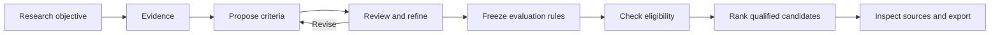

# MAS Research Workbench

**English** | [简体中文](README.zh-CN.md)

MAS develops evidence-based research criteria, checks candidate eligibility, and ranks qualified candidates with traceable reasons. Researchers supply an objective, a candidate population and evidence. The workbench connects these inputs into one observable investigation.

[Agent quick start](docs/agent-run.md) · [Install](docs/installation.md) · [Usage guide](docs/user-guide.md) · [Complete example](docs/tutorial.md) · [Component walkthrough](docs/component-walkthrough.md) · [v1.1.0 release](docs/releases/v1.1.0.md)

## The research process



Criteria expand before they converge. Each retained criterion specifies what is measured, how observations are combined, and whether it acts as a hard condition, a preference or reference context. Eligibility and preference scores are separate. Missing evidence is not a pass or an automatic failure.

The browser provides natural-language tasks, candidate and measurement CSV import, persistent progress, criterion history, evidence grouped by source, score breakdowns and complete exports. English is the default UI language; switching to Chinese preserves research content and original sources.


## Reproduce the example or start another study

Give [the agent-run guide](docs/agent-run.md) to a coding agent, or run its commands yourself. It covers installation, fixed inputs, model settings, custom CSVs, resuming work and complete exports. Python 3.11+ is required; Node.js/npm is needed to build the browser interface.

```sh
git clone --depth 1 https://github.com/YWDDLiang03/mas.git
cd mas
python scripts/agent_run.py replay --bootstrap --workspace var/agent-replay --open
```

This command downloads a checksum-verified 168 MB research capsule, restores it into an independent workspace, recalculates qualification and ranking from the saved assessments, and opens the workbench. It needs no API key. Verification covers all 3,177 candidates and 98,487 assessment cells; Surufatinib reproduces rank 1 among 10 qualified candidates. The capsule is an optional release download, separate from the source checkout. Allow about 3 GB for the restored workspace and several minutes for its first index.

| What you want to do | Entry point |
|---|---|
| Inspect and verify this saved case | The `replay` command above, then [read the case](docs/tutorial.md) |
| Generate new CQA from the same fixed evidence | [Original-task plan and run](docs/agent-run.md), using [task.original.json](config/examples/task.original.json) and your model credentials |
| Change the question, candidate library or observations | [Custom task and CSVs](docs/agent-run.md#your-own-objective-candidates-and-observations), then [worked modifications](docs/component-walkthrough.md#change-objective) |
| Understand or extend a component | [Practical component walkthrough](docs/component-walkthrough.md) and [component reference](docs/components/README.md) |

A new model investigation starts with zero CQA and records its own criteria, cost and outcome. Recorded replay checks the existing result; it does not regenerate the original model responses.

## Start on Windows

The core requires Python 3.11+. The React client needs Node.js and npm. Release installation checks used Python 3.14.2 and Node.js 24.13.0 on Windows.

```powershell
git clone --depth 1 https://github.com/YWDDLiang03/mas.git
cd mas
python -m venv .venv
.\.venv\Scripts\python.exe -m pip install -r requirements.txt
npm.cmd --prefix web/client ci
npm.cmd --prefix web/client run build
.\start_workbench.cmd -Store var\workspace\store -InitializeStore -AllowOperations -ActorKind human -ActorName "$env:USERNAME"
```

Open [the local workbench](http://127.0.0.1:8769/workbench/). This manual setup creates an empty workspace without a model call. Before starting research, follow [model and credential configuration](docs/installation.md#3-configure-deepseek-for-new-research), then import your data or select available evidence sources. To restore the published case, use the agent quick start above.

[Installation](docs/installation.md) covers first launch, existing workspaces, alternative ports, Linux/macOS commands and troubleshooting. [Configuration](docs/configuration.md) explains settings precedence, role bindings, cost accounting and the optional prediction environment. Credentials and local databases remain outside tracked source files.

## Feature and component navigation

Every linked component page describes its purpose, design rationale, inputs/outputs, failure behavior, concrete implementation and a worked example. The [hands-on walkthrough](docs/component-walkthrough.md) connects all twelve component groups to the saved run, with executable inspections and examples of changing objectives, constraints, CSVs, sources and tools. The [architecture](docs/architecture.md) maps all twenty original design components to their implemented, partial or planned status.

| Component | Design question | Implementation entry |
|---|---|---|
| [Records and storage](docs/components/foundation.md) | How can decisions be reconstructed without overwriting history? | [Journal](src/mas/core/journal.py), [artifacts](src/mas/core/artifacts.py), [store](src/mas/core/store.py) |
| [Tasks and configuration](docs/components/tasks-and-configuration.md) | How does an objective become a bounded investigation? | [Task](src/mas/core/task.py), [config](src/mas/core/config.py), [investigation](src/mas/core/investigation.py) |
| [Models and budgets](docs/components/models-and-budgets.md) | How are requests and known or unknown costs recorded? | [Models](src/mas/core/models.py), [budget](src/mas/core/budget.py) |
| [Tools and providers](docs/components/tools-and-providers.md) | How does a capability resolve to an observable tool result? | [Broker](src/mas/core/broker.py), [adapters](src/mas/adapters/) |
| [Evidence and reading](docs/components/evidence-and-reading.md) | How are findings kept with conditions and source locations? | [Reading](src/mas/core/reading.py), [evidence](src/mas/core/evidence.py), [uploads](src/mas/core/uploaded_evidence.py) |
| [Criteria and review](docs/components/criteria-and-review.md) | How do proposals become reviewed, executable standards? | [Derivation](src/mas/core/derivation_stages.py), [pool](src/mas/core/pool.py), [adjudication](src/mas/core/adjudication.py) |
| [Assessment and qualification](docs/components/assessment-and-qualification.md) | How are hard failures, missingness and eligibility distinguished? | [Assessor](src/mas/core/assessor.py), [measurement](src/mas/core/measurement.py) |
| [Ranking and explanations](docs/components/ranking-and-explanations.md) | What contributes to a score, and which candidates are comparable? | [Leaderboard](src/mas/core/leaderboard.py), [score details](src/mas/ui/score_details.py), [mechanism](src/mas/core/mechanism.py) |
| [Execution and reuse](docs/components/execution-and-reuse.md) | How does work continue and reuse valid observations? | [Controller](src/mas/core/controller.py), [workflows](src/mas/ui/workflows.py), [existing evidence](src/mas/core/existing_research.py) |
| [Evaluation and CQA comparison](docs/components/evaluation-and-recovery.md) | How are reference exposure and criterion recovery measured? | [Freeze](src/mas/core/freeze.py), [recovery](src/mas/core/recovery.py) |
| [Domain adapters](docs/components/domain-adapters.md) | What changes with the research object or source? | [Drug](src/mas/adapters/drug/), [literature](src/mas/adapters/literature/), [prediction](src/mas/adapters/predict/) |
| [Workbench and CLI](docs/components/workbench-and-cli.md) | How do users operate and inspect the same records? | [Browser](web/client/src/), [read model](src/mas/ui/read_model.py), [CLI](src/mas/cli/main.py) |

## Use your own research question

1. Set workload, concurrency and budget in **Settings**.
2. Select **New research** or **Use own data**. Describe the objective, required observations and constraints.
3. Choose or import candidates, then select saved evidence or import measurements. Review IDs, units, conditions and evidence basis in the preview.
4. Start the investigation. Follow stage progress and criterion evolution; unresolved work keeps its reasons.
5. Inspect the qualified, pending, rejected and unassessed groups. Open **Score** for contributions and **Evidence** for sources. Export the complete population.

[Usage](docs/user-guide.md) explains the actions and outcomes. [CSV formats](docs/csv-input.md) provide clearly synthetic examples and actual validation rules. Drug providers are supplied; carrier and other studies use uploaded data and appropriately registered tools. The supplied end-to-end scientific example is a drug study.

## Latest example: oral multi-target drug prioritization

The [complete tutorial](docs/tutorial.md) follows the saved research from Settings to export. It includes the actual objective, screenshots, CQA changes, a six-proposal merge, eligibility evidence, the first unranked outcome and its correction, score arithmetic and source inspection.

| Recorded result | Latest study |
|---|---:|
| Candidate population | 3,177 |
| Fixed derivation input | 3,157 facts / 164 sources |
| Criterion trajectory | 0 → 6 requirements → 1,917 working items → 53 |
| Enabled core | 18: 1 hard condition + 17 preferences |
| Other working items | 13 reference observations + 22 not enabled |
| Candidate groups | 10 qualified; 3,167 pending evidence |
| Surufatinib | Rank 1 of 10; score 0.7592592593 |
| Surufatinib direct preference coverage | 10/17 |

The [comprehensive study](examples/oral-multitarget/comprehensive/results/) is also retained, where Surufatinib ranks fourth. Its criteria differ, so the scores belong to different comparisons. [Both complete exports](examples/oral-multitarget/) preserve every candidate and its unknown states. The optional capsule restores the latest study and its fixed factual inputs for independent research.

### Original versus generated CQAs

The original manuscript has **11 human-selected predicted-property conditions**, distinct from the older 59-item system registry. The [item-by-item comparison](docs/reference/cqa-comparison.md) finds 2 same-named endpoints with changed decisions, 3 related but unresolved rows, and 6 absent endpoints. One same-named original endpoint is in the latest 18-rule core. No full original pass/fail gate is reproduced unchanged. This descriptive comparison is separate from ranking performance and is not a new blind recovery measurement.

[Comparison CSV](examples/oral-multitarget/cqa-comparison.csv) · [Comparison JSON](examples/oral-multitarget/cqa-comparison.json) · [Presentation and speaker notes](docs/presentation/README.md)

## Scope and development

v1.0 ships the recorded research workflow, drug/source adapters, uploads, qualification-first ranking and local workbench. The original design's general planning agent, open-question service, scoped memory and strategy-promotion archive are not all implemented. The [component status map](docs/architecture.md) identifies these boundaries.

```powershell
.\.venv\Scripts\python.exe -m pytest -q
npm.cmd --prefix web/client run build
.\.venv\Scripts\python.exe scripts/check_publication.py
```

Default tests exclude live services. [Contributing](CONTRIBUTING.md) explains relevant checks and scientific record handling. [v1.1.0 release notes](docs/releases/v1.1.0.md) describe the portable example, agent runner and interface changes; [v1.0.0](docs/releases/v1.0.0.md) records the original publication.
