# TRIAGE Medical Research Workbench

**English** | [简体中文](README.zh-CN.md)

TRIAGE helps researchers build evaluation criteria from a research question and available evidence, then use those criteria to screen and compare candidates. The workflow is reusable: the objective, candidate data, required observations and evidence sources belong to each study. Drug research is the supplied end-to-end example; uploaded data and domain tools support other candidate types. MAS is the repository and Python package name.

[Quick start](docs/agent-run.md) · [Windows installation](docs/installation.md) · [User guide](docs/user-guide.md) · [Workflow design](docs/design.md) · [Component tutorials](docs/component-walkthrough.md) · [Documentation index](docs/README.md)

## From a research question to a ranked result

```mermaid
flowchart LR
    A[Objective, candidates and evidence] --> B[Start a new criterion set]
    B --> P[Proposer: explore relevant properties]
    P --> C[Critic: check evidence and applicability]
    C -->|Specific findings| P
    C --> D[Adjudicator: resolve and combine]
    D -->|Further review| C
    D --> E[Set the evaluation criteria]
    E --> F[Assess eligibility]
    F --> G[Compare eligible candidates]
    G --> H[Inspect evidence and export]
```



A new study starts with an empty criterion set. Task requirements are incorporated first. Proposals then explore relevant properties and measurement choices; review clarifies definitions, withdraws unsupported proposals and combines compatible descriptions. Distinct experimental conditions and decision uses remain visible. The [design guide](docs/design.md) explains why criteria expand before refinement and how the three roles exchange feedback.

Each adopted criterion defines its measurement, accepted evidence and use. **Eligibility requirements** decide which candidates can enter comparison; **prioritization criteria** contribute to scores; **contextual observations** help interpretation. These uses can overlap. The workbench displays **Eligible**, **Evidence incomplete** and **Excluded**, with the responsible requirements and sources. [Decision definitions](docs/reference/decision-language.md) explain the classification and ranking rules.

The browser includes natural-language task entry, candidate and measurement CSV imports, persistent progress, criterion histories, evidence grouped by source, score contributions and full exports. English is the default interface language; Chinese translates the interface while research content and source text keep their original wording.


## Choose your starting point

| Goal | Guide |
|---|---|
| Inspect and recalculate the saved public example | [One-command replay](docs/agent-run.md) |
| Build fresh criteria using the example's saved evidence | [Plan and run a new investigation](docs/agent-run.md) |
| Supply another objective, candidate library or measurements | [Custom task](docs/agent-run.md#your-own-objective-candidates-and-observations) and [CSV formats](docs/csv-input.md) |
| Understand each component and change its inputs | [Hands-on component walkthrough](docs/component-walkthrough.md) |
| Connect a new provider or domain tool | [Models](docs/components/models-and-budgets.md), [tools](docs/components/tools-and-providers.md) and [domain adapters](docs/components/domain-adapters.md) |

## Reproduce the public example

Python 3.11+ and Git are required. Node.js/npm is needed when building the browser interface.

```sh
git clone --depth 1 https://github.com/YWDDLiang03/mas.git
cd mas
python scripts/agent_run.py replay --bootstrap --workspace var/agent-replay --open
```

The runner downloads the optional checksum-verified research capsule, restores a separate workspace and recalculates the saved result. Replay needs no API key. It checks 3,177 candidates and 98,487 assessments and reproduces Surufatinib at rank 1 among ten eligible compounds. Allow about 3 GB for the restored workspace and several minutes for the first index. Archive identity and any public metadata substitutions are declared in the [capsule manifest](examples/oral-multitarget/latest/reproduction/manifest.json).

For fresh criterion generation, use `plan` and `run` with [task.original.json](config/examples/task.original.json) and your own model credentials. The new investigation starts from an empty criterion set and records its own result and cost. [The agent guide](docs/agent-run.md) covers setup, progress, resume and export.

## Start an empty workspace on Windows

```powershell
git clone --depth 1 https://github.com/YWDDLiang03/mas.git
cd mas
python -m venv .venv
.\.venv\Scripts\python.exe -m pip install -r requirements.txt
npm.cmd --prefix web/client ci
npm.cmd --prefix web/client run build
.\start_workbench.cmd -Store var\workspace\store -InitializeStore -AllowOperations -ActorKind human -ActorName "$env:USERNAME"
```

Open [the local workbench](http://127.0.0.1:8769/workbench/). Follow [model configuration](docs/installation.md#3-configure-deepseek-for-new-research), then:

1. Set workload, concurrency and budget in **Settings**.
2. Choose **New research** or **Use own data** and describe the objective and requirements.
3. Choose or upload candidates, select evidence, and check units, conditions and evidence types in the preview.
4. Start research and follow the current stage, recent activity and criterion changes.
5. Open a candidate's **Score** and **Evidence** views, then export the complete results.

The [installation guide](docs/installation.md) covers alternative ports, existing workspaces and other operating systems. [Configuration](docs/configuration.md) covers providers, budgets and the optional prediction environment. API keys stay in an environment variable or external key file.

## Feature and component navigation


Every linked component page describes its purpose, design rationale, inputs/outputs, failure behavior, concrete implementation and a worked example. The [hands-on walkthrough](docs/component-walkthrough.md) connects all twelve component groups to the saved run, with executable inspections and examples of changing objectives, constraints, CSVs, sources and tools. The [architecture](docs/architecture.md) maps all twenty original design components to their implemented, partial or planned status.

| Component | Design question | Implementation entry |
|---|---|---|
| [Records and storage](docs/components/foundation.md) | How can decisions be reconstructed without overwriting history? | [Journal](src/mas/core/journal.py), [artifacts](src/mas/core/artifacts.py), [store](src/mas/core/store.py) |
| [Tasks and configuration](docs/components/tasks-and-configuration.md) | How does an objective become a bounded investigation? | [Task](src/mas/core/task.py), [config](src/mas/core/config.py), [investigation](src/mas/core/investigation.py) |
| [Models and budgets](docs/components/models-and-budgets.md) | How are requests and known or unknown costs recorded? | [Models](src/mas/core/models.py), [budget](src/mas/core/budget.py) |
| [Tools and providers](docs/components/tools-and-providers.md) | How does a capability resolve to an observable tool result? | [Broker](src/mas/core/broker.py), [adapters](src/mas/adapters/) |
| [Evidence and reading](docs/components/evidence-and-reading.md) | How are findings kept with conditions and source locations? | [Reading](src/mas/core/reading.py), [evidence](src/mas/core/evidence.py), [uploads](src/mas/core/uploaded_evidence.py) |
| [Criteria and review](docs/components/criteria-and-review.md) | How do proposals become reviewed, evaluation criteria? | [Derivation](src/mas/core/derivation_stages.py), [pool](src/mas/core/pool.py), [adjudication](src/mas/core/adjudication.py) |
| [Assessment and qualification](docs/components/assessment-and-qualification.md) | How are hard failures, missingness and eligibility distinguished? | [Assessor](src/mas/core/assessor.py), [measurement](src/mas/core/measurement.py) |
| [Ranking and explanations](docs/components/ranking-and-explanations.md) | What contributes to a score, and which candidates are comparable? | [Leaderboard](src/mas/core/leaderboard.py), [score details](src/mas/ui/score_details.py), [mechanism](src/mas/core/mechanism.py) |
| [Execution and reuse](docs/components/execution-and-reuse.md) | How does work continue and reuse valid observations? | [Controller](src/mas/core/controller.py), [workflows](src/mas/ui/workflows.py), [existing evidence](src/mas/core/existing_research.py) |
| [Evaluation and criterion comparison](docs/components/evaluation-and-recovery.md) | How are evaluation policies and criterion sets compared? | [Freeze](src/mas/core/freeze.py), [recovery](src/mas/core/recovery.py) |
| [Domain adapters](docs/components/domain-adapters.md) | What changes with the research object or source? | [Drug](src/mas/adapters/drug/), [literature](src/mas/adapters/literature/), [prediction](src/mas/adapters/predict/) |
| [Workbench and CLI](docs/components/workbench-and-cli.md) | How do users operate and inspect the same records? | [Browser](web/client/src/), [read model](src/mas/ui/read_model.py), [CLI](src/mas/cli/main.py) |


## Public case: oral multi-target candidate prioritization

The [complete tutorial](docs/tutorial.md) follows the saved case from Settings through criterion development, candidate assessment, score inspection and export. The supplied case illustrates the general workflow; its target names and counts are study inputs and results.

| Quantity | Saved example |
|---|---:|
| Candidate library | 3,177 compounds |
| Saved evidence collection | 3,157 records from 164 sources |
| Evidence selected for criterion generation | 3,021 records |
| Criterion development | 0 → 6 task requirements → 1,917 proposals/working items → 53 retained entries |
| Evaluation criteria | 18 unique criteria: 6 eligibility requirements + 17 scoring criteria − 5 shared target criteria |
| Other retained entries | 13 contextual observations; 22 outside this evaluation |
| Candidate groups | 10 Eligible; 1,305 Evidence incomplete; 1,862 Excluded |
| Surufatinib | Rank 1 of 10; score 0.7592592593 |
| Scoring evidence | 10/17 direct-evidence coverage; 15 available equally weighted contributions |

The five target criteria require usable direct observations for eligibility and compare their potency values during scoring. The other eligibility requirement concerns oral administration. Details and source observations are in the [case guide](examples/oral-multitarget/README.md), [selection table](examples/oral-multitarget/latest/selection/candidate-selection.csv) and [score explanation](examples/oral-multitarget/latest/score-details.json).

The [criterion comparison guide](docs/reference/cqa-comparison.md) shows how to compare definitions, conditions and decision uses with explicitly synthetic examples.

## Development and publication

The [architecture status map](docs/architecture.md) distinguishes implemented components from planned extensions. The source distribution is v1.1.0; the [28 October documentation update](docs/releases/2026-10-28-documentation.md) records this refresh.

```powershell
.\.venv\Scripts\python.exe -m pytest -q
npm.cmd --prefix web/client run build
.\.venv\Scripts\python.exe scripts/check_publication.py
```

[Contributing](CONTRIBUTING.md) describes relevant checks. The [public-content policy](docs/reference/public-content.md) defines what belongs in source and release assets. Private manuscripts, draft figures, clinical materials and local credentials stay outside the public repository.
