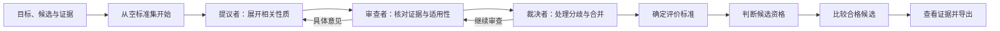
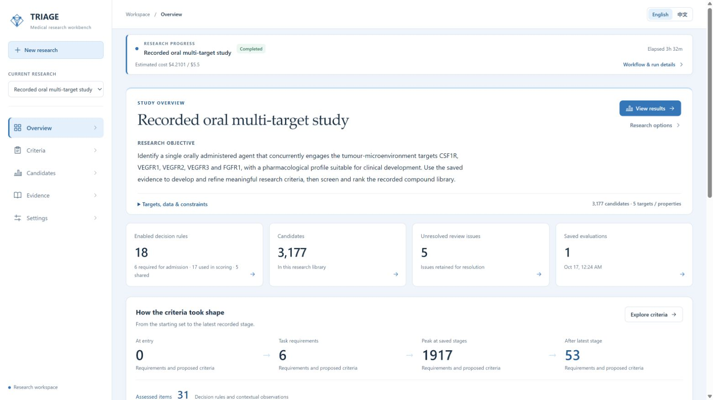

# TRIAGE 医学研究工作台

[English](README.md) | **简体中文**

TRIAGE 根据研究目标和现有证据形成评价标准，再使用这些标准筛选、比较候选。通用流程与具体研究分开：目标、候选数据、必需观测和证据来源由每项任务定义。仓库提供药物研究的完整示例；其他候选类型可以接入上传数据和适用的领域工具。MAS 保留为仓库及 Python 包名。

[智能体一键运行](docs/zh/agent-run.md) · [Windows 安装](docs/zh/installation.md) · [使用指南](docs/zh/user-guide.md) · [流程设计](docs/zh/design.md) · [组件实操](docs/zh/component-walkthrough.md) · [文档导航](docs/zh/README.md)

## 从研究问题到候选结果



新研究从空标准集开始，先纳入任务明确提出的要求，再充分提出相关性质和测量方式。审查澄清定义、撤回支持不足的提议，并合并兼容描述；不同实验条件和决策用途继续区分。[流程设计](docs/zh/design.md)说明为什么先展开后提炼，以及三个角色如何反馈和修订。

每项标准明确测量内容、接受哪些证据以及如何使用结果。**准入要求**决定哪些候选进入比较，**评分标准**产生排序贡献，**解释性观察**帮助理解结果；这些用途可以重叠。工作台使用 **Eligible、Evidence incomplete、Excluded** 三组，并展示对应要求和来源。[判定说明](docs/zh/decision-language.md)给出完整含义。

浏览器支持自然语言任务、候选与测量 CSV 上传、持续进度、标准历史、按来源组织的证据、得分分解和完整导出。界面默认英文，可切换中文；研究内容和来源保留原文。



当前 Windows 界面，2026 年 10 月 28 日实拍，展示已保存的公开案例。[最新版截图、结果与响应时间](docs/zh/current-status.md)。

## 选择起点

| 目标 | 入口 |
|---|---|
| 查看并重新计算公开案例 | [一键复现](docs/zh/agent-run.md) |
| 使用保存的证据重新生成标准 | [新任务的 plan / run](docs/zh/agent-run.md) |
| 更换问题、候选库或测量 | [自定义任务](docs/zh/agent-run.md)与[CSV 格式](docs/zh/csv-input.md) |
| 理解各组件并修改输入 | [组件实操教程](docs/zh/component-walkthrough.md) |
| 接入其他模型或领域工具 | [模型](docs/components/models-and-budgets.md)、[工具](docs/components/tools-and-providers.md)、[领域适配器](docs/components/domain-adapters.md) |

## 复现公开案例

需要 Python 3.11+ 和 Git。构建浏览器界面时另需 Node.js 和 npm。

```sh
git clone --depth 1 https://github.com/YWDDLiang03/mas.git
cd mas
python scripts/agent_run.py replay --bootstrap --workspace var/agent-replay --open
```

运行器下载并校验可选研究数据包，恢复到独立工作区，然后重新计算保存的结果。复现无需 API key，核对覆盖 3,177 个候选和 98,487 条评估记录，重现 Surufatinib 在十个合格候选中的第 1 名。恢复后工作区约需 3 GB，首次索引需要几分钟。文件校验信息及公开副本的元数据替换在[数据包清单](examples/oral-multitarget/latest/reproduction/manifest.json)中声明。

需要重新生成标准时，使用 `plan`、`run`、[任务示例](config/examples/task.original.json)和自己的模型凭证。新研究从空标准集开始，保存自己的结果与费用。[智能体运行指南](docs/zh/agent-run.md)介绍设置、进度、继续运行与导出。

## Windows 空工作区启动

```powershell
git clone --depth 1 https://github.com/YWDDLiang03/mas.git
cd mas
python -m venv .venv
.\.venv\Scripts\python.exe -m pip install -r requirements.txt
npm.cmd --prefix web/client ci
npm.cmd --prefix web/client run build
.\start_workbench.cmd -Store var\workspace\store -InitializeStore -AllowOperations -ActorKind human -ActorName "$env:USERNAME"
```

打开[本地工作台](http://127.0.0.1:8769/workbench/)，按[安装指南](docs/zh/installation.md)配置模型，然后：

1. 在 **Settings** 设置工作强度、并发和预算。
2. 选择 **New research** 或 **Use own data**，填写研究目标与要求。
3. 选择或上传候选，准备证据，在预览中核对单位、条件与依据类型。
4. 启动研究，查看当前阶段、最近活动与标准变化。
5. 打开候选的 **Score**、**Evidence** 查看分项依据，并导出完整结果。

[配置说明](docs/configuration.md)介绍提供者、预算及可选预测环境。API key 使用环境变量或仓库外的密钥文件。

## 功能与组件导航


每个组件页均说明职责、设计理由、输入输出、失败处理、实现函数和示例。[中文实操教程](docs/zh/component-walkthrough.md)沿保存案例串起全部 12 组组件，提供可执行检查及修改任务、约束、CSV、来源与工具的示例。组件参考采用英文；[架构文档](docs/architecture.md)列出原设计 C1–C20 的全部实现状态。

| 组件 | 设计关注点 | 主要实现 |
|---|---|---|
| [记录与存储](docs/components/foundation.md) | 保留历史并重建决定 | [Journal](src/mas/core/journal.py)、[Store](src/mas/core/store.py) |
| [任务与配置](docs/components/tasks-and-configuration.md) | 将自然语言整理成明确范围 | [Task](src/mas/core/task.py)、[Config](src/mas/core/config.py) |
| [模型与预算](docs/components/models-and-budgets.md) | 记录角色调用与已知、未知费用 | [Models](src/mas/core/models.py)、[Budget](src/mas/core/budget.py) |
| [工具与提供者](docs/components/tools-and-providers.md) | 将能力匹配到可检查结果 | [Broker](src/mas/core/broker.py)、[Adapters](src/mas/adapters/) |
| [证据与阅读](docs/components/evidence-and-reading.md) | 保存发现、条件和原文位置 | [Reading](src/mas/core/reading.py)、[Evidence](src/mas/core/evidence.py) |
| [标准与审查](docs/components/criteria-and-review.md) | 提议如何修订、合并并启用 | [Derivation](src/mas/core/derivation_stages.py)、[Adjudication](src/mas/core/adjudication.py) |
| [评估与资格](docs/components/assessment-and-qualification.md) | 区分硬失败、缺失与合格 | [Assessor](src/mas/core/assessor.py)、[Measurement](src/mas/core/measurement.py) |
| [排名与解释](docs/components/ranking-and-explanations.md) | 解释贡献与比较范围 | [Leaderboard](src/mas/core/leaderboard.py)、[Score details](src/mas/ui/score_details.py) |
| [运行与复用](docs/components/execution-and-reuse.md) | 中断后继续并复用有效观测 | [Controller](src/mas/core/controller.py)、[Workflows](src/mas/ui/workflows.py) |
| [科研评价与标准对比](docs/components/evaluation-and-recovery.md) | 固定比较策略并核对标准之间的关系 | [Freeze](src/mas/core/freeze.py)、[Recovery](src/mas/core/recovery.py) |
| [领域适配器](docs/components/domain-adapters.md) | 更换对象或来源需要改什么 | [Drug](src/mas/adapters/drug/)、[Literature](src/mas/adapters/literature/)、[Prediction](src/mas/adapters/predict/) |
| [工作台与 CLI](docs/components/workbench-and-cli.md) | 操作和查看同一套记录 | [前端](web/client/src/)、[Read model](src/mas/ui/read_model.py)、[CLI](src/mas/cli/main.py) |


## 公开案例：口服多靶点候选优选

[完整教程](docs/zh/tutorial.md)从 Settings 开始，展示标准生成、候选评价、得分说明与导出。该案例用于演示通用流程；靶点名称和具体数量属于这次研究的输入与结果。

| 项目 | 保存的案例 |
|---|---:|
| 候选库 | 3,177 个化合物 |
| 保存的证据集合 | 3,157 条记录，164 个来源 |
| 用于标准生成的证据 | 3,021 条记录 |
| 标准变化 | 0 → 6 项任务要求 → 1,917 项提议／工作项 → 53 项保留条目 |
| 评价标准 | 18 项独立标准：6 项准入＋17 项评分−5 项共享靶点标准 |
| 其他保留条目 | 13 项解释性观察；22 项未用于本次评价 |
| 候选分类 | 10 Eligible；1,305 Evidence incomplete；1,862 Excluded |
| Surufatinib | 第 1／10；得分 0.7592592593 |
| 评分证据 | 直接证据覆盖 10/17；15 项可用得分等权汇总 |

五项靶点标准在准入时要求可用的直接观测，在评分时比较效力数值；另一项准入要求为口服给药。完整定义及观测见[案例说明](examples/oral-multitarget/README.md)、[候选分类表](examples/oral-multitarget/latest/selection/candidate-selection.csv)和[评分明细](examples/oral-multitarget/latest/score-details.json)。

[标准比较指南](docs/zh/cqa-comparison.md)使用明确标注的合成示例，说明怎样比较定义、条件和决策用途。

## 开发与公开内容

[架构状态表](docs/architecture.md)区分已实现组件与计划扩展。源码版本为 v1.1.0；[10 月 28 日文档更新](docs/releases/2026-10-28-documentation.md)记录本轮同步。

```powershell
.\.venv\Scripts\python.exe -m pytest -q
npm.cmd --prefix web/client run build
.\.venv\Scripts\python.exe scripts/check_publication.py
```

[贡献指南](CONTRIBUTING.md)介绍相关检查；[公开内容规范](docs/reference/public-content.md)约定源码和 Release 附件的范围。私有稿件、论文图稿、临床材料与本地凭证留在公开仓库之外。
