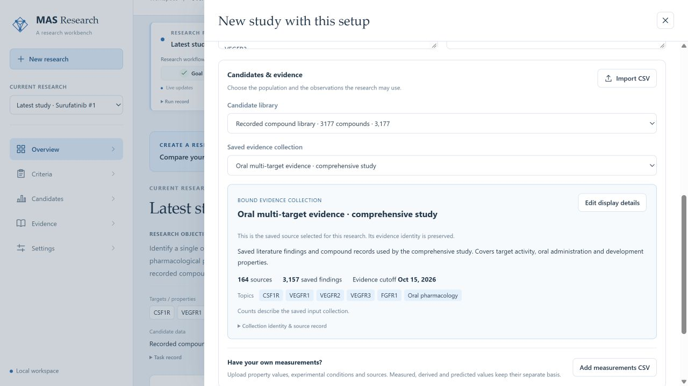
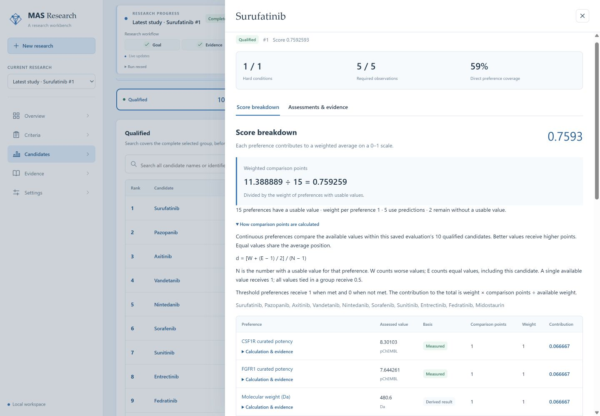
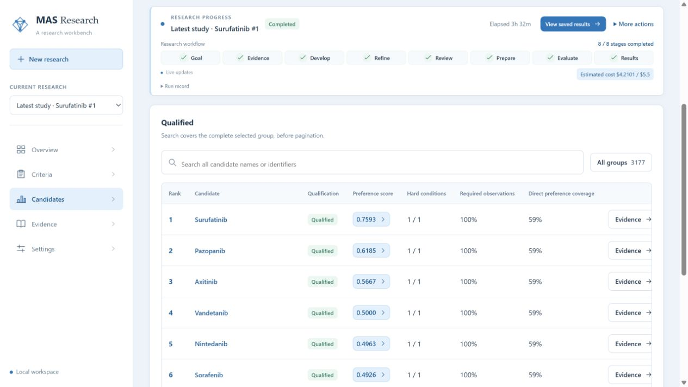
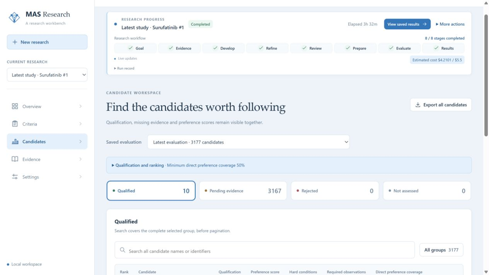

# MAS：通用研究系统、组件设计与完整案例

状态：大纲、截图分配及第 8 页样张均已获用户确认。34 页 PPT 与逐页讲稿已经完成，并已在本机 PowerPoint 打开、渲染和核对。最终页面采用更短的标题，主题、顺序及素材分配沿用本大纲。

本稿按 codex-ppt 的大纲阶段编排，并按 avoid-ai-writing 检查叙事和措辞。

## 讲述目标

面向第一次接触 MAS 的研究者。听完后，应当能够解释系统怎样把研究问题变成可执行标准，说明各组件为什么存在，并独立找到设置任务、查看过程、核对结果和导出的入口。

全篇主线：研究者给出问题、候选和证据；系统组织多智能体形成并审查标准，再按固定方案评估候选；研究者从结果回查每项判断的依据。

顺序固定为：通用系统 → 组件及设计理由 → 最新案例的完整操作 → 更换研究对象。Surufatinib 在第 15 页才进入主叙事。

预计 32 页正文，2 页评分附录，约 30–35 分钟。页面上的文字用于指引视线，详细解释放入后续讲稿。

## 各部分承担的任务

| 部分 | 页码 | 听众需要理解什么 | 主要呈现方式 |
|---|---|---|---|
| 通用系统 | 1–5 | MAS 处理什么问题，输入输出是什么，为什么能用于不同研究 | 系统全景、流程与分层示意图 |
| 组件与设计 | 6–14 | 每个组件接收什么、做什么、交付什么，设计解决了什么困难 | 对象拆解、协作回路、决策图、版本关系图 |
| 案例准备与启动 | 15–19 | 在哪里设置，如何填写研究问题，如何选择候选和证据，怎样观察运行 | 实际设置、任务表单、证据选择与进度截图 |
| 标准形成与评估 | 20–27 | CQA 怎样从零展开再收敛，如何确定资格和得分 | 数量变化图、具体合并实例、标准历史、评分截图 |
| 结果与再次使用 | 28–32 | 如何读榜、查原文、导出，以及怎样换成自己的研究 | 榜单、证据与上传截图，结果解释 |
| 附录 | 33–34 | 需要时逐项核对 17 项偏好 | 两页完整评分表 |

## 叙事和配图约定

- 每页回答一个问题。介绍组件时按“输入 → 处理 → 输出 → 设计理由”讲；介绍案例时按“用户操作 → 系统动作 → 可见结果”讲。
- 通用部分使用药物与载体的简短示例解释抽象概念，不提前分析 Surufatinib 的数值。载体例子标为应用示意，已完成的完整验证仍以本次药物案例为准。
- 截图页直接使用工作台的原始画面。允许裁切并放大关注区域；页面内容、数值、状态和原文保持原样。截图不交给 image 重画。
- image 用于系统架构、协作关系、标准提炼、决策与来源关系等示意图。图中的对象和箭头必须有明确含义，不画装饰性的机器人或抽象科技背景。
- 数量、得分和比例来自保存结果，制作数据图时先按原始数据绘制并核对，再作为严格素材使用。示意箭头的粗细不冒充数量比例。
- 截图页以一张大图为主，最多标注三个操作位置。机制页以一幅图为主，完整公式和大量数值留给附录。
- 历史运行截图与本次重新打开界面的截图分别说明。重新打开已保存配置用于演示填写方式，不描述为新执行了一次研究。
- 前半段解释设计理由，后半段展示对应的实际行为。重复出现的流程只标出当前所处位置，不再重讲全部内容。

## 第一部分：先建立对通用系统的认识

### Slide 1：MAS，把研究问题变成有依据的候选比较

主旨：MAS 是围绕研究决策组织证据、标准与候选的工作台。

讲什么：
- 研究者给出目标、候选范围和可用材料。
- 系统形成研究标准，并按标准筛选、比较候选。
- 交付包括候选结果、判断依据和待补证据。

怎么讲：用一句话交代系统用途，再指向画面中的问题、研究过程和结果，建立整份报告的范围。

画面：image 生成简洁的输入到输出全景；只显示研究问题、证据与标准、候选结果三个主要对象。角色：开场。

衔接：为什么已有很多文献和数据库，还需要这样的系统？

### Slide 2：研究材料丰富，比较标准却常常没有准备好

主旨：候选比较的困难同时存在于标准、证据条件和解释过程。

讲什么：
- 不同文献关注的性质、对象与实验条件不同。
- “表现好”需要转成可判断的性质和用途。
- 研究者需要知道某项结果为什么影响资格或排名。

怎么讲：用同一候选在两个实验条件下的记录说明，收集数值后仍需要决定是否可比、怎样使用。

画面：image 生成“分散研究记录 → 尚待回答的决策问题”示意。标注对象、条件、性质，不堆功能词。角色：问题解释。

衔接：由此确定系统必须接收的输入和必须交付的结果。

### Slide 3：输入研究问题、候选和证据，输出一套可检查的研究结果

主旨：任务、候选与证据各有入口，结果包含标准与依据。

讲什么：
- 任务描述目标、硬条件、偏好和研究范围。
- 候选可选已有库，也可上传候选名单；证据可来自已保存材料或自有测量。
- 输出包含核心标准、候选分区与排序，以及每项决定的来源。

怎么讲：沿输入到输出解释研究者需要准备什么，完成后可以拿走什么。

画面：image 生成输入输出关系图；明确区分候选名单和测量证据两种数据。角色：产品范围。

衔接：这些输入经过哪些步骤才能成为结果？

### Slide 4：先形成标准，再评估候选，最后发布结果

主旨：系统由一条连续研究流程连接起来。

讲什么：
- 理解任务 → 准备证据 → 提出标准 → 审查与提炼。
- 解决争议 → 固定评估方案 → 筛选候选 → 发布结果。
- 标准修订发生在评估方案确定之前；修改后保留新的版本。

怎么讲：先顺着主线走一遍，再指出提议与审查之间的反馈。此时只介绍阶段作用，不加入本次案例的数量。

画面：image 生成八阶段流程，分为“形成标准”和“应用标准”两段，含明确的修订回路。角色：全流程总览。

衔接：这条流程怎样适用于不同研究对象？

### Slide 5：通用流程、领域工具和具体任务分开配置

主旨：系统的通用性来自流程与领域知识的分离。

讲什么：
- 通用部分负责标准演化、审查、证据记录、资格判断和排名。
- 领域部分提供候选身份、性质定义、数据来源和可用工具。
- 具体任务决定目标、限制、候选库和证据范围。

怎么讲：以药物的靶点效力和载体的粒径、递送效率作对照。换对象时改变任务和工具，研究流程仍然适用。载体只是应用示例。

画面：image 生成三层架构，旁边用两条小例子说明替换位置。角色：架构与设计理由。

衔接：下面按数据经过的顺序介绍各组件。

## 第二部分：组件做什么，为什么这样设计

### Slide 6：任务整理把自然语言变成明确的研究范围

主旨：系统先区分目标、必须满足的条件和待比较的性质。

讲什么：
- 输入为自然语言目标、候选范围和补充约束。
- 整理为研究对象、目标性质、硬条件、偏好与关键缺项。
- 可推断的信息自动整理；影响执行的关键未知需要补充。

怎么讲：用一个示例任务逐段标出目标和约束，然后说明任务整理的结果怎样指导后续分工。

画面：image 生成“自然语言 → 结构化研究范围 → 研究步骤”的拆解图。角色：组件说明。

衔接：研究范围明确以后，需要把什么样的材料交给智能体？

### Slide 7：证据组件保存发现，也保存发现成立的条件

主旨：一条证据需要同时携带对象、测量、条件和来源位置。

讲什么：
- 来源可以是文献、数据库或用户上传的测量。
- 证据保存研究对象、性质、数值与单位、实验条件、原文位置。
- 同一篇文献集中展示，不同实验条件分别保留。

怎么讲：拆开一条示例测量，说明每个字段回答的问题，以及为什么只摘出数值会丢失解释所需信息。

画面：image 生成文献到结构化发现的示意，使用明确标注为示例的短记录。角色：证据结构。

衔接：有了带上下文的证据，标准怎样被提出并质疑？

### Slide 8：多智能体通过提议、质疑、修订和裁决推进标准

主旨：角色分工的产出是可检查的修改和决定。

讲什么：
- 提出者把任务和证据转成候选标准。
- 审查者检查依据、定义、适用性和可执行性，并提出具体问题。
- 修订回应问题；持续分歧进入裁决或待处理区。

怎么讲：用一条示例提议走完一次交流，讲清谁交给谁什么材料。分别解释接受、修订和保留争议的去向。

画面：image 生成协作回路，箭头写明提议、意见、修订和决定。角色：协作机制。

衔接：这些讨论最终必须落成什么样的标准？

### Slide 9：一条 CQA 既要说明测什么，也要说明怎样影响决定

主旨：属性定义与决策规则共同决定标准能否执行。

讲什么：
- 属性规定测量对象、单位、条件和多条记录的汇总方式。
- 规则规定硬条件、偏好或参考用途，以及阈值或比较方向。
- 支持来源和执行方法与该版本一起保存。

怎么讲：用载体粒径作应用示例，分别说明“测量粒径”和“粒径怎样影响选择”。阈值示例明确标为示意，不写成该领域的通用科学结论。

画面：image 生成一条标准的解剖图，突出属性、规则、依据三部分。角色：核心对象定义。

衔接：同一个性质往往会被提出很多次，怎样得到少而有用的标准？

### Slide 10：提炼依次处理支持不足、定义含糊、审查问题和重复

主旨：标准数量减少来自具体的审查动作。

讲什么：
- Filter 检查支持与适用性，Distill 把宽泛表述变成可测量定义。
- Refine 回应审查问题，Merge 合并同一性质和用途的提议。
- 不同条件或用途保持区别，原提议和变化理由可追溯。

怎么讲：跟随几条示例提议，看它们分别被保留、修订、合并或暂缓。10–30 条是收敛目标，核心是每条保留项有独立决策作用。

画面：image 生成多条提议的收敛示意，末端仍有独立待处理分支。角色：提炼机制。

衔接：标准确定以后，工具怎样为候选补齐所需观测？

### Slide 11：工具按标准读取或计算观测，并保留结果依据

主旨：测量、确定性计算和预测在评估中承担不同作用。

讲什么：
- 标准规定要什么性质、单位和条件，再匹配可用数据与工具。
- 直接测量、结构计算、模型预测分别记录。
- 工具失败或缺失留下原因；同一性质已有直接记录时，预测作为旁证。

怎么讲：画出三条观测获取路线，说明它们怎样进入同一个候选评估。领域工具可替换，数据依据保持可见。

画面：image 生成标准到工具到观测的关系图。角色：工具组件。

衔接：取得观测后，资格判断和偏好评分如何分工？

### Slide 12：资格判断决定谁能比较，偏好评分决定比较顺序

主旨：硬条件失败、证据不足和合格分别处理。

讲什么：
- 明确硬条件失败进入淘汰；缺证、冲突或工具失败保留对应状态。
- 满足资格后，再检查用于排名的证据覆盖。
- 合格且满足排位条件的候选按固定偏好方案比较；分数和覆盖率分别展示。

怎么讲：沿决策图走三个候选示例，再解释“合格”和“可以排名”之间仍有覆盖检查。

画面：image 生成决策树，分支用“通过、失败、缺证”明确标注。角色：判断机制。

衔接：这条长流程运行时，研究者怎样知道系统做到哪里？

### Slide 13：运行控制把阶段、当前工作和消耗一起呈现

主旨：可观察的运行需要同时交代位置、工作量和等待原因。

讲什么：
- 全流程展示阶段状态，当前阶段展示批次或候选进度。
- 分母未知时说明正在处理的工作，不拼造完成百分比。
- 暂停、继续、停止和预算状态与保存的运行记录连接。

怎么讲：用“已完成两个阶段，当前批次正在处理”的概念示意区分两级进度；本次实际截图留到案例启动页。

画面：image 生成阶段轨道与局部工作进度的解释图，不仿造产品截图。角色：运行组件与交互设计。

衔接：运行结束或修订后，如何继续解释原来的结果？

### Slide 14：版本和来源把每次决定连成可回查的过程

主旨：已有证据可以复用，标准、计算和结果仍绑定各自版本。

讲什么：
- 结果关联到候选评估、标准版本、证据和原文位置。
- 修改任务、标准或读取方法时保留原结果，产生新的记录。
- 有效证据与未受影响结果可继续利用，受影响部分重新计算。

怎么讲：顺着“名次 → 得分 → 标准 → 观测 → 原文”向后看，再指出版本变化发生的位置。

画面：image 生成双方向关系图，前向表示研究过程，后向表示核对路径。角色：历史与解释组件。

衔接：下面把这些组件放进同一次实际研究，按用户操作顺序走完整流程。

## 第三部分：进入我们的 case，从设置开始

### Slide 15：本次研究寻找口服、多靶点的候选药物

主旨：案例把通用系统配置成一个具体的候选优先级问题。

讲什么：
- 从已有药物库中寻找单一口服药物，覆盖 CSF1R、VEGFR1、VEGFR2、VEGFR3、FGFR1。
- 结合临床开发相关性质形成标准，用已保存证据开展研究。
- Surufatinib 是用户披露的参考候选；以下展示其实际通过条件和排名。

怎么讲：先解释研究问题，再明确口服要求和五靶点范围，最后说明参考候选的角色。

画面：image 生成一个候选对象连接五个研究靶点的任务图；不绘制未经来源支持的疾病机制。角色：案例开场。

依据：最新 task.json 的 objective_text、constraints、scope_entities 和 author_exposure。

### Slide 16：在 Settings 选择本次运行的配置

主旨：先设置工作强度、并发与预算，再创建研究。

讲什么：
- 本次文献与推理工作强度均为 mid，界面显示 Medium。
- 并发为 4；这次保存运行的预算上限为 $5.5。
- 语言切换只影响界面，研究任务和来源内容保持原文。

怎么讲：直接在截图上指出两个 Medium、并发和预算。默认未来任务上限 $10 与本次保存的 $5.5 分开说明。

画面：严格使用素材 A，放大 Settings 配置区域；该图拍摄于历史运行期间，不称为启动前抓拍。角色：操作截图。

衔接：运行方式设好后，填写研究任务。

### Slide 17：新建任务，写清目标、靶点和口服约束

主旨：自定义目标和显式约束决定本次研究范围。

讲什么：
- 输入自然语言目标，选择 Drugs & small molecules。
- 五个靶点放入研究范围，口服要求放入 Constraints。
- 新研究的标准从空集合建立，保存的证据另行选择。

怎么讲：按输入顺序讲解表单；右侧用短中文解释目标，英文原始输入保留在截图中。

画面：严格使用素材 B，任务目标区域为主。该图是重新打开已保存配置的操作演示，没有另起运行。角色：操作截图。

衔接：目标写好后，要明确系统使用哪些候选和材料。

### Slide 18：选择 3,177 个候选与固定证据集合

主旨：候选范围和证据范围在启动前明确绑定。

讲什么：
- 候选库共 3,177 个化合物。
- 所选集合包含 3,157 条事实、164 个来源，截止日期 2026-10-15。
- 仅使用已有证据；标准生成材料剔除 136 条明确提及参考候选的事实，剩余 3,021 条。

怎么讲：先读集合名称、简介和覆盖主题，再说明来源数量与截止时间，最后解释生成阶段的材料范围。参考身份仍已披露。

画面：严格使用素材 C，以候选库和证据集合两块为主；生成输入范围作为短注。角色：输入选择截图。

衔接：启动以后，工作台如何显示正在发生的事？

### Slide 19：启动后，进度条同时显示阶段与当前批次

主旨：研究者能分清流程位置和当前工作的完成程度。

讲什么：
- 历史画面显示已完成 2/8 阶段，正在生成标准。
- 当前安全性维度完成 17/18 证据批次。
- 同屏查看最近活动、已用时间、估计消耗及暂停/停止入口。

怎么讲：沿三个标注读图，重点解释局部 94% 代表证据批次进度。

画面：严格使用素材 A 的上半部分，与第 16 页关注区域不同。角色：历史运行截图。

衔接：这段生成工作具体把标准集扩展到了什么规模？

## 第四部分：沿本次运行观察标准和候选怎样变化

### Slide 20：从空标准集开始，按四个研究维度展开

主旨：任务要求先建立，证据驱动的提议随后展开。

讲什么：
- 起点为 0；先绑定五靶点与口服要求，共 6 项。
- 按靶点覆盖、口服性质、代谢稳定性、安全性提出标准。
- 保存阶段的工作项依次为 6 → 293 → 504 → 1,192 → 1,917。

怎么讲：按维度逐步点亮数量，说明 1,917 包括 6 项要求与 1,911 条提议。

画面：依据保存数据制作数量增长图；辅以小幅素材 D 定位 Criteria 页面。角色：阶段数据解释。

衔接：充分展开后，哪些处理让这些提议收敛？

### Slide 21：三轮审查与提炼把 1,917 个工作项收敛到 53 个

主旨：每轮数量变化都对应实际处理记录。

讲什么：
- 三轮末端数量分别为 147、68、53。
- 每轮都经过支持检查、定义提炼、修订与合并。
- 统计口径持续包含已注册标准和未注册提议，53 还需要区分用途。

怎么讲：先看轮次变化，再用第一轮的几个实际节点解释下降来自哪些动作。完整 22 个阶段留在历史记录中，不把整张表搬上投影。

画面：固定数据制作轮次变化图；image 可绘制处理动作关系，数值标签由核对后的数据素材提供。角色：收敛过程。

衔接：数量下降的含义，需要看一条实际标准的变化。

### Slide 22：分子量提议经历合并、质疑和修订后才启用

主旨：合并整理重复提议，审查继续决定最终用途。

讲什么：
- 第二轮中六条分子量提议合并成一个判断项，父项与来源保留。
- 后续审查继续检查 500 Da 经验线的解释和适用性。
- 最终用途为阈值偏好，按是否满足 ≤500 Da 计算比较分。

怎么讲：从六个父项走到合并项，再读一条审查意见和修订摘要。不要把整个过程压缩成“去重”。

画面：image 绘制有来源依据的谱系图，审查意见与变化引用已保存记录；制作时核对实际父项和版本。角色：组件实例。

衔接：有了这样的审查，最终每类标准分别承担什么作用？

### Slide 23：53 个工作项中，18 条承担核心决定

主旨：核心标准、参考项和待处理项的用途不同。

讲什么：
- 核心 18 条：1 条口服硬条件与 17 条偏好，五靶点已包含在偏好内。
- 另有 13 条参考项、22 条未启用项。
- 用 logP 最佳区间定义尚未解决的提议说明，保留问题与直接启用之间的区别。

怎么讲：先读三类分区，再回到 Criteria 页面指出查看入口；解释界面“31 条进入评估”包含 13 条参考项。

画面：素材 D 的分类区域为主，配三类去向示意。角色：实际规则结果。

衔接：启用项明确后，评估依据需要固定下来。

### Slide 24：固定方案后，对候选按同一组条件开展评估

主旨：标准、来源和比较方法确定后，才进入候选评估。

讲什么：
- 本次使用保存的 rules@v2：1 条硬条件、17 条偏好、13 条参考项。
- 逐层模式在明确硬失败后跳过后续昂贵评估，并记录原因。
- 本次所有候选留下结果；没有明确硬失败，因前序失败而跳过为 0。

怎么讲：解释一次评估固定哪些材料，再说逐层模式在这个案例中的实际表现。

画面：image 生成固定方案到候选评估的示意，配实际 3,177 × 31 = 98,487 个记录单元。角色：执行步骤。

衔接：具体看 Surufatinib 怎样通过资格检查。

### Slide 25：Surufatinib 的口服条件通过，五靶点证据齐全

主旨：资格来自启用条件与实际证据。

讲什么：
- 人类给药记录明确报告口服，硬条件 1/1 通过。
- 五个必需靶点均有直接记录，要求覆盖 5/5。
- 本任务要求五靶点直接证据，没有额外统一效力硬阈值。

怎么讲：先看候选详情的资格区域，再读一句口服原文，最后指出五靶点覆盖。

画面：素材 E 顶部资格区域与一条原文摘录组合；五靶点使用简单连线。角色：资格检查实例。

衔接：资格通过以后，还需要确认支持排名的偏好证据是否充分。

### Slide 26：首次结果暴露证据读取问题，修正后另存结果

主旨：最终排名来自有记录的修正过程。

讲什么：
- 首次 Surufatinib 直接偏好证据为 6/17，低于 50% 排位门槛，暂时无名次。
- 修正已有事实复用，以及四项确定性结构描述符的依据分类。
- 新结果为 10/17；权重、阈值和覆盖门槛保持原样，比较集合按新证据重新计算。

怎么讲：围绕一条问题、两类修正和结果变化解释，不展开代码修复细节。

画面：基于记录的前后对照，使用 image 画清因果连接；不伪造首次结果截图。角色：实际问题与修正。

衔接：现在可以展开最终分数，看每类偏好怎样贡献。

### Slide 27：点击 Score，可以逐项解释 0.7593 的来源

主旨：总分、单项贡献和直接证据覆盖可以分开核对。

讲什么：
- 17 项偏好中 15 项有可用值，本次各项权重为 1。
- 加权比较分之和 11.388889，除以可用权重 15，得到 0.759259。
- 五靶点、五项结构计算、五项预测分别贡献约 0.30370、0.21852、0.23704；直接覆盖为 10/17。

怎么讲：在实际评分详情上读出公式，再展开 BRENK 的并列排名例子，说明比较分如何产生。两项缺值保留缺失。

画面：素材 E 的评分区域占主要位置，旁边用按实际数值绘制的贡献图。角色：评分实例。

衔接：同一套方法应用到合格候选后，就得到最终榜单。

## 第五部分：读懂结果，回查依据，带走完整记录

### Slide 28：Surufatinib 在 10 个合格候选中排名第一

主旨：合格榜显示当前方案下的相对优先顺序。

讲什么：
- 合格且有名次的候选共 10 个，Surufatinib 排第 1。
- 3,167 个候选处于待补证据区；淘汰和未评估均为 0。
- 展示榜单、分区和评分入口之间的操作关系。

怎么讲：先解释分区，再读前三名，最后点击 Score / Evidence 的入口位置。明确比较集合。

画面：严格使用素材 F 的榜单主体，保留分区和当前研究身份。角色：实际结果截图。

衔接：名次如何沿证据关联回到文献？

### Slide 29：从 FGFR1 得分回到文献和原始观测

主旨：点击结论后，可以核对采用的值、汇总方式与原文条件。

讲什么：
- 原文中 FGFR1 的 IC50 为 34 nM，换算 pChEMBL 约 7.4685。
- 本次还采用 7.2800、7.82、7.82 三条直接记录。
- 四条观测的中位数为 7.6443；同一文献的发现归组展示，条件与原文位置保留。

怎么讲：按“候选 → 标准 → 文献 → 具体发现”的顺序读截图，再解释一条原文值与最终汇总值的关系。

画面：严格使用素材 G，配简短换算及汇总关系；不把共享引文中的 CSF1R 5 nM 当作 FGFR1 值。角色：证据回查实例。

衔接：完成核对以后，如何保存全部结果？

### Slide 30：导出完整候选结果，并保留对应的标准和证据

主旨：交付文件覆盖整个候选集合和解释所需材料。

讲什么：
- Export all candidates 导出完整 3,177 行候选结果。
- 交付包含完整 JSON、标准演化、任务范围和来源记录。
- 导出绑定当前保存的评估，CSV、JSON 和界面对应同一结果。

怎么讲：在截图中指出评估选择和导出按钮，再说明三类文件各自用于什么；不展示内部长编号。

画面：素材 H 的导出区域与少量交付文件示意。角色：操作收尾。

衔接：整个案例最终完成了什么，还有哪些证据值得补？

### Slide 31：本次完成了标准生成、候选比较和依据回查

主旨：案例交付了一份有依据的研究优先名单及后续缺项。

讲什么：
- 标准从 0 展开后形成 18 条核心决定，原提议与审查变化可追溯。
- Surufatinib 通过启用硬条件，在 10 个合格候选中排名第一。
- 人类实测口服 F%、Tmax 等仍缺失；下一步补充材料并检查对排序的影响。

怎么讲：回到第 4 页的流程，沿本次已完成步骤走一遍，再停在明确的后续证据问题上。

画面：image 生成简短的完整流程回顾，配本次三个实际结果。全面研究第 4 名作为已有另一方案的小注，避免画成同一分数体系的提升。

衔接：若研究者换成自己的药物或载体，需要改变哪些输入？

### Slide 32：换一组候选和研究目标，沿用相同工作流程

主旨：系统通过自定义任务和数据入口服务下一项研究。

讲什么：
- 替换研究目标和对象类型，上传候选名单与测量 CSV。
- 测量记录保留身份、性质、值、单位、条件和来源；工具按领域配置。
- 新任务重新形成标准，再经过资格判断、排序和依据核对。

怎么讲：以载体比较作为应用示意，点出粒径、递送效率等可能性质，再回到实际上传入口说明怎样开始。

画面：严格使用素材 I 的上传界面，加一条数据到研究流程的连线。角色：通用性落点与结束页。

## 附录

### Slide 33：17 项偏好的实际值与评分明细，1/2

- 保留原始值、依据类型、比较分、权重和总分贡献。
- 从保存的 score-details.json 与评分 CSV 读取。
- 使用大字号表格；正文按需要跳转，不逐行朗读。

### Slide 34：17 项偏好的实际值与评分明细，2/2

- 接续前页，覆盖所有剩余偏好与两项缺值。
- 展示精度适度舍入，完整原始精度留在交付数据。
- 页脚简述总分与直接覆盖的两个分母。

## 截图素材与页面对应

以下为严格输入素材，制作时保留其内容。素材名采用引用，不复制已有图片。新增 4 张截图仅为本次讲述规划采集。

### A：历史运行中的 Settings 与进度，Slide 16、19

Slide 16 关注下方配置区域；Slide 19 关注上方进度区域。同一张历史截图清楚显示两部分。

### B：重新打开最新研究配置的任务表单，Slide 17

本次截图用于演示填写位置，没有保存新草稿或启动新研究。

### C：候选库与证据集合选择，Slide 18

与 B 来自同一表单，展示集合名称、简介、来源数与截止时间。

### D：当前保存结果的标准演化概览，Slide 20、23

### E：候选资格及评分详情，Slide 25、27

### F：最新榜单，Slide 28

### G：FGFR1 文献与具体发现，Slide 29

### H：最新候选结果与导出入口，Slide 30

### I：自有测量上传入口，Slide 32

## 事实依据与范围

- 最新完整结果：`../fresh_browser_2026-10-16/results-snapshot2/`。
- 组件设计：`../optimized_design.md`、`../module.md`；当前阶段与行为同时核对 `src/mas/ui/workflows.py`、`src/mas/core/existing_research.py`、`src/mas/core/controller.py`。
- 历史设计中有关记忆与策略自动改进的扩展，不写成本次运行已经验证的行为。主讲当前实际研究路径涉及的组件。
- 标准谱系与审查例子：`../workbench_presentation_2026-10-17/presentation_source/source-facts.json` 及最新 `source-cqa-history.json`。
- 得分与原始观测：`../workbench_presentation_2026-10-17/presentation_source/data/score-details.json`。
- 本次估计模型费用 $4.2101472，保存运行上限 $5.5；若使用费用信息，明确其估计状态。
- 本稿只规划新版讲述并采集界面素材；科研结果、规则、费用和两个保留研究未修改。

## 文案检查

第一遍重排：把通用性、输入输出和组件职责提前；将案例操作与通用机制分开；把评分公式、单项排名和失败修正放回它们在案例中的位置。

第二遍检查：每页保留一个主旨，补上前后因果或操作衔接；删除泛化价值判断、重复结论和内部实现名称；数据表仅用于两页评分附录。设计扩展、示意例子和实际结果分别标明。

## 当前制作阶段

- [x] 已确认 34 页大纲及截图对应关系。
- [x] 第 8 页多智能体协作样张已获确认。
- [x] 全套图页、截图页与讲稿已完成。
- [x] 图、文字、数据和截图已核对，PPT 已完成装配及本机 PowerPoint 检查。
