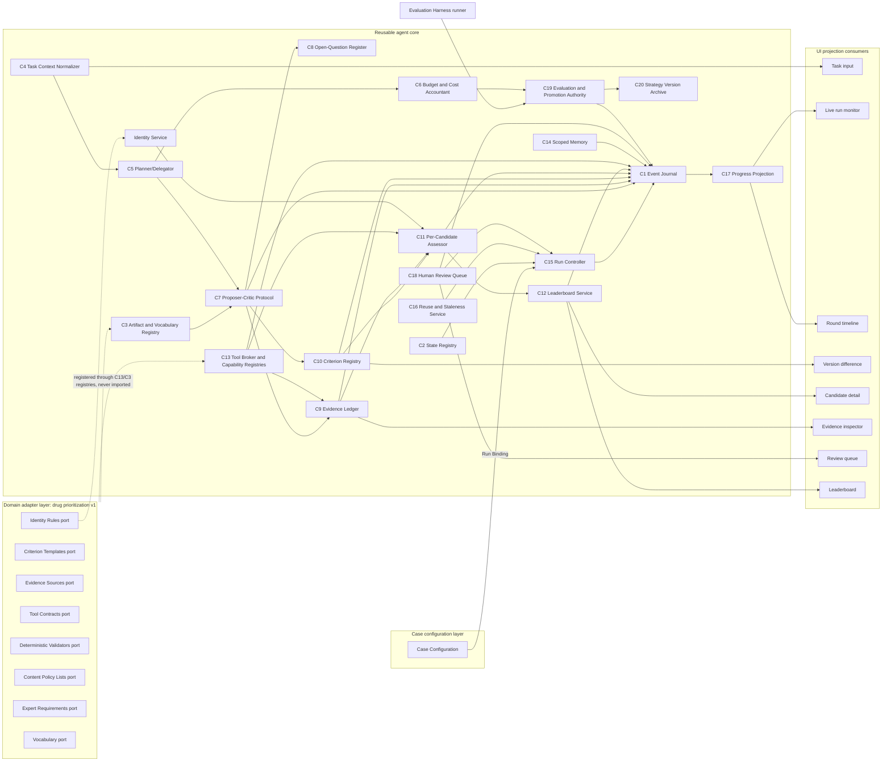

# Modules: Responsibilities, Interfaces, Flow, Stored Artifacts, Reuse, and Failure Behaviour

Coordinating agent (drafting fork), 12 October 2026. Design-phase module map for the architecture in `optimized_design.md`; no code. Each module entry gives: **owner layer** (Core, Adapter, Case, UI), **depends-on** (modules it reads from, respecting the import rule that Core never imports Adapter), **exposes** (ports or record kinds), **persists** (stores from design Section 14), **emits** (journal event kinds from Section 4.1), **fails-as** (behaviour from the Section 15 matrix), and **reuse** (pattern-level reuse from inspected repositories, with Agentic Doping paths at commit `0007ad10` and the verdicts of `audit_report.md` §4; everything not listed as reuse is new development).

## 1. Dependency diagram

**Capability naming (added after independent review).** Capability names used in this document (`identity_resolution`, `interaction_evidence_lookup`, `interaction_estimate`, `property_estimate`, `literature_retrieval`) are the drug adapter's declared bindings of the core's domain-neutral `capability_kind` values (`entity_resolution`, `relationship_evidence_lookup`, `relationship_estimate`, `attribute_estimate`, `source_retrieval`); see `optimized_design.md` §7.1 and ADR-29. The core resolves tools on the kind, never on the adapter label.

Arrows are "writes to" or "reads from" dependencies among core modules; dotted arrows show that adapter ports are resolved through registries keyed by `adapter_id` and `adapter_version`, never imported. The UI nodes are rendered by two surfaces, the terminal client and the browser workbench, through the Operator API (design §2.4); the API is left out of the diagram for readability.

## 2. Foundation modules

### C1 Event Journal
- **Owner layer:** Core. **Depends-on:** none (foundation). **Exposes:** `append(event) → seq`; `subscribe(stream_id, from_seq)`; `replay(stream_id, from_seq, to_seq)` for every stream (design §2.4). **Persists:** append-only journals per stream; compaction projection snapshots keyed by `snapshot_seq`. **Emits:** nothing of its own; it is the sink. **Fails-as:** write failures surface to the caller; a crashed attempt is closed by C15 with `attempt.finalized {finalized_by: controller}`; unanswered tool calls receive synthetic `unknown_outcome` results so replay stays valid.
- **Reuse:** the atomic-replace plus append discipline of Agentic Doping `orchestration/run_dir.py` 91-143 (keep the discipline, redesign the record: three statuses and two event kinds are replaced by the Section 4.1 record); deepseek-harness `SessionEvent {type, seq, time, data}` with contiguous `seq`, crashed-turn closure, and pure-fold projections. **New:** the event record, counter rule, heartbeat retention window, projection hashes.

### C2 State Registry
- **Owner layer:** Core. **Depends-on:** C3 (vocabulary versions). **Exposes:** `lookup(label_domain, state_id) → {semantics, is_terminal, implies_admission, ui_label, ui_tone}`; validation of every state write. **Persists:** registry versions. **Emits:** none. **Fails-as:** a value outside the registered vocabulary rejects the write; journaled as `step.failed {vocabulary_violation}`.
- **Reuse:** none directly; the module exists because Agentic Doping relabels `exhausted` as `sent_after_revision_limit` (`web/server.py` 980-989) and keeps three state vocabularies (`run_dir.py` 200; `core/task_state.py` 18-24). **New:** entire module and the contract test that no label maps to admission when the authoritative state does not.

### C3 Artifact and Vocabulary Registry
- **Owner layer:** Core. **Depends-on:** none. **Exposes:** Artifact Envelope schema; payload schemas per artifact kind; vocabulary versions; generated validators and labels; adapter schema registration (`adapter_extensions` declared, opaque to core logic). **Persists:** content-addressed artifact store; vocabulary registry. **Emits:** `artifact_written` is recorded as the creating event's `artifact_links`. **Fails-as:** schema or vocabulary violation rejects the write.
- **Reuse:** Agentic Doping has tested JSON schemas (`schemas/ledger_record_v1.json`, `tests/test_schemas.py`) but duplicated vocabularies that drifted (`evidence_ledger/enums.py` vs the schema); the single-source vocabulary registry is new. ARIS `REVIEW_STATE.json` identity fields inform the envelope's actor block.

## 3. Task and planning modules

### C4 Task Context Normalizer
- **Owner layer:** Core. **Depends-on:** C3; adapter Vocabulary port (through registry) for entity typing. **Exposes:** `normalize(inputs) → task_context@v`; `missing_info_requests`. **Persists:** task context versions in the artifact store. **Emits:** `stage.*`, `human.review_requested` for blocking unknowns. **Fails-as:** blocking unknown → `waiting_human`; derivation impossible → run `unresolved` with `dependency_unresolved {dependency_detail: derivation_unavailable}`; never a keyword fallback.
- **Reuse:** none; Agentic Doping goes from goal text to a scoring vocabulary (`objective_analysis/analyze.py` 33-122, 1110-1117, keyword tables — do not transfer). **New:** the task-context record, modes, unknowns.

### C5 Planner/Delegator
- **Owner layer:** Core. **Depends-on:** C4, C6, C3. **Exposes:** `plan@v` with steps (delegation brief fields in the step), `result_return` consumption, re-planning after failure. **Persists:** plan versions. **Emits:** `plan.recorded`, `step.queued`. **Fails-as:** `on_failure` policy per step; circular or unexecutable plan rejected at `draft` with a journaled reason.
- **Reuse:** the nine-stage pipeline of Agentic Doping `orchestration/recommend.py` becomes the default plan template only; no plan-as-data exists there (WS2 B1). **New:** plan and step records, complexity table, result-return policy.

### C6 Budget and Cost Accountant
- **Owner layer:** Core. **Depends-on:** C1 (reads budget fields on events). **Exposes:** budget envelope issuance; retry and exchange tokens; cost records per round and strategy version; `cost_per_changed_decision`. **Persists:** cost records. **Emits:** none of its own; budgets ride on events. **Fails-as:** budget exhaustion returns a `LoopOutcome {budget_exhausted}` to the caller; never truncates silently.
- **Reuse:** hsi per-call usage log by scope (`src/react_loop/agent.py` 514-538) as the pattern for `tokens_by_role`; Agentic Doping's `MAX_ROUNDS` module constant (`dual_agent/harness.py` 37) is what this replaces. **New:** everything else.

## 4. Collaboration modules

### C7 Proposer–Critic Protocol
- **Owner layer:** Core. **Depends-on:** C3, C5, C9, C10, C13 (through broker), C8, C14 (recall), C2. **Exposes:** exchange lifecycle; artifact kinds proposal, critique, revision, adjudication, decision; Independence Declaration; adjudication precedence table (core) over finding classes (adapter Deterministic Validators port). **Persists:** exchange artifacts. **Emits:** `exchange.{proposed, critiqued, revised, adjudicated, closed}`, `decision.recorded`. **Fails-as:** critique without external referent → `restatement`; persistent disagreement → deterministic adjudication → escalation → queue; `unresolved` legitimate.
- **Reuse:** Agentic Doping bounded loop `dual_agent/loop.py` 209-292 (reuse as pattern; split the shared counter; add LoopOutcome); deterministic critic plus gate `dual_agent/reviewer.py` 474, 601-686 (reuse as pattern); citation cross-check and downgrade-only calibration `reviewer.py` 206-422 (adapt); withheld-input review only on the file-chat path and `review_fixed_proposal` (`dual_agent/harness.py` 1121-1124; `loop.py` 71-130) — the default tool-harness path discloses the proposer rationale (`dual_agent/agent_harness.py` 920-955; `dual_agent/proposer.py` 121-145), so disclosure is recorded per exchange rather than assumed. ARIS: file-paths-only reviewer input, Type-A/Type-B gate split, code-computed verdicts (`skills/kill-argument`), cross-family rule. hsi: hypothesis with falsification criteria. **New:** typed checks, Independence Declaration, dissent record, `revision_check`.

### C8 Open-Question Register
- **Owner layer:** Core. **Depends-on:** C9, C10, C11, C13 (referents). **Exposes:** question records; admissibility rule for another round; `realized_information_gain` on `round.closed`. **Persists:** register entries. **Emits:** contributes to `round.closed`. **Fails-as:** no admissible trigger → `no_actionable_step`.
- **Reuse:** Agentic Doping gap-directed retrieval `orchestration/gap_discovery.py` 42-129 (adapt: gaps become durable register entries; keep the backward flow from held knowledge to targeted search); ARIS `tools/iteration_log.py` stall ladder (adapt as `no_actionable_step`). **New:** referent and expected-decision-change fields, attempts, gain accounting.

## 5. Evidence and criteria modules

### C9 Evidence Ledger
- **Owner layer:** Core. **Depends-on:** C13 (provenance), C3, IDS. **Exposes:** Source, Claim, Location, Independence Group, Visibility Manifest, Search Coverage records; `admit`, `quarantine`, `supersede`. **Persists:** Claim Ledger (append-only). **Emits:** `evidence.{admitted, conflict_recorded, quarantined}`. **Fails-as:** fetch failure → source `access_state: fetch_failed`; full text unavailable → `reading_depth` capped and `limitation_kind` on dependents; shortfalls reported, never padded.
- **Reuse:** Agentic Doping append-only JSONL ledger `evidence_ledger/ledger.py` 22-51 (adopt; add `seq`, task-context keys); prompt-inclusion audit and context manifest `literature/visibility.py` 296-334 and `objective_analysis/analyze.py` 900-950 (reuse as design, with the pre-catalog filters logged); cached-extraction status taxonomy and `prompt_safe` gate `literature/quality.py` 374-473 (reuse as pattern); transfer-scope rank `visibility.py` 24-76 (becomes `scope_match`); aggregate-claim suppression `visibility.py` 88-127. Avoid: cache-key independence with a fixed bonus (`quality.py` 653-657). ARIS `tools/evidence_check.py` ("verified is not correct"). **New:** claim-type and verifier fields, independence groups, location records, visibility manifest as publication gate.

### C10 Criterion Registry
- **Owner layer:** Core. **Depends-on:** C9, C7, C18 (confirmation), C3, C2; adapter Criterion Templates port (through registry). **Exposes:** Attribute and Rule records; change records; invariants; confirmed `rules@v` with admission-predicate hash; ordering method; comparison function over the historical artifact (evaluator-only reader). **Persists:** registry versions and change records. **Emits:** `criterion.{version_proposed, change_recorded, version_approved}`. **Fails-as:** invariant violation → typed critique, bounded repair, then `unresolved`; non-evaluable attributes stay `proposed` with reason; rejected proposals retained.
- **Reuse:** scientific identity key `literature/quality.py` 687-695 (becomes the duplicate-criterion test); exact-phrase normalizer `quality.py` 173-216; invariant audit with bounded repair `objective_analysis/analyze.py` 215-282, 761-810 (reuse as pattern); useful fields of the fixed-vocabulary target contract `analyze.py` 680-750 (direction, rationale, computation method — adapt; redesign the contract). **New:** two-record contract, per-field provenance, change records, reversal test, comparison function, `derivation_configuration`.

### C11 Per-Candidate Assessor
- **Owner layer:** Core. **Depends-on:** C10 (rules), C9 (claims), C13 (lookups), IDS, C16 (reuse decisions), C2. **Exposes:** `rule_evaluation` capability; assessment and reason records; roll-ups. **Persists:** Assessment Ledger. **Emits:** `candidate.assessed`, `tool.*` through the broker. **Fails-as:** tool failure for one candidate → `unknown_missing` with error ref; every candidate leaves with a row. **Sweep obligations (design §6.6):** breadth-first by rule within the bound `sweep_scope`; no short-circuit after a hard fail; identical per-candidate caps.
- **Reuse:** weight-based coverage reported separately in Agentic Doping `evaluation_cascade/scoring.py` 252-254 (right instinct; here it gates admission); typed `FailureReason` preserved and visibly sunk (`evidence_ledger/enums.py` 33-54; `leaderboard.py` 81-90). Avoid surrogate and proxy fallbacks (`scoring.py` 222-228, 257-265). **New:** assessment and reason records, disqualifiers, roll-up rules.

### C12 Leaderboard Service
- **Owner layer:** Core. **Depends-on:** C11, C10 (ordering method, change records), C18 (review status), C16. **Exposes:** snapshots, candidate entries, change records, reporting tuple, tool coverage. **Persists:** immutable snapshots. **Emits:** `leaderboard.snapshot_published`, `leaderboard.current_set`, `projection.hash`. **Fails-as:** `recommended` without the required `hd_` → `provisional {awaiting_human_review}`; unexplained material change renders as a defect.
- **Reuse:** read-only evidence-first leaderboard projection `evidence_ledger/leaderboard.py` 78-90 (adapt: add snapshot id, rule version, ordering method, four states); avoid `leaderboard_all` cross-run aggregation (`leaderboard.py` 220-233). **New:** task scoping by construction, result kind, reporting tuple, change records with causes.

## 6. Tool module

### C13 Tool Broker and Capability Registries
- **Owner layer:** Core. **Depends-on:** C3, C6 (retry allowance), C1; adapter Tool Contracts and Evidence Sources ports (registered). **Exposes:** tool registry resolution `(capability, question_kind, required_value_kind)`; Model Adapter Capability Registry; invocation, result, provenance records; `tool_observation` feedback; provider health and circuit breaker; contract tests. **Persists:** tool cache; capability records; invocation/result artifacts. **Emits:** `tool.{requested, returned, errored, retry_scheduled, degraded}`. **Fails-as:** pre-check failure → `not_attempted` with absence reason and manifest; runtime → `failed` with typed error; repeated failures → `degraded` and `run_degradation[]`; adapter cannot return results → protocol refused or policy-approved single-shot with `unresolved` steps.
- **Reuse:** Agentic Doping Anthropic tool loop `core/llm_client.py` 413-488 (adapt behind a neutral contract; add exhaustion reporting); tool errors fed back rather than aborting `llm_client.py` 472-479 (keep, add output-schema validation); `needs_other_env`/`skipped` tier status and `required_dft_inputs` manifest (`evaluation_cascade/base.py`, `dft_bridge.py`) generalized into the absence vocabulary. Avoid: one-shot Codex bridge reported as tool-capable (`llm_client.py` 342-410, 139-151); inline schema literals and name-based dispatch (`dual_agent/agent_harness.py` 62-117). deepseek-harness: durable `tool/call`–`tool/result`, synthetic results for unanswered calls, tool contract with output schema, cancellation, and timeout. **New:** capability resolution, thirteen-field provenance, breaker, capability record, contract tests.

## 7. Memory module

### C14 Scoped Memory
- **Owner layer:** Core. **Depends-on:** C1, C18 (approval), C19 (evaluation), C3; adapter Content Policy Lists port (registered). **Exposes:** memory items; operations `add`, `retire`, `supersede`, `retag`; recall policy with `memory.recalled` records; `check_procedure` chokepoint; drafting of skills and lessons during runs from tool recoveries, the Reflector role, expert corrections, and people, each with `historical_list_exposure` (design §10.5); run groups as memory namespaces (design §6.9). **Persists:** memory store and operations log. **Emits:** operations journaled; refusals journaled. **Fails-as:** content-policy violation → item to review queue with codes; no auto-promotion; counts never create procedures.
- **Reuse:** group and role scoping with provisional recall limits `harness/memory.py` 64-66, 207-218, 299-333 (reuse as pattern); content policy violation-code contract `harness/skill_policy.py` 140-213 (adapt; vocabulary to the adapter); post-run reflection with honest skip `orchestration/reflection.py` (reuse the mechanism; recall governed by memory mode, review state, and the firewall rules of design §10.2 and §10.5). Avoid count-based skill promotion `memory.py` 422-456. ACE: identified delta items with helpful/harmful counters and append-only operations (`playbook_utils.py` 13-93, 96-217). **New:** support-basis and review-state axes, counter attribution with signal provenance, pool caps, store-level chokepoint, reversal test.

## 8. Run control and observability modules

### C15 Run Controller
- **Owner layer:** Core. **Depends-on:** C1, C2, C5, C6, C8, C16, C18; Case Configuration (Run Binding). **Exposes:** run/stage/step/exchange state machines; LoopOutcome; attempt, continuation, evidence-refresh run, reopen; checkpoints; continuation decision; `run_degradation[]`; the candidate sweep scheduler (sweep scope, ordering, per-rule reservation, rule-pass checkpoints with `sweep_cursor`, `unswept_cells_manifest`); run chains, run continuations, branches, and annotations (design §6.8); run groups and their lifecycle (design §6.9). **Persists:** Run Binding, checkpoints. **Emits:** `run.*`, `stage.*`, `step.*`, `round.*`, `attempt.*`, `checkpoint.written`, `group.*`, `task.group_changed`. **Fails-as:** crash → attempt finalized by controller, new attempt from checkpoint; budget → `unresolved`; stale checkpoint → steps restored `queued` unless an evaluated artifact exists.
- **Reuse:** server-side terminal finalization and startup reaper `web/server.py` 403-446, 1255-1283 (adopt: disk never stays `running`); continue/resume distinction `orchestration/recommend.py` 209-238 (redesign: file-existence reuse replaced by C16 fingerprints); deepseek-harness crashed-turn closure and goal `blocked` with typed reason; ARIS `tools/run_state.py` resume to the first phase not `accepted`. Continue and resume modes `orchestration/recommend.py` 209-218, 734 (redesign: continuing after a run ends is a new run in a chain, never a re-entered run); run groups `core/groups.py` and child-run group inheritance `orchestration/recommend.py` 645 (adapt: the active group becomes a session setting; groups are archived, never deleted). **New:** state machines with the Section 0.4 vocabulary, LoopOutcome, units of work, degradation records.

### C16 Reuse and Staleness Service
- **Owner layer:** Core. **Depends-on:** C1, C9, C10, C11, C12 (dependency edges). **Exposes:** reuse records, dependency graph, stale marks, Rerun Plan, reuse manifest. **Persists:** reuse records and graph edges (derived, rebuildable from the journal). **Emits:** `staleness.marked`, `rerun.scheduled`. **Fails-as:** fingerprint mismatch → recompute; over-invalidation is accepted over serving superseded results.
- **Reuse:** none; Agentic Doping has no staleness representation (WS4 F9). **New:** entire module.

### C17 Progress Projection
- **Owner layer:** Core (projection). **Depends-on:** C1 only. **Exposes:** three-level progress with `denominator_kind`; budget meter; now-running table; `subscribe(stream_id, from_seq)` relay with compaction snapshots. **Persists:** projection snapshots keyed by `snapshot_seq`. **Emits:** `progress.estimate_revised` on denominator changes (written by C15 on the projection's behalf). **Fails-as:** disconnected client → `view_stale` (client-side); unknown denominator → indeterminate indicator; never a cross-stage percentage.
- **Reuse:** always-visible activity bar plus detailed monitor `web/client/src/App.tsx` 3111-3125, 3524-3546 (reuse the layout idea); run history, restore, and polling fallback `App.tsx` 2490-2508, 2797-2805, 2842-2884 (adapt: resume by sequence number). Avoid linear ETA over changing denominators (`App.tsx` 3108-3125; `recommend.py` 624-680) and version-skipping WebSocket (`server.py` 4179-4208). **New:** denominator kinds, freshness labels, replay contract.

## 9. Human review module

### C18 Human Review Queue
- **Owner layer:** Core. **Depends-on:** C1, C2, C3, C16 (precomputed consequences); adapter Expert Requirements port (registered). **Exposes:** queue items; `hd_` records; trigger table; submission intake lifecycle; `blocked_on_review[]` projection; ownership of `waiting_human`. **Persists:** queue, decisions, submission store. **Emits:** `human.{review_requested, review_decided, review_claimed, review_claim_released, review_withdrawn, review_expired, input_submitted}`, `trace.opened`. **Fails-as:** expert disagreement → both records retained, subject `unresolved`; submission parse failure → retained with `needs_confirmation`.
- **Reuse:** none directly; Agentic Doping has one unattributed human input route (`web/server.py` 1585-1622), a default-pass verification gate (`dual_agent/harness.py` 84-92), and an upload path that writes top-tier evidence on success (`feedback/ingest.py`) — all redesigned. ARIS `done` versus `accepted` with mandatory `verdict_id` and reviewer. **New:** entire module.

## 10. Evaluation modules

### C19 Evaluation and Promotion Authority
- **Owner layer:** Core. **Depends-on:** C1, C6, C13 (tool set identity), C20, C10 (comparison function and admission-predicate hash), Run Binding. **Exposes:** Protocol Manifest; policy arms; Round Progress Record; pools; promotion conjunction; hidden evaluator functions; evaluator epochs; `claim_scope`; Case Acceptance Register; preregistration. **Persists:** evaluation store. **Emits:** `preregistration.recorded`, `evaluation.recorded`. **Fails-as:** run without manifest → exploratory, inadmissible; guard breach after promotion → rollback event.
- **Reuse:** DGM never-delete archive, staged budgets, noise leeway (`DGM_outer.py` 50-190; `self_improve_step.py` 152-178) — adapt, scoped to strategy versions; hsi frozen non-copied selector, LCB reward, dev/val/test splits (`src/react_loop/agent.py` 1457-1466; `state.py` 66-96; `src/benchmark/adapter.py` 162-275) — adopt; HGM separate post-run evaluation on a different split (`evaluate_agent.py`) — adopt; ARIS `meta-optimize`/`meta-apply` split (proposal versus human landing) — adopt. Avoid: selection and reporting on the same sets (DGM); acceptance-credited `uses` counter (`dual_agent/harness.py` 1275-1283). **New:** manifest, arms, pools, conjunction, claim scope, register.

### C20 Strategy Version Archive
- **Owner layer:** Core (owned by C19). **Depends-on:** C19, C14 (approved memory snapshot refs). **Exposes:** strategy version records with lineage, status, rollback target, expiry. **Persists:** evaluation store. **Emits:** `ops_` decisions journaled as `decision.recorded`. **Fails-as:** never deletes; rollback is one step.
- **Reuse:** DGM and HGM archive lineage (`hgm_metadata.jsonl` append per update, no deletion). **New:** `change_class`, LCB metrics, lineage metrics, `promotion_policy_version` outside the evolvable surface.

### Identity Service
- **Owner layer:** Core, driven by the adapter Identity Rules port. **Depends-on:** C13 (`identity_resolution` providers), C18 (ambiguous merges). **Exposes:** identity records with `identity_link_basis` and `identity_review_state`; merge with change record. **Persists:** identity records in the artifact store. **Emits:** `human.review_requested` on `name_match_ambiguous`. **Fails-as:** unresolved identity → candidate `not_assessed`; claims held `pending`.
- **Reuse:** none; Agentic Doping's element-symbol parser is domain-specific. **New:** entire module.

## 11. Adapter module set (drug prioritization v1)

Each port is declarative configuration registered with C3 and C13; no port is imported by core code.

| Port module | Declares | Consumed by | Fails-as |
|---|---|---|---|
| Vocabulary | entity kinds (compound, target, assay endpoint), identifier schemes with authorities, aliasing rules, units, unit conversions (store `unit_as_reported` beside the normalized unit), scope-match rules | C4, C9, C11, Identity Service | unknown unit → value stored but never consumed |
| Criterion Templates | attribute definitions with empty cutoffs, measurement kinds, directions, applicability conditions, acceptable value sources, default rule forms for the four dimensions | C10 as `proposed` entries | a template is never pre-approved |
| Evidence Sources | the Section 2 sources of `tools.md` with access mode, evidence kinds supplied, source-status defaults, provenance fields, cutoff semantics, absence behaviour, rate limits, license | C13, C9 | pre-check failure → `not_attempted` |
| Tool Contracts | contracts for identity, interaction evidence, property estimation, literature retrieval, document reading, dataset context, optional interaction estimate (CDES, Boltz-2) | C13 | per contract |
| Deterministic Validators | finding classes and severity map for unit consistency, duplicate attributes, weak exclusions, reference-candidate identifier scan; `hard_exclusion_eligible` flags | C7 adjudication precedence, C10 invariants | typed findings only |
| Content Policy Lists | candidate identifiers and aliases including the disclosed reference outcome; numeric-claim policy | C14 chokepoint | rejection with codes |
| Expert Requirements | which action kinds require review, required qualification, evidence to present | C18 trigger table | missing requirement → item cannot be auto-approved |
| Identity Rules | resolution order among providers, salt/tautomer/stereo alias treatment, merge conditions | Identity Service | ambiguity → queue |

Reuse: fields of the fixed-vocabulary target contract (`objective_analysis/analyze.py` 680-750) inform the template shape; the `skill_policy.py` vocabulary moves here. Everything else is new domain configuration, with no biological conclusions asserted.

## 12. Case Configuration module

- **Owner layer:** Case. **Depends-on:** none (bound into the core at run start). **Exposes:** the Section 2.2 record: objective text, mode, scope entities, candidate universe, historical stage artifacts, seed candidates with reference-outcome disclosure, constraints, evidence cutoff, historical-criteria intake (`visibility: evaluator_only`), case-source documents, calibration pool reference, a `visibility` declaration on every field (`agent_visible`, `evaluator_only`, `control_only`), `historical_list_exposure` declarations on authored fields, registered constants, evaluation scope, baseline and alternative configurations, human-review requirements, budget envelope. **Persists:** versioned case records; the Run Binding written by C15. **Emits:** `preregistration.recorded` through C19. **Fails-as:** changing a bound field requires a new run; missing mandatory inputs (candidate universe access) block the run as `waiting_human`.
- **Reuse:** none. **New:** entire module.

## 13. UI projection consumers

All UI modules read projections only; none writes a state. Wireframes and component states are in `ui_ux_spec.md`. Two surfaces render these modules, the terminal client and the browser workbench; both reach them only through the Operator API (design §2.4), and the "Writes" column names the command either surface sends.

| UI module | Reads | Writes (as commands through the Operator API; design §2.4) | Reuse from Agentic Doping |
|---|---|---|---|
| Task input | C4 task context, blocking and advisory unknowns | task context versions via C4 | none |
| Live run monitor | C17 three-level progress, now-running table, budget meter, freshness | pause, resume, cancel via C15 | activity bar plus monitor layout (`App.tsx` 3111-3125, 3524-3546), redesigned semantics |
| Round timeline | C1 events filtered by kind | none | per-round proposer/reviewer blocks (`App.tsx` 1933-1962) as snapshot display; semantic diff is new |
| Version difference | C10 and C12 change records | none | report lineage with `parent_version` (`analysis/report_iteration.py` 270-290; `ReportIterator.tsx` 130-178) — adapt |
| Candidate detail | C12 entries, C11 assessments and reasons, C18 review status, C16 reused/re-evaluated labels | exclude with reason, request rerun via C18/C15 | separated review dimensions (`App.tsx` 3785-3799) — adapt, adding attributed human approval |
| Evidence inspector | C9 sources, claims, locations, independence, visibility manifests | dispute, submit better source via C18 | retained rejected references (`dual_agent/reviewer.py` 206-230, 382-418) — adopt; claim-to-passage navigation is new |
| Review queue | C18 items with precomputed consequences | `hd_` records via C18 | none |
| Leaderboard | C12 snapshots, four states, tool coverage, reporting tuple, change records | none | evidence-first ordering idea (`leaderboard.py` 78-90) — adapt; task scoping and result kind are new |
| Run chain and Continue dialog | C15 bindings and chain projection, C16 reuse estimates, C6 `chain_cost` | continue, branch, add round, annotate, set current (C15, C8, C12) | none |
| Run-group switcher | C15 group records | create, rename, archive, reactivate, move or copy a task (C15) | groups `core/groups.py` (adapt) |
| Skills & lessons | C14 items and `memory.recalled` | add, retire provisional items, send for review, request a trial (C14, C18, C19) | none |
| Evaluation | C19 manifests, preregistration events, strategy versions | record preregistration, compare, scan, register protocols, promote or roll back (C19, C20) | none |

### Operator API, service host, and the two surfaces
- **Owner layer:** Host infrastructure (design §0.1): the service host and the Operator API; the terminal client and the browser workbench are UI. **Depends-on:** C17 (subscriptions and projections); C4, C8, C15, C16, C18, C19 (each validates the commands on its own subjects); C2 (labels); C3 (canonical serialization). **Exposes:** subscribe for every stream kind, query, command, session, and role grants (design §2.4); deployment profiles L, W, and X (design §14.1). **Persists:** `ses_` and `cmd_` records, role grants, and the operator log; every other record stays in the core stores. **Emits:** no run or task events of its own; events caused by commands carry `actor.via`; a confirmed evaluator-only read is journaled as `evaluator_only.read` in the case stream; `service.started` and `service.stopping` go to the operator log. **Fails-as:** command on a stale view → `rejected_stale_basis`; failed precondition → `rejected_not_permitted_in_state`; resent command → `duplicate`; same id with another payload → `rejected_invalid`; missing role or scripted `hd_` → `rejected_unauthorized`; foreign Host, foreign origin, or missing token → refused before any component; second host on a root → `store_locked`; synchronized or network root → `store_root_unsupported`; stop or suspend → attempt recovery of design §14.1 with `host_gap`.
- **Reuse:** Agentic Doping's server-side finalization at shutdown and startup reaper (`web/server.py` 403-446, 1255-1283; listed under C15) — adopt; its live view served from an in-memory job object (`server.py` 4179-4208) — avoid. **New:** the Operator API, task streams, sessions and role grants, command records and outcomes, request checks, the terminal client, encrypted evaluator-only storage, and portable records (design §14.2).

## 14. Evaluation Harness runner

- **Owner layer:** Core (outside the decision path). **Depends-on:** C19 (manifest), C15 (runs policy arms as separate runs with bound `policy_arm`), C6 (cost), C1 (log inspection), C20. **Exposes:** execution of arms P0, P0-noreview, P1, P2, P2-cap, P0+ variants on fixed snapshots with cold or frozen memory; repeated seeds; process scenarios S1–S14; metric computation; `claim_scope` emission; held-out touch counting. **Persists:** evaluation runs. **Emits:** `evaluation.recorded`. **Fails-as:** tool outage per `tool_outage_policy`; a run without `protocol_id` is exploratory.
- **Reuse:** DGM staged budgets; hsi test-only-at-nomination with rotating repeat seeds (`main_final.py` 198-241); HGM `evaluate_agent.py` as a separate post-run evaluation. **New:** arms, scenarios, matched-budget accounting, process-versus-domain separation.

## 15. Reuse summary

| Source | Reuse as pattern or adopt | Adapt | Redesign or avoid | New development |
|---|---|---|---|---|
| Agentic Doping `0007ad10` | bounded loop; deterministic critic plus gate; append-only ledger; scoped memory; reflection with honest skip; prompt-inclusion audit; scientific identity key; invariant repair loop; server-side finalization; typed failures preserved | citation cross-check; versioned proposal/review artifacts; Anthropic tool loop; per-candidate ledger; content policy; gap-directed retrieval; target-contract fields; report lineage; leaderboard projection; monitor layout | one-shot bridge; progress record vocabulary; file-existence reuse; evidence ladder; cross-run leaderboard; count-based skills; verification gate; upload-as-evidence; keyword fallback; disposition remap; ETA over changing denominators | C2, C3, C4, C5, C6, C8, C16, C18, Identity Service, Case Configuration, change records, Independence Declaration, reporting tuple |
| deepseek-harness | typed events with `seq`; durable tool call/result with synthetic results; crashed-turn closure; pure-fold projections; tool contract with output schema, cancellation, timeout; typed `blocked` reasons | — | two-value status as user-facing vocabulary | — |
| ARIS | file-paths-only reviewer input; Type-A/Type-B gates; done versus accepted; evidence pre-check; code-computed verdicts; meta-optimize/meta-apply split | stall ladder | AI-score trajectory as evidence | — |
| DGM, HGM | never-delete archive; staged budgets; noise leeway; separate post-run evaluation | failure-class-directed proposals; clade selection as warning | same-set selection and reporting; no cost accounting | — |
| hsi | frozen selector outside evolvable surface; LCB reward; fixed-seed splits; usage log by scope; falsification criteria | max-of-evaluations ranking; LLM commit pool | in-place lesson overwrite | — |
| ACE | delta items with counters; append-only operations | deterministic grouping with human-reviewed merge | prompt-text budgets; label-driven "no ground truth" branching | — |

## 16. Sources

`optimized_design.md` Sections 0, 2, 4, 7, 14, 15; `audit_report.md` §4–§5; `agent_reports/mas_architecture.md` (B1, C1–C3, D1–D2, E2, F1–F3, G1, H1, I1 and cross-reviews); `agent_reports/reference_harness_inspection.md` (§2–§8); `agent_reports/human_review_and_ui.md` (§1, §8); `agent_reports/evidence_and_policy.md` §9; `agent_reports/tools_and_data.md` (§1, Findings 1–10, cross-review).
