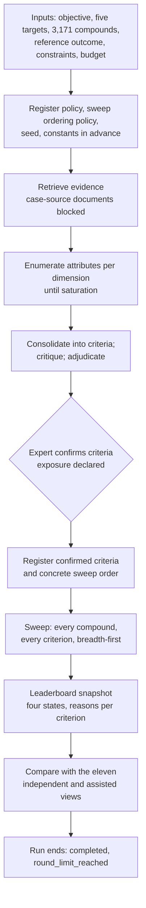

# Post-Handoff Design Decisions

Coordinating agent, 13 October 2026. Design phase only; nothing here reports a run, a ranking, or a recovery result. This document summarizes the nine follow-up discussions held with the user after the design audit was handed off, the decisions taken, and the design changes each produced. Component ids, states, and record names follow `optimized_design.md` Section 0. The change log entries are `collaboration_log.md` §7.4 to §7.7.

## 1. Decisions confirmed by the user

| Decision | Statement |
|---|---|
| Final goal | Using the manuscript case as the worked example, the MAS should put surufatinib on the task-scoped leaderboard and produce most of the eleven original CQAs, where similar criteria count. |
| What "on the leaderboard" means | Candidate state `recommended`, or `provisional` where a criterion could not be evaluated, under the prespecified baseline (`case_study_protocol.md` §1). |
| What "similar" means | A derived criterion matching an original one in definition but differing in cutoff, applicability, or granularity counts, and is reported separately from an exact match: `recovered_with_different_cutoff`, `recovered_with_narrower_applicability`, `merged_into`, `split_into`. |
| How the CQAs are produced | The system derives them from the objective and evidence; the original list is never shown to derivation agents. Recovery is measured afterwards. |
| Option considered and not adopted | Giving the eleven to the system openly and having it evidence-check each one. It would make high recovery near-certain but would support only the claim that the original CQAs were checked, not that they were derived. |

## 2. The nine discussions and what changed

### D1. "Brief introduction of the design"

No change. The overview given: three layers (reusable core, replaceable drug adapter, case configuration), twenty core components, an append-only event journal as the only source of truth, criteria as versioned evidence-linked records, a per-criterion assessment and reason for every compound, a conservative four-state leaderboard, single-pass operation by default, human approval kept separate from agent verdicts, and strategy changes promoted only on held-out evidence at matched budget.

### D2. "How can I verify the results, and how will the CQAs be produced and distilled to the eleven?"

Answer: the CQAs are derived, consolidated, confirmed by an expert, and then compared with the eleven by a separate component; verification relies on records fixed before results and traceable afterwards. Checking this exposed two leaks: confirming experts who know the eleven, and adapter templates written from them.

| Change | Where |
|---|---|
| Exposure to the original list is declared on every criterion-affecting expert decision and every adapter template; recovery is reported in an `independent` view and an `assisted` view | ADR-31; design §0.4, §8.6; protocol §4.5 |
| A ten-question run verification checklist, each question tied to records | evaluation plan §8.4 |
| After review (PH-01, PH-02): exposure is also derived from the access log, so anyone with a logged read of the list counts as having seen it; the review queue shows the list only for comparison adjudication after the criteria are confirmed; the objective text, dimension list, consolidation rule, and derivation strategy must be verbatim public text or pass a criterion-content scan run by the comparison component | ADR-31; design §0.4, §8.6; protocol §4.5, §5.1; tasks T1.8, T8.14, T8.16 |
| After review (PH-12): labels for the new vocabularies and a recovery comparison panel showing both views with denominators; opening it counts as reading the list | UI spec §11.1, §13 |

### D3. "The final goal is that drug on the leaderboard and most of the eleven CQAs produced"

Answer: the design already targeted this; it lacked mechanisms aimed at recall and left the manuscript itself retrievable.

| Change | Where |
|---|---|
| The manuscript, its supplement, preprints, and documents quoting the criteria list are registered as case-source documents and excluded from derivation | ADR-30; design §2.2, §4.9, §8.6; protocol §2.3, §4.5; task T8.13 |
| Recall-first enumeration per dimension until saturation, from standards, other published screening studies, and candidate evidence; then consolidation by a rule fixed in advance; the count is an output | ADR-32; design §8.3; protocol §5.4 |
| Optional calibration of the derivation strategy on other published cases with known criteria lists; the primary case stays sealed until the strategy is frozen | ADR-32; design §8.3; evaluation plan §8.1, study E0b; task T8.15 |
| The route to admission: the only two ways off the leaderboard, and the symmetric control for each risk | protocol §6.5; design §17 |
| After review (PH-03, PH-04): acceptance-bearing runs use cold or frozen memory; `final`-pool runs never feed strategy lineage metrics; calibration cases are selected by a registered inclusion rule and screened against the case-source documents and the original list | design §8.3, §10.2, §10.4, §4.20; evaluation plan §10.4, study E2; ADR-32 |

### D4. "When will one run terminate? Does it go over all drugs?"

Answer: one run covers every compound in the universe and, by default, ends after one pass. Checking this exposed a contradiction (the superseded §6.3 sentence is quoted in `collaboration_log.md` §7.5): §6.3 allowed `completed` only on `sufficient_support` over an undefined "decision-relevant set", which, with mostly missing values, would have made nearly every run `unresolved`, while §16 said such a run ends `completed`. There was also no stop reason for a finished single pass and no rule for the order of the sweep.

| Change | Where |
|---|---|
| A run is `completed` when its candidate sweep is complete; missing values make candidates `provisional`, never the run `unresolved`; `unresolved` means the sweep could not finish | ADR-33; design §0.4, §6.3, §6.7 |
| New termination reason `round_limit_reached`, the normal end of a single-pass run | design §0.4, §6.3; UI label table |
| The sweep: identity first; breadth-first by rule in a registered order (cheap lookups first, literature last); randomized order within a rule; no short-circuit after a hard fail; budget reserved per rule; plan-time feasibility check; checkpoint per rule pass | ADR-33; design §6.6; task T4.4 |
| Feasibility of a full literature-backed sweep is an open question, to be estimated in the pilot | U-13 |
| After review (PH-05 to PH-11): completion is judged within a bound `sweep_scope` (full universe, rerun plan, or refresh delta); the ordering policy and seed are registered before derivation and the concrete order with the confirmed criteria; two feasibility verdicts (plan time, then after identity resolution); a never-attempted cell is `not_assessed` with a registered reason, counts against coverage, and caps the compound at `provisional`; the run-level list is the `unswept_cells_manifest`; rule-pass checkpoints carry a `sweep_cursor`, and unchanged per-cell assessments are reusable; precedence among stop reasons; `sweep_completeness` reported separately from `coverage_fraction` | design §0.4, §0.5, §2.3, §4.10, §4.11, §4.16, §6.3, §6.5, §6.6, §13.6; protocol §4.4; evaluation plan §4.1, §8.4; leaderboard spec reporting tuple; iteration spec §7, §11; task T4.4 |

### D5. "What is the initial input for the MAS?"

Answer: a goal, the targets, the candidate set, constraints, and a budget; the system produces the criteria, cutoffs, and ranking. The question exposed that only the original criteria list had a stated visibility rule.

| Change | Where |
|---|---|
| Every case-configuration field declares `agent_visible`, `evaluator_only`, or `control_only`; agent context is built from `agent_visible` fields only | ADR-34; design §2.2; task T2.9 |
| An inputs-at-a-glance table for the primary case with provider and visibility | protocol §2.4 |

### D6. "Users must be able to use both a Linux terminal and a Windows local server with Chrome"

Answer: one service host runs the core on Linux or Windows, and two surfaces, a terminal client and a browser workbench used in Chrome, are clients of one Operator API. Neither surface keeps state, so a run started in one can be watched, paused, or reviewed from the other, and both show the same thing at the same journal position. In v1 the terminal operates Linux hosts and Chrome operates Windows or Linux hosts; a Linux terminal operating a Windows host is not supported, and whether that pairing meets the requirement is to be confirmed (U-15). The requirement exposed four gaps: the design assumed one browser surface, a Linux-like host, no operators acting at the same time, and no rule for a host that stops because a laptop sleeps.

| Change | Where |
|---|---|
| Operator API (subscribe, query, command, session) as the only interface; effects shown only from journal events; commands applied at most once (`command_id`) and rejected when based on a stale view (`basis`); `actor.via` attribution; the same visibility rules and logging of evaluator-only reads on both surfaces | ADR-35; design §2.4, §4.1, §11.4; iteration spec §2.1, §9, §12 |
| Three deployment profiles: L (Linux host, terminal), W (Windows host, Chrome on the same machine), X (Linux host, Chrome on Windows through an SSH port forward); loopback-only listening; Host-header, origin, and token checks; single-use, short-lived launch address | design §14.1; `ui_ux_spec.md` §15.1, §15.5 |
| Portable records: one canonical serialization for every hash, store-relative paths with hash-derived names, UTC and monotonic time; one service host per store root | ADR-36; design §14.2 |
| Tools declare `supported_platforms[]` and `execution_location`; a tool that cannot run on the host is absent with `requires_other_environment`; host and tool manifest on the Run Binding | design §2.3, §7.1, §14.2; `tools.md` §1, §9 |
| Host stop, log-off, and sleep handled by the crash path with `host_gap`; the wall-clock budget excludes the gap | design §14.1, §15 |
| Terminal command for every browser screen and action; terminal wireframes; parity rules; behaviour when both surfaces act at once; labels for surface, host, command outcome, and exit status | `ui_ux_spec.md` §13, §15 |
| Scenarios S11 (two surfaces, one record) and S12 (portability and host interruption); a checklist row on host and surface | `evaluation_plan.md` §2, §8.4 |
| Tasks T0.7, T3.7, T6.10 to T6.13 | `task.md` |
| Open: Linux-only tools on a Windows host (U-14); several people on one host (U-15) | `architecture_decisions.md` |
| After review (SR-01 to SR-17): a sleep starts recovery, and a paused run or a step waiting for an expert stays as it was, with the gap charged to no budget; evaluator-only content is encrypted under a key the evaluator holds; non-run subjects get task streams; commands are recorded durably, checked against declared preconditions and a role table, and expert decisions need interactive entry; a disagreement is kept beside the first decision, never replacing it; logged reads are confirmed commands and are never exported; path submissions are limited to registered intake directories; store roots must be local and unsynchronized; platform-dependent tool results are not reused across platforms; every browser action has a terminal command | design §2.4, §8.6, §12.2, §12.3, §14.1, §14.2, §15; ADR-35, ADR-36; UI spec §15; `agent_reports/surfaces_review.md` |

### D7. "Users can edit the runs and continue rounds and runs"

Answer: yes. Within a run that has not ended, a person resumes it, decides review items, and adds a round within its round budget. Anything else, including edits to bound fields, more budget, or continuing after the run ended, creates a new run in the same run chain. That run binds the edits and reuses every unaffected result, and the surfaces show the chain as one continued run. Agentic Doping's continue mode re-entered the same run and merged its leaderboard; the design keeps the same experience without rewriting what an ended run claimed.

| Change | Where |
|---|---|
| Run chains, run continuation, branches on confirmation, annotations; the parent closes with `continued_by`; a continuation after visible results is exploratory | ADR-37; design §0.5, §2.3, §6.8, §15, §17 |
| A person may request a round (`human_request`), labelled and not counted as an adaptive trigger | design §4.8; iteration spec §6 |
| Chain view and Continue dialog; terminal `run continue`, `run add-round`, `run annotate`, `chain show` | UI spec §15.3, §16.1 |
| Scenario S13; tasks T2.10, T6.14 | `evaluation_plan.md` §2; `task.md` |
| After review (CG-03 to CG-09): resume, round continuation, and run continuation named apart; continuation kind decides the sweep scope; open review items of a closed parent withdrawn and raised again; early closing of a registered run needs the evaluator; `chain_cost`; outcome-informed defined, with a preregistered budget-extension rule; snapshots chain through `parent_snapshot_id`; comparability breaks open a new leaderboard; per-stream `basis`; every bound field editable from both surfaces | design §6.8, §13.6; ADR-37; UI spec §15.3, §16.1; `leaderboard_spec.md` §2.2, §6.1 |

### D8. "Switching run groups should be a feature"

Answer: a run group is a named workspace and the namespace of its memory, as in Agentic Doping. Switching is per session, never server-wide, and it changes no record and never affects a running run. Groups are archived, never deleted. A task with runs moves only by continuing or copying into another group, so memory recalled in one group never silently appears in another.

| Change | Where |
|---|---|
| Group record, group stream, `group_id` on task contexts and Run Bindings, session `active_group_id`, archive and reactivate, move and copy rules | ADR-38; design §2.4, §4.4, §6.9 |
| Group switcher on the activity bar and `group` commands | UI spec §15.3, §16.2 |
| Scenario S14; tasks T2.11, T6.15; the case's group as an input | `evaluation_plan.md` §2; `task.md`; protocol §2.4 |
| After review (CG-05, CG-10): C15 owns groups; archiving waits for running runs; continuing into another group copies the task first; a copy references the same case configuration and does not inherit preregistration | design §6.9; ADR-38 |

### D9. "Can the system produce skills and lessons during the run?"

Answer: yes, with limits. During a run, drafts come from tool errors fixed by a corrected call, a capped reflection step at round and run end, expert corrections, and people. Every draft passes the content-policy check and starts provisional in the run's group. A run uses its own drafts in later rounds only when its memory is `warm`, and every use is journaled. Acceptance-bearing runs, whose memory is cold or frozen, still draft but do not use them. A skill becomes reusable only after an expert approves it or a held-out procedure trial supports it. Changes to prompts and playbooks happen between runs, under the promotion gate.

| Change | Where |
|---|---|
| Drafting sources, the Reflector role, `memory.recalled`, same-run use only in `warm` mode, "skill" and "lesson" as display names | ADR-39; design §0.4, §4.1, §5.1, §10.5 |
| Skills & lessons screen and `memory` commands | UI spec §15.3, §16.3 |
| Scenario S14; task T5.6, T6.16; U-16 on whether the Reflector is worth its cost | `evaluation_plan.md` §2; `task.md`; `architecture_decisions.md` |
| After review (CG-01, CG-02, CG-11): memory items carry `historical_list_exposure`; acceptance-bearing runs never recall items from exposed or undeclared authors or approvers; recallable items pass the criterion-content scan; case-source documents on every group's content lists; the recall set enters fingerprints; `memory_mode` governs recall only | design §8.6, §10.1, §10.2, §10.4, §10.5, §4.16; protocol §4.5 |

## 3. How one run of the primary case now proceeds

| Step | What the user sees afterwards |
|---|---|
| Inputs | the case configuration, each field with its visibility |
| Derivation | the full enumeration list per dimension with each attribute's fate (kept, merged, split, dropped) and its sources |
| Confirmation | expert decisions with exposure declarations |
| Sweep | 3,171 rows; a per-criterion record with evidence, value, verdict, and reason for every resolved compound |
| Leaderboard | surufatinib's state, its decisive criteria, and any unknown criteria with their causes |
| Comparison | one row per original CQA with its mapping kind, in both views, plus expert reason-quality ratings |
| End | the run state, the termination reason, open questions carried forward, and an empty `unswept_cells_manifest` when `completed` |

## 4. Inputs still required before the case can run

| Input | Owner | Blocks |
|---|---|---|
| Identity list of the 3,171 compounds | authors | the sweep at the stated scale |
| The eleven original CQAs with definitions, units, directions, any thresholds, and a completeness attestation | authors | measuring recovery |
| The exact objective wording with its location in the manuscript | authors | binding the case configuration |
| Coverage floor value | experts | any `recommended` state |
| List of case-source documents | authors | a defensible claim that criteria were derived, not read |
| Exposure declarations from confirming experts and template authors | experts, authors | the `independent` recovery view |
| External calibration cases (optional) | experts | calibrated derivation |
| Budget sized from a pilot estimate of per-cell cost | operator | a `completed` full sweep |
| Choice of deployment profile (L, W, or X) and, on a Windows host, how Linux-only tools are provided | operator | nothing for the run itself; a tool that cannot run on the host is absent and lowers coverage (U-14) |

## 5. What the design still cannot guarantee

- A CQA that no retrievable source supports will not be produced. It is reported as `not_recovered_no_evidence`, with the searches that failed.
- If surufatinib fails an expert-confirmed hard rule on admitted evidence, it is `rejected`, and that is reported under the recording rule of `case_study_protocol.md` §6.2.
- If the only available confirming experts know the eleven, the `independent` view may be small; it is reported as it is.
- Whether a full literature-backed sweep fits a realistic budget is unknown until the pilot (U-13).
- On one operating-system account, role separation and the token boundary rest on attestation: any process under that account can read its files, the token file included. Evaluator-only content stays protected because it is encrypted under a key the evaluator holds.
- Portability between Linux and Windows hosts is a design requirement checked by scenario S12; nothing has been run on Windows.
- Skills and lessons drafted in an acceptance-bearing run do not improve that run, and whether any of them helps later is unknown until a procedure trial.

## 6. Independent review and status

An independent reviewer examined both revisions (`agent_reports/post_handoff_review.md`) and returned **not ready**: one blocking finding, seven material, six minor, each fixable by text edits. The coordinator applied a fix for every finding:

| Finding | Severity | Fix |
|---|---|---|
| PH-01 review queue could show the list to confirming experts; exposure only self-declared | blocking | queue reads limited to comparison adjudication after confirmation; exposure derived from the access log; conflicting declarations block the recovery summary |
| PH-02 objective text, dimension list, consolidation rule, strategy undeclared | material | exposure declared on them; verbatim public text or criterion-content scan; a scan match moves shaped items to `assisted` |
| PH-03 memory and lineage could carry primary-case information | material | cold or frozen memory for acceptance-bearing runs; `final`-pool runs excluded from lineage metrics |
| PH-04 calibration cases unscreened | material | registered inclusion rule; screening against case-source documents and the list; curator exposure; strategy text scanned |
| PH-05 refresh and rerun runs contradicted "completed = full sweep" | material | `sweep_scope` on the Run Binding; completion judged within scope; only `full_universe` supports the coverage claim |
| PH-06 sweep order registered where rule ids do not yet exist | material | ordering policy and seed at stage 1; concrete order at stage 2 |
| PH-07 budget reserved before its inputs exist | material | two feasibility verdicts, the second after stage 2 and identity resolution |
| PH-08 undefined per-cell `not_assessed`; manifest name collision | material | `not_assessed` row in the evaluation table and roll-up; registered reasons; `unswept_cells_manifest` |
| PH-09 checkpoint per rule pass unsupported; reuse forbidden | material | rule pass as a unit of work; `sweep_cursor` on checkpoints; per-cell reuse on unchanged fingerprint |
| PH-10 no precedence among stop reasons; stale examples | minor | precedence stated; worked examples and P1/P2 rows updated |
| PH-11 `coverage_fraction` ambiguous | minor | `coverage_fraction` is value-bearing only; `sweep_completeness` added |
| PH-12 new vocabularies missing from UI | minor | label rows and a recovery comparison panel |
| PH-13 module map and tasks lagged; `derivation_unavailable` unregistered | minor | module entries refreshed; `dependency_detail` registered |
| PH-14 this document cited a log section and review that did not yet exist | material | `collaboration_log.md` §7.5 written; this section rewritten after the review |

The same reviewer then re-checked the fixes and returned **ready with fixes**: the blocking finding was resolved, eleven findings fully and three partly, and eight new items (N1 to N8) were raised, three of them material. The coordinator fixed those too:

| Item | Fix |
|---|---|
| N1 `sweep_scope` per run but used per round; rerun example re-entered a completed run | a rerun after completion is a new run with `sweep_scope: rerun_plan`; continuation rounds carry `round_scope`; example rewritten |
| N2 artifacts derived from the original list had no visibility rule; the recovery panel was an unlisted reader | derived artifacts inherit `evaluator_only` and stay out of later derivation; the panel is an enumerated reader |
| N3 promotion replay view could include the sealed primary case | replay view excludes the `final` pool |
| PH-02, PH-11 partial | canonical `independent` definition and "shapes" defined; coverage definition aligned in the leaderboard spec |
| N4 to N8 minor | memory mode on the Run Binding; corrected citations and names; UI labels; per-cell fingerprint widened; expected rule count declared `control_only`; the access log prevails over a false declaration; task dependency and arm wording fixed |

All changes are in the deliverables and left uncommitted. The consistency checker was rerun after each round of fixes (log §7.4 and §7.5). The second round of fixes was checked by the coordinator, not by a further independent re-check.

**Review of D6.** A separate independent reviewer examined the two-surface revision (`agent_reports/surfaces_review.md`) and returned **not ready**: two blocking findings, eleven material, four minor, all fixable by text edits. The coordinator applied a fix for every finding:

| Finding | Severity | Fix |
|---|---|---|
| SR-01 sleep never triggered recovery; recovery overrode `paused` and `waiting_human`; a sleep could exhaust the budget | blocking | suspend detected against a suspend-excluding clock; a new attempt keeps the checkpointed execution state; `host_gap {kind}` charged to no budget |
| SR-02 file permissions on one Windows account would make every user `exposed`; reads had no record | blocking | evaluator-only content encrypted under an evaluator-held key; `evaluator_only.read` events form the access log |
| SR-03 `basis_seq` undefined outside a run | material | run and task streams; `basis {stream, seq}`; declared preconditions separate stale basis from not-permitted |
| SR-04 review claims unjournaled; lease constant misfiled | material | claim and release events; `const_review_claim_lease` under `core_policy`; claim, release, reassign on both surfaces |
| SR-05 disagreement replaced the first decision | material | `disputes_decision_id`; both kept; subject `unresolved` |
| SR-06 logged reads were plain queries; exports leaked copies; subscriptions unfiltered | material | logged reads are confirmed commands; evaluator-only content on screen only; redacted frames keep `seq` |
| SR-07 terminal parity claim false | material | commands for case authoring, plan only, rules screen, exclusion, compound addition, claim actions, edits, round view, journal export, evaluation; Evaluation screen added; exposure declaration in `hd_` and the browser queue |
| SR-08 no role table; scripts could create expert approvals | material | role grants and a role table; `hd_` needs interactive entry; same-account limit stated; `rerun approve` writes `hd_` only |
| SR-09 path submission could read the store and token | material | registered intake directories only |
| SR-10 synced or network store roots, stale locks, antivirus, unsafe file names | material | `store_root_unsupported`; OS lock; bounded retry; hash-only file names |
| SR-11 platform-dependent tool results reused across platforms | material | `executed_on` in fingerprints unless platform-independent; resume refused on manifest mismatch (wording corrected after the consolidated review); `platform_support_basis` |
| SR-12 no browser session start on L and X; Host check against forwarded ports; history overclaim | material | `session open --browser`; allowed Host and origin values on every request; single-use, short-lived address |
| SR-13 "not a component" incoherent; `cmd_` undefined | material | host infrastructure row in design §0.1; `cmd_` fields, durable before acknowledgement |
| SR-14 to SR-17 | minor | the terminal-to-host pairing stated and left for the user to confirm (U-15); raw-byte and text hashes; wireframe rows and labels restored; S11 and S12 scheduled; label domains, events, and stale references updated |

These fixes were checked by the coordinator with the consistency checker and a table-structure check, not by a further independent re-check.

**Review of D7 to D9.** A further independent reviewer examined the edit-and-continue, run-group, and skills-and-lessons revision (`agent_reports/chains_groups_memory_review.md`) and returned **not ready**: one blocking finding, nine material, two minor. The coordinator applied a fix for every finding:

| Finding | Severity | Fix |
|---|---|---|
| CG-01 memory, Reflector drafts, person-added rounds, and task edits could carry knowledge of the original list into the baseline without any record | blocking | memory items carry `historical_list_exposure`; the Reflector inherits exposure and never reads evaluator-only content or recovery-mapping decisions; recallable items pass the criterion-content scan; acceptance-bearing runs never recall items from exposed or undeclared authors or approvers; a bound snapshot is a global shaping artifact; case-source documents on every group's content lists; `author_exposure` on `human_request` questions and task versions; three new rows in protocol §4.5 |
| CG-02 fingerprints ignored recalled memory | material | `recall_set_hash` in step and cell fingerprints; records made with provisional recall never reused in `cold` or `frozen` runs or other groups |
| CG-03 `human_request` referent and scope | material | the referent is the named subject; barred from evaluation-arm and prespecified runs; `run followup` and `run add-round` aligned with `--subject`; "five adaptive classes" wording |
| CG-04 same-run versus new-run contradictions; overloaded "continuation" | material | resume, round continuation, and run continuation named apart; in-run rule edits allowed; kind decides the sweep scope; §14.2, §15, and iteration spec reworded |
| CG-05 leaderboard comparability, branch snapshots, group mismatch | material | new leaderboard when comparability breaks; `parent_snapshot_id`; `board set-current`; continuing into another group copies the task first |
| CG-06 closing a parent that has not ended | material | open items withdrawn and raised again, claims released; closing a registered run early needs the evaluator and records a protocol deviation; reuse from a failed parent limited; dialog warns |
| CG-07 no chain budget; "results visible" undefined | material | `chain_cost` reported; preregistered `budget_extension_rule`; outcome-informed defined mechanically |
| CG-08 single-stream basis for a continuation | material | one `basis` per stream read plus expected versions of every listed edit |
| CG-09 surfaces did not cover every bound field | material | dialog fields and `run continue` flags for every bound field; `--task-edits-from` limited to task and binding fields; `chain list`, `memory send-for-review`, edit and reactivate controls, group in the terminal header |
| CG-10 group archive, ownership, streams, task copy | material | archive refused while runs have not ended; C15 owns groups; `task.group_changed` in the task stream; copy references the same case configuration and does not inherit preregistration |
| CG-11, CG-12 | minor | `memory_mode` governs recall only; `memory_item` subject and `retire` decision; Reflector trigger and `reflection_turns` budget class; interactive entry for person-written items; stale stream, event, label, and scenario references updated; "planned rounds finished" label |

These fixes were checked by the coordinator with the consistency checker and a table-structure check, not by a further independent re-check.

### Consolidated review of the whole design

After D1 to D9, the user asked for further suggestions and accepted two: an independent check of the whole design, and a smaller first version. The cut-down first version is `v1_scope.md`: what is built first, the build order in five slices, the inputs to request now, and three gaps found while scoping. A fresh reviewer then checked every document for contradictions across documents and across the four post-handoff revisions (`agent_reports/consolidated_review.md`) and returned **not consistent**: two blocking findings, twelve material, four minor. Most were changes made in `optimized_design.md` but not carried into the other documents, or interactions that no single-revision review could see. The coordinator fixed all eighteen and added the three scoping gaps:

| Finding | Severity | Fix |
|---|---|---|
| CR-01 four incompatible answers to where a rerun runs and who starts it | blocking | in a run that has not ended, stale cells are re-assessed in the current round; after it ends, an approved Rerun Plan runs only in a run continuation a person starts; iteration spec §8.3, §11.2, §11.3 and the UI timeline rewritten |
| CR-02 the run monitor would mark every finished single-pass run `unresolved` | blocking | only budgets other than the round budget give `budget_exhausted`; a used round budget after a full sweep is `round_limit_reached`, `completed` (UI §4.2, §5.1; C6 failure behaviour) |
| CR-03, CR-04 state machines and withdrawn review items | material | steps get the run states plus `rejected`; a cancel or a continuation that closes a run cancels its unfinished stages and steps; `waiting_human` exit conditions widened; `human.review_withdrawn` and `human.review_expired` events |
| CR-05 to CR-07 binding fields and preregistration | material | `protocol_ref`, `preregistration_ref`, `promotion_policy_version` in the Run Binding; preregistration recorded by the evaluator per task and run, with the run waiting; design §13.6 is the single list of stage contents, now including `strat@v`, the constants hash, the "most" threshold, and the budget-extension rule |
| CR-08 to CR-10 streams, the evaluator key, leaderboard identity | material | five stream kinds (run, task, group, case, evaluation); the recovery comparison and scans are evaluator commands outside runs; leaderboard record `lbd_` with comparability key and current snapshot |
| CR-11 to CR-16 vocabularies, roles, fingerprints, budgets, stale meanings | material | label domains, acceptance label, queue-item and host-refusal labels; role table and validators extended; step fingerprint completed; `reflection_turns` everywhere; "continuation" and "per run" corrected, `subscribe(stream_id, …)` throughout |
| CR-17, CR-18 | minor | stale counts and ranges; task dependencies, a constants task (T0.8), and the broken M8 table fixed |
| G1 to G3 from scoping | — | credentials outside every record, encrypted backups with a restore drill and evaluator key escrow, exact model versions per role in the Run Binding (design §14.3; ADR-40; task T0.9) |

These fixes were checked by the coordinator with the consistency checker, a table-structure check, a stale-term scan, and a task-reference check, not by a further independent re-check.
