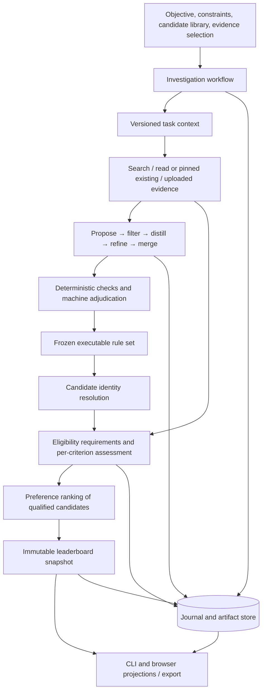

# MAS v1.0 architecture

[Documentation home](../README.md) · [Component reference](components/README.md)

MAS turns a research objective into executable criteria, evaluates candidates against those criteria, and publishes a ranking with evidence and decision records. The shipped application combines a Python research core, registered source providers, a command line interface, and a local browser workbench. Its primary supplied domain adapter is drug prioritization; uploaded candidate and measurement tables also support carrier and general research workflows.

The architectural boundary that matters most is between **scientific records** and **their presentation**. Task versions, criterion versions, source claims, assessments, run bindings, and leaderboard snapshots are persisted records. The browser reads projections of those records and sends explicit commands to start or revise work. A display label or generated explanation does not rewrite an assessment.

## The implemented path

The workbench composition lives in [`core/investigation.py`](../src/mas/core/investigation.py) and [`ui/workflows.py`](../src/mas/ui/workflows.py). Criterion derivation and screening are separate recorded runs. Screening is driven by [`RunController`](../src/mas/core/controller.py), which binds the task version, rules, settings, providers, evidence mode, and implementation before execution. The current qualification policy supports staged elimination and full evaluation. In staged mode, a verified hard failure can skip later cells; every skipped cell carries its cause. Missing evidence continues as an explicit unknown.

The older screening route remains available for historical compatibility. Its full sweep, calibration policy, and state roll-up differ from `qualification_first_v1`. Read the bound policy when interpreting a saved run; the application does not reinterpret earlier snapshots under new settings.

## Layers and ownership

| Layer | Owns | Concrete entry points |
|---|---|---|
| Core | Canonical records, criterion checks, evidence admission, assessment, ranking, execution, measurement | [`src/mas/core`](../src/mas/core) |
| Source and domain adapters | Identity, database fields, curated interactions, permitted document retrieval, optional predictions | [`src/mas/adapters`](../src/mas/adapters) |
| Composition | Register providers, choose models and settings, connect workflows to the controller | [`cli/main.py`](../src/mas/cli/main.py), [`core/investigation.py`](../src/mas/core/investigation.py) |
| Local application | HTTP routing, operation token, workflow state, CSV intake, derived read cache | [`ui/server.py`](../src/mas/ui/server.py), [`ui/workbench_api.py`](../src/mas/ui/workbench_api.py) |
| Browser client | Navigation, English/Chinese display, forms, charts and evidence inspection | [`web/client`](../web/client) |

The core accepts registered tools and adapter metadata rather than importing the drug adapter. Providers return observations with provenance; the core decides whether those observations may support a claim and a criterion. Model providers and scientific tools have different contracts and accounting paths.

## Record flow and authority

1. A task context states the objective, population, scope, constraints, and unresolved inputs. Each revision creates a version.
2. Derivation reads permitted evidence or a pinned fact bank. Candidate criteria retain their evidence, pool lineage, and stage decisions.
3. An **attribute** defines what is measured and how evidence is reduced. A **rule** defines how that measurement affects a decision. Confirmation freezes an executable set and its authority records.
4. A tool response becomes a located claim only through the evidence layer. Admission, value basis, and independent document support are separate properties.
5. An assessment connects candidate, attribute, rule version, claims, verdict, and reason. Qualification checks every task-defined condition requirement and required direct observation. The same observation can also contribute to prioritization. Predictions retain a separate evidence basis.
6. The leaderboard records qualification, coverage, scores, positions, missingness, and changes. A score or first place alone does not establish scientific confirmation.

The durable store is SQLite with append-only event and artifact tables, canonical hashes, and one writer per store root. Read caches, workflow control files, display annotations, and upload files have their own storage paths. Thus “replayable” refers to reconstructing recorded scientific state; it does not imply that an external database or model will return the same answer if called again.

## Status of the original C1–C20 design

The identifiers below provide a stable crosswalk for readers of the original design. **Implemented** means an identifiable shipped path exists for the stated responsibility. **Partial** means a narrower path exists. **Planned** means the design concept is not a functioning service in this release. These labels describe architecture, not the result of a new live acceptance run.

| ID | Original responsibility | v1.0 status | Shipped implementation and boundary |
|---|---|---|---|
| C1 | Event Journal | Implemented | [`journal.py`](../src/mas/core/journal.py): per-stream sequence numbers, append, replay, hashes; SQLite append-only triggers. |
| C2 | State Registry | Implemented | [`vocab.py`](../src/mas/core/vocab.py): closed values, labels and tones; journal/component writers validate their fields. |
| C3 | Artifact and Vocabulary Registry | Implemented, narrower schema registry | [`artifacts.py`](../src/mas/core/artifacts.py), [`canonical.py`](../src/mas/core/canonical.py), vocabulary registry. Generic envelopes are stored; component functions validate payload semantics. |
| C4 | Task Context Normalizer | Implemented | [`task.py`](../src/mas/core/task.py) versions and checks tasks; investigation normalization prepares structured English research input and missing-input prompts. |
| C5 | Planner/Delegator | Partial | Controller records a fixed plan and derivation has configured stages. General plan synthesis, task delegation and failure-driven replanning are not implemented as a planner service. |
| C6 | Budget and Cost Accountant | Implemented | [`budget.py`](../src/mas/core/budget.py), model-attempt accounting, bound caps, soft/hard spend policy and rule-pass reservations. General strategy-comparison cost metrics remain outside this path. |
| C7 | Proposer–Critic Protocol | Implemented for criteria/scoring | Derivation stages, deterministic proposal validation, model critic and machine adjudication; independence metadata records actual model bindings. |
| C8 | Open-Question Register | Planned | Task unknowns and bounded derivation exist; the screening controller closes with an empty `open_questions` list. No durable adaptive question/realized-gain service exists. |
| C9 | Evidence Ledger | Implemented | [`ledger.py`](../src/mas/core/ledger.py), reading and gathering: located claims, admission/quarantine, source records, coverage and frozen evidence snapshots. |
| C10 | Criterion Registry | Implemented | [`criteria.py`](../src/mas/core/criteria.py), pool stages, reduction, versioning, authority checks, frozen rule sets and exports. |
| C11 | Per-Candidate Assessor | Implemented | [`assessor.py`](../src/mas/core/assessor.py), controller scheduling; full and staged evaluation, explicit unknown/skipped cells, direct-evidence qualification. |
| C12 | Leaderboard Service | Implemented | [`leaderboard.py`](../src/mas/core/leaderboard.py): task-scoped immutable snapshots, member-set comparability, coverage, abstention and change records. |
| C13 | Tool Broker and Capability Registries | Implemented | [`broker.py`](../src/mas/core/broker.py): capability resolution, contracts, prechecks, typed outcomes, retry, provenance and exact historical replay. |
| C14 | Scoped Memory | Planned | `memory_mode` and memory event names exist in the vocabulary/binding. There is no memory-item store, recall engine, procedure trial or reflector workflow. |
| C15 | Run Controller | Implemented for fixed workflows | Binding, execution, checkpoints, pause/resume, terminal states and linear continuation; derivation has a separate controller path. Adaptive multi-policy execution is not implemented. |
| C16 | Reuse and Staleness Service | Partial | Compatible assessment reuse, pinned tool replay, existing evidence manifests, inheritance and supplements. No general dependency-graph staleness service exists. |
| C17 | Progress Projection | Implemented | [`projection.py`](../src/mas/core/projection.py) plus the materialized workbench read model; scoped denominators and separate cost reporting. |
| C18 | Human Review Queue | Partial / compatibility path | [`review.py`](../src/mas/core/review.py) retains queue and interactive CLI decisions; the main workbench uses machine adjudication and labels its authority. Queue ownership, authenticated accounts and the full submission lifecycle are not shipped. |
| C19 | Evaluation and Promotion Authority | Partial | Prospective freeze, measurement profiles, historical CQA comparison and reporting are implemented. General matched-budget policy arms, promotion/rollback authority and the full design harness are planned. |
| C20 | Strategy Version Archive | Planned | The controller binds a fixed `strat@v1` identifier. There is no implemented strategy lineage, expiry, promotion or rollback archive. |

## Scope boundaries that affect interpretation

`policy_arm` values and `memory_mode` values are accepted vocabulary and saved metadata; their presence does not implement the proposed P1/P2 policies or warm/frozen memory behavior. The active screening algorithm is the fixed workflow described above.

Evaluator-only intake and human review use process-level guards and logged actor records. The SQLite artifact store contains JSON and does not encrypt evaluator-only payloads. Direct filesystem or Python access can bypass application-level restrictions. The local web host binds loopback and validates same-origin operation tokens; it is not a hosted multi-user authorization system.

The implemented scientific checks and existing tests establish specific behaviors. Live source availability, model responses, predictive validity, and research success depend on the selected case and installed providers. See [evaluation and recovery](components/evaluation-and-recovery.md) for the distinction between recorded measurements and proposed experiments.

Continue with the [component reference](components/README.md) for the purpose, rationale, inputs, outputs, implementation, failure behavior, examples and relevant tests of each subsystem.
