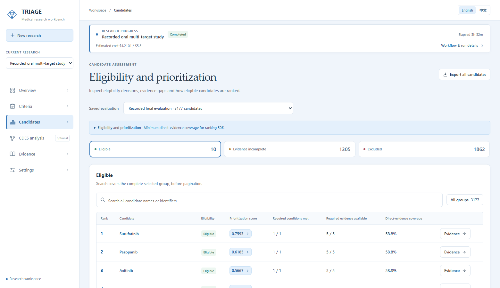
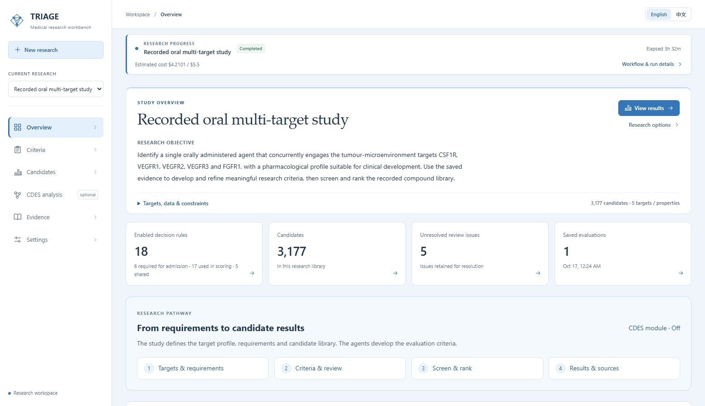
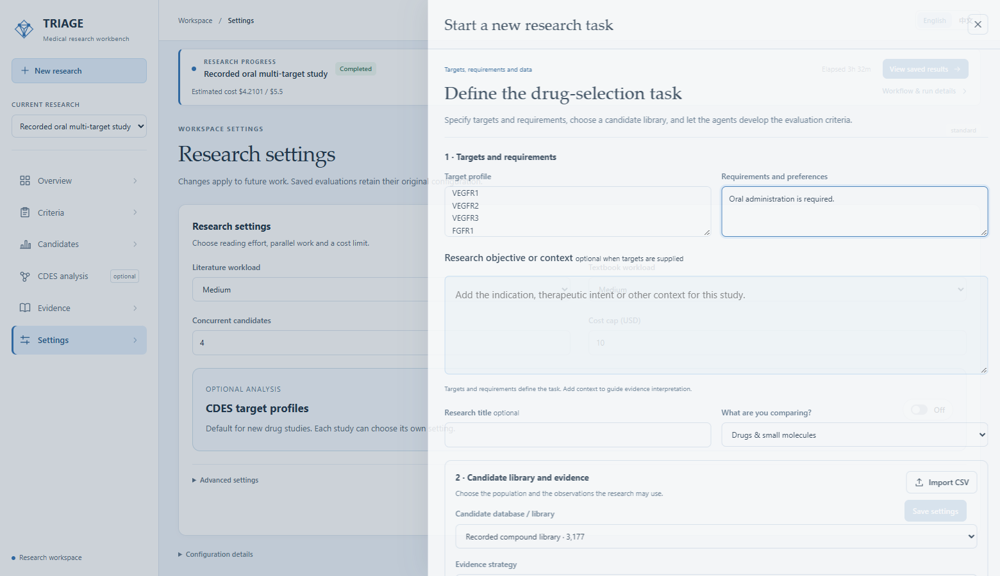
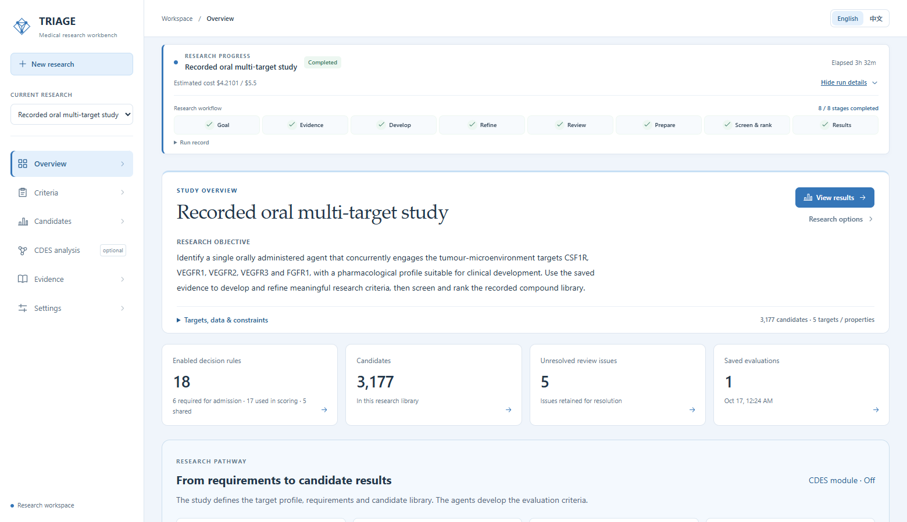
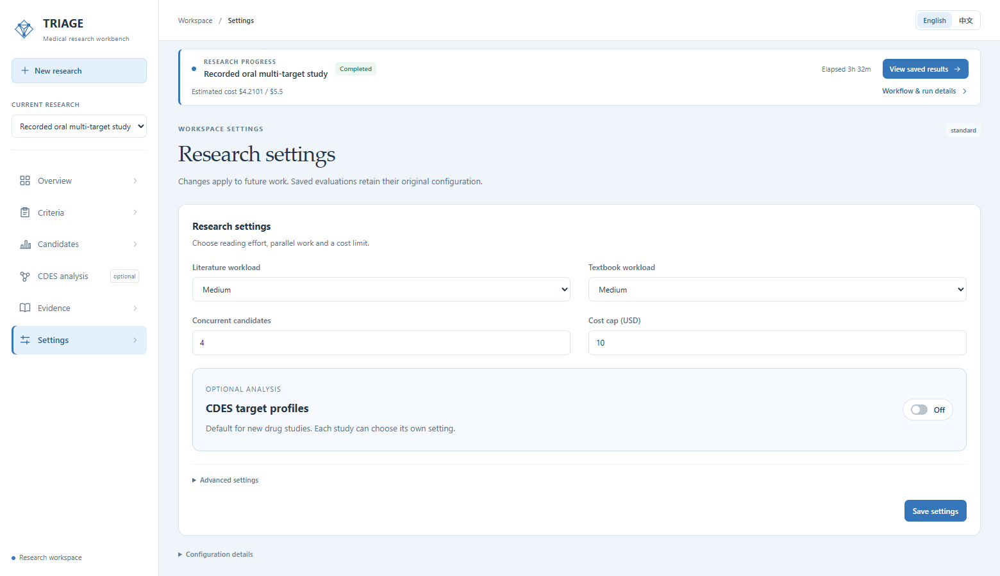
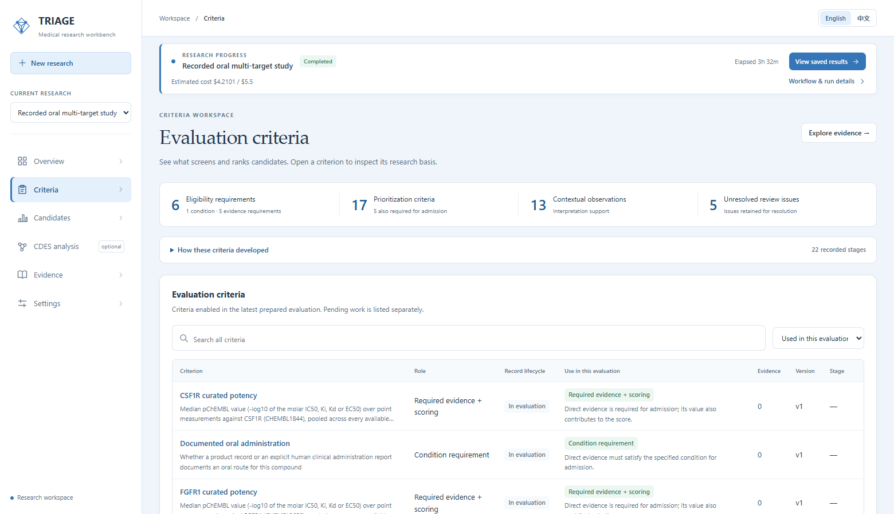
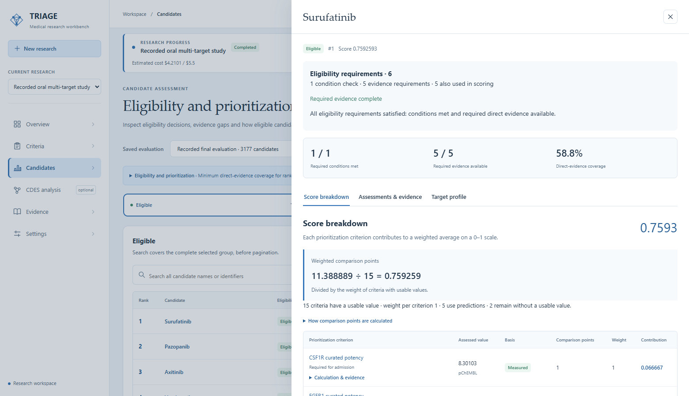
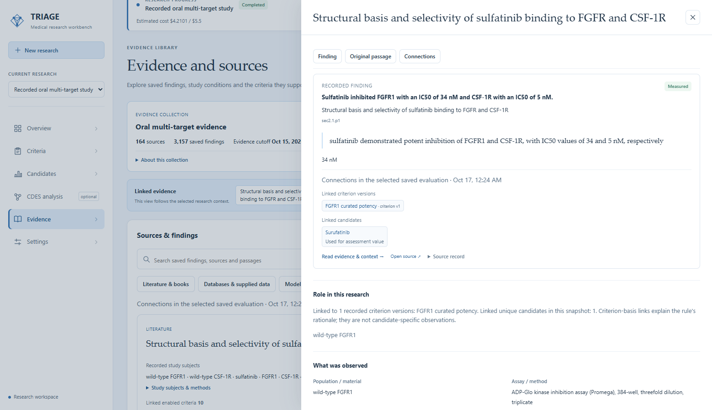
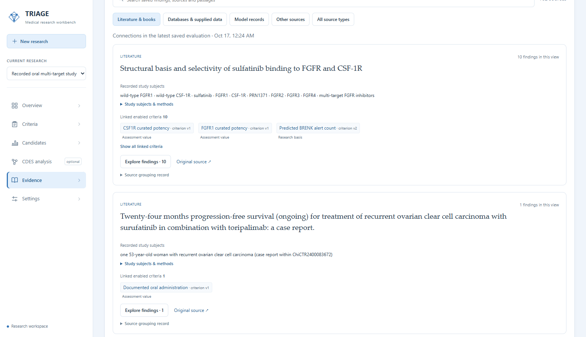

# Current interface and results

[中文](zh/current-status.md) · [Tutorial](tutorial.md) · [Presentation](presentation/README.md) · [Screenshot manifest](assets/current/manifest.json) · [Verification data](reference/current-ui-validation.json)

The screenshots were captured on **2 November 2026** in Microsoft Edge on Windows, using the updated 1.1.0 workbench. They show the saved public study and current task controls. Eight views were refreshed after the wording review in `12acd15`; the manifest identifies each image's source version. The result and response checks below were measured at `d81dd77`.

## Current study results

| Item | Current value |
|---|---:|
| Candidate library | 3,177 |
| Eligible | 10 |
| Evidence incomplete | 1,305 |
| Excluded | 1,862 |
| Eligibility requirements | 6 |
| Scoring criteria | 17 |
| Criteria shared by eligibility and scoring | 5 |
| Unique evaluation criteria | 18 |
| Contextual observations | 13 |
| Retained items outside this evaluation | 22 |

The six eligibility requirements comprise oral administration and direct quantitative observations for five required targets. These five target criteria also contribute to scoring: **6 + 17 − 5 = 18 unique criteria**. The retained set contains 53 items; 31 are assessed, including 13 contextual observations.

Surufatinib ranks first among the ten eligible candidates. Its score is 0.7592592593, averaged over 15 available scoring values. Direct evidence coverage is calculated separately as 10/17 (58.8%). Five ADMET predictions contribute to the score; the ten direct values comprise five target observations and five structure-derived values.

In this case, the 1,305 Evidence incomplete candidates have partial support for the required evidence. The 1,862 Excluded candidates have no usable admission support after the required assessments are complete. [Decision definitions](reference/decision-language.md) explain the task-defined rules, including exclusion after a confirmed condition failure.

The [full browser export](../examples/oral-multitarget/latest/selection/workbench-export.csv) contains all 3,177 candidates. Its `selection_decision` field matches these groups. Earlier raw fields remain in the export for tracing the recorded snapshot; use the current selection field for reporting.

## Task, progress and evidence

The overview connects the selected question, criterion development and candidate results. **New research** foregrounds targets and requirements, with optional context, library and evidence choices. **Research options → New study with this setup** reuses the selected inputs and begins a fresh criterion set.

Expand **Workflow & run details** to see the saved stage record. The displayed study has completed 8/8 stages. Its recorded elapsed time is about 3 hours 32 minutes and estimated model cost is USD 4.2101472 against a USD 5.50 cap. These are saved study measurements. The current Settings screenshot configures subsequent work at Medium, four workers and a USD 10 cap.

**CDES target profiles** is optional. Settings provides the default for new drug studies; task setup selects its collection and adds an analysis stage after screening. The current adapter reads supplied results, links the study’s own activity and ranking, and provides prediction-source exports. See [the target-driven workflow](target-workflow.md) and [CDES component](components/structure-predictions.md).

The Criteria page shows expansion and refinement alongside the final roles. A criterion opens its definition, changes, lineage and sources.

The score panel separates eligibility, scoring contributions and evidence coverage. Evidence details connect findings to the candidate and criterion that use them. The library groups findings by source; preserved excerpts and conditions accompany the source links.

Further views: [Evidence selection](assets/current/evidence-selection.png), [expanded findings](assets/current/evidence-findings.png), [criterion lineage](assets/current/criterion-lineage.png), [criterion changes](assets/current/criterion-changes.png), [candidate evidence](assets/current/candidate-details.png), [coverage calculation](assets/current/score-coverage.png), [Evidence incomplete](assets/current/candidates-incomplete.png), [Excluded](assets/current/candidates-excluded.png), [Chinese interface](assets/current/candidates-zh.png) and [CSV preview](assets/current/csv-import.png). The CSV preview uses two explicitly synthetic carrier records and was checked before import.

## Current response measurements

Measured on Windows with Python 3.14.2, using the restored public study after the query index was ready. Each resource received 20 serial local HTTP requests. Times include the response and JSON decoding; cold indexing, browser painting and research/model execution have separate durations.

| Read request | Median | P95 |
|---|---:|---:|
| Overview | 56.41 ms | 69.99 ms |
| Criteria, page size 50 | 189.98 ms | 233.79 ms |
| Eligible candidates, page size 50 | 22.21 ms | 32.79 ms |
| Literature sources, page size 20 | 7.10 ms | 21.59 ms |
| Candidate score details | 27.77 ms | 39.50 ms |

The [verification record](reference/current-ui-validation.json) contains the routes, sample counts, candidate totals and CSV hash. The [screenshot manifest](assets/current/manifest.json) records each image's source URL, capture time, dimensions and checksum. Dated release notes retain their original validation history and link here for the current display.
