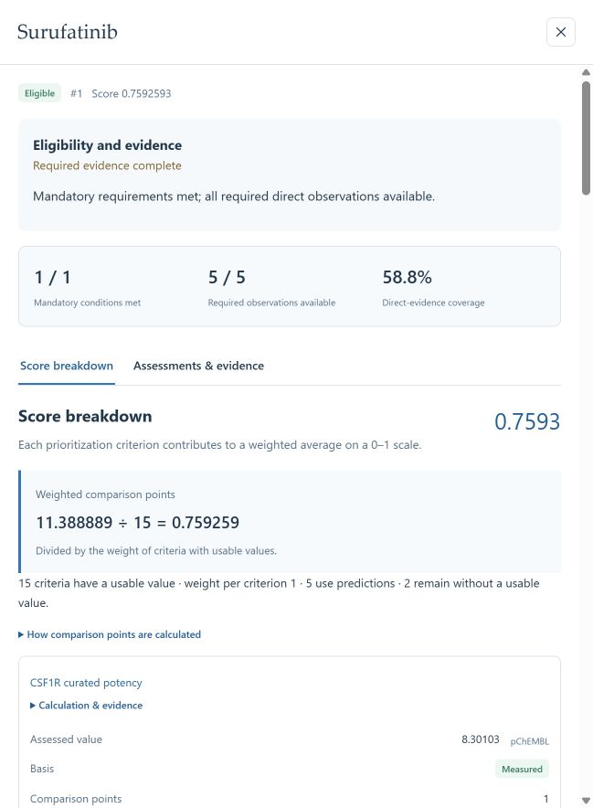

# Workbench terminology and selection update, 26 October 2026

[System and study alignment](../reference/system-alignment.md) · [Decision definitions](../reference/decision-language.md) · [English tutorial](../tutorial.md) · [中文教程](../zh/tutorial.md)

The workbench uses TRIAGE as its product name and aligns the main workflow with criterion generation, eligibility screening and weighted prioritization. Research objectives, candidate types, requirements and evidence policies remain task-configurable.

## Changes

- Share candidate-selection decisions between newly published snapshots and workbench result readers. Each decision contains its policy, specific reason and affected requirement references.
- Display Eligible, Evidence incomplete and Excluded, with green, amber and red indicators. Keep required-work errors and framework readiness visible as operational states.
- Explain each criterion outside the active evaluation: scoring definition, review, unit conversion, alternative policy or unfinished proposal.
- Use the selected evaluation's exact rule assessment for evidence explanations and its frozen framework for criterion-use details.
- Display deterministic descriptors as calculated where their current evidence definitions specify derived values. Preserve recorded names in details.
- Publish bilingual decision definitions, a terminology catalog, a general figure specification and a complete current selection table.

## Correspondence with the recorded study

The workflow and quantities agree: 1,917 expanded working items; 53 retained items; 18 enabled decision rules comprising one mandatory requirement and 17 prioritization criteria; 13 contextual observations; 22 items outside the evaluation; 3,177 candidates; ten eligible candidates; Surufatinib rank 1 with direct coverage 10/17.

The current selection policy refines the historical 3,167 pending records into 1,305 Evidence incomplete and 1,862 Excluded for no admission support. The [alignment document](../reference/system-alignment.md#classification-version) defines this version change. Scientific observations, thresholds, weights and saved ranks retain their values.

## Validation

| Check | Result |
|---|---|
| Decision semantics, read model and qualification checks | 64 passed for this implementation, including a carrier task, rule-specific reasons, cache backfill and staged/full agreement. |
| Additional UI, portable reproduction and workflow checks | 39 passed before publication. |
| Display aliases, score details and related read checks | 41 previously passed; these overlap the read-model checks above. |
| Frontend production build | Passed TypeScript validation and Vite build. |
| Running workbench API | Overview, criterion history/sources, candidate details, evidence list, search, snapshots and complete 3,177-row CSV passed. |
| Latest-study selection and CSV | 10 Eligible, 1,305 Evidence incomplete, 1,862 Excluded; selection reasons and totals agree. |
| Browser | Group names, red Excluded indicator, criterion-use reasons and Surufatinib score details verified. The page shows 11.388889 / 15 = 0.759259 and direct coverage 10/17. |
| Frozen result integrity | All 28 result files checked against the published manifests. |

This update uses the retained study for numerical checks and synthetic tasks for general decision behavior. It performs no new literature retrieval or paid model investigation.

