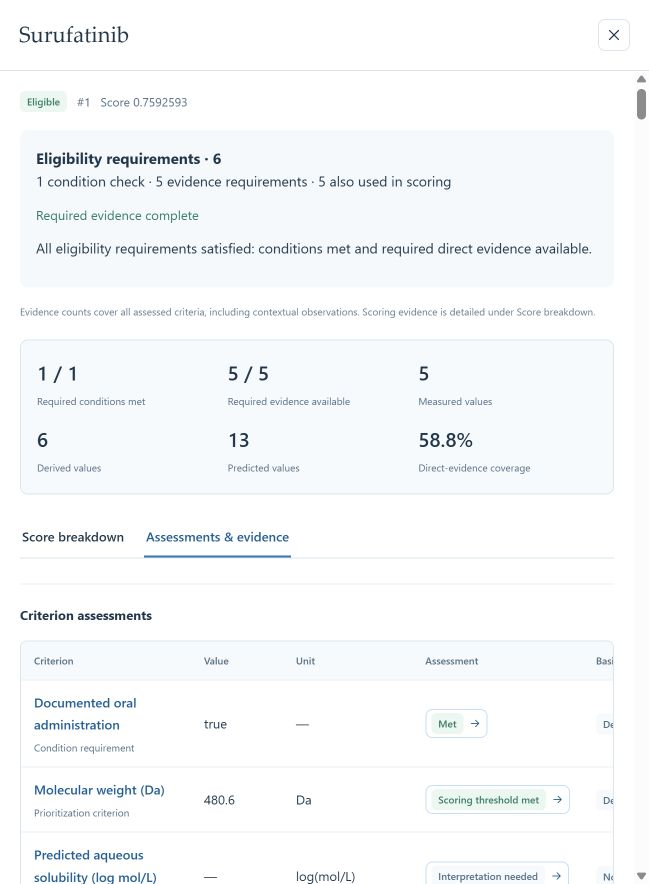

# Workbench terminology and selection update, 26 October 2026

[System and study alignment](../reference/system-alignment.md) · [Decision definitions](../reference/decision-language.md) · [English tutorial](../tutorial.md) · [中文教程](../zh/tutorial.md)

The workbench uses TRIAGE as its product name and aligns the main workflow with criterion generation, eligibility screening and weighted prioritization. Research objectives, candidate types, requirements and evidence policies remain task-configurable.

## Changes

- Share candidate-selection decisions between newly published snapshots and workbench result readers. Each decision contains its policy, specific reason and affected requirement references.
- Display Eligible, Evidence incomplete and Excluded, with green, amber and red indicators. All admission requirements must be satisfied for Eligible. Partial support without a confirmed condition failure yields Evidence incomplete; a confirmed condition failure or completed zero-support assessment yields Excluded. Required-work errors and framework readiness remain separate operational states.
- Present condition requirements and evidence requirements under Eligibility requirements. Both are compulsory. Show overlapping admission and scoring uses from each frozen task version.
- Allow new evaluations with bound evidence requirements alone, condition requirements alone, or both. Empty or unresolved requirement definitions remain not ready; historical replay and resume retain their recorded readiness policy.
- Explain each criterion outside the active evaluation: scoring definition, review, unit conversion, alternative policy or unfinished proposal.
- Use the selected evaluation's exact rule assessment for evidence explanations and its frozen framework for criterion-use details.
- Display deterministic descriptors as calculated where their current evidence definitions specify derived values. Preserve recorded names in details.
- Publish bilingual decision definitions, a terminology catalog, a general figure specification and a complete current selection table.
- Update both publication figures in their accepted layouts. Eligibility, scoring overlap, candidate counts and ranking coverage now match the workbench. Provide native editable PowerPoint, vector PDF/SVG and 600 dpi PNG.
- Label candidate evidence totals as all assessed criteria, including contextual observations. Score details and the result figure report the scoring subset. Complete, partial and failed evidence labels use the corresponding green, amber and red colors.

## Correspondence with the recorded study

The workflow and quantities agree: 1,917 expanded working items; 53 retained items; 18 unique enabled decision rules serving six eligibility requirements and 17 prioritization criteria, with five shared target criteria; 13 contextual observations; 22 items outside the evaluation; 3,177 candidates; ten eligible candidates; Surufatinib rank 1 with direct coverage 10/17.

The current selection policy refines the historical 3,167 pending records into 1,305 Evidence incomplete and 1,862 Excluded for no admission support. The [alignment document](../reference/system-alignment.md#classification-version) defines this version change. Scientific observations, thresholds, weights and saved ranks retain their values.

## Validation

| Check | Result |
|---|---|
| Decision semantics, qualification, read model and score details | 75 passed in the final publication check, including evidence-only tasks, overlap counting, frozen scope, missing required evidence and historical compatibility. |
| Reproduction and workflow compatibility | Previously passed checks remain valid; the bound policy preserves historical replay and resume. [Verification record](../reference/admission-roles-verification.json). |
| Frontend production build | Passed TypeScript validation and Vite build. |
| Running workbench API | Overview, criterion history/sources, candidate details, evidence list, search, snapshots and complete 3,177-row CSV passed. |
| Latest-study selection and CSV | 10 Eligible, 1,305 Evidence incomplete, 1,862 Excluded; selection reasons and totals agree. |
| Browser | Group names, red Excluded indicator, criterion-use reasons and Surufatinib score details verified. The page shows 11.388889 / 15 = 0.759259 and direct coverage 10/17. |
| Frozen result integrity | All 14 currently published result files checked against the latest-study manifest. |
| Figure layout and editing | Both native PowerPoint files opened with zero text overflow, raster objects or gradients. The wording pass preserves workflow shape geometry and result diagram geometry. [Figure validation](../figures/current/validation.json). |
| Presentation notes | Slides 24 and 28 use the current requirements and classification. Historical screenshots are identified; slide and media bytes are unchanged. |

This update uses the retained study for numerical checks and synthetic tasks for general decision behavior. It performs no new literature retrieval or paid model investigation.

[Current workflow and result figures](../figures/current/README.md) · [Reconciled revision brief](../figures/revision-plan.md)

