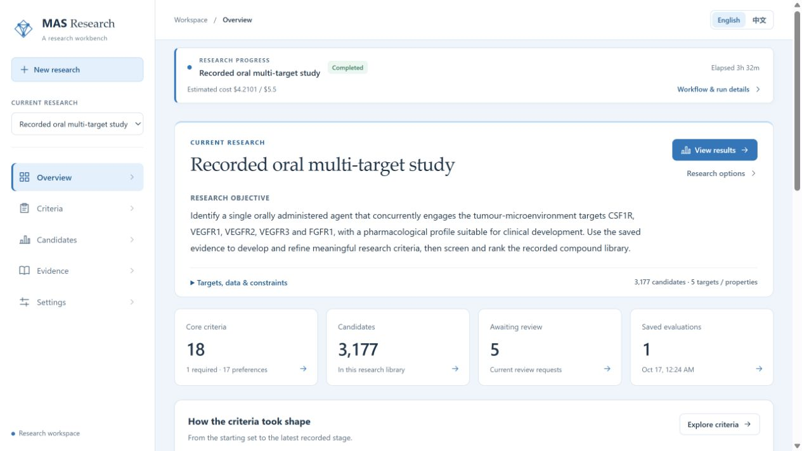
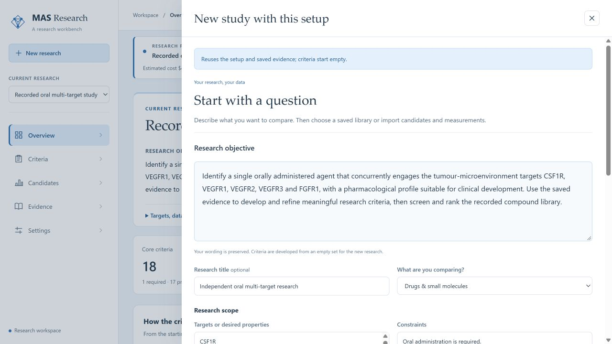
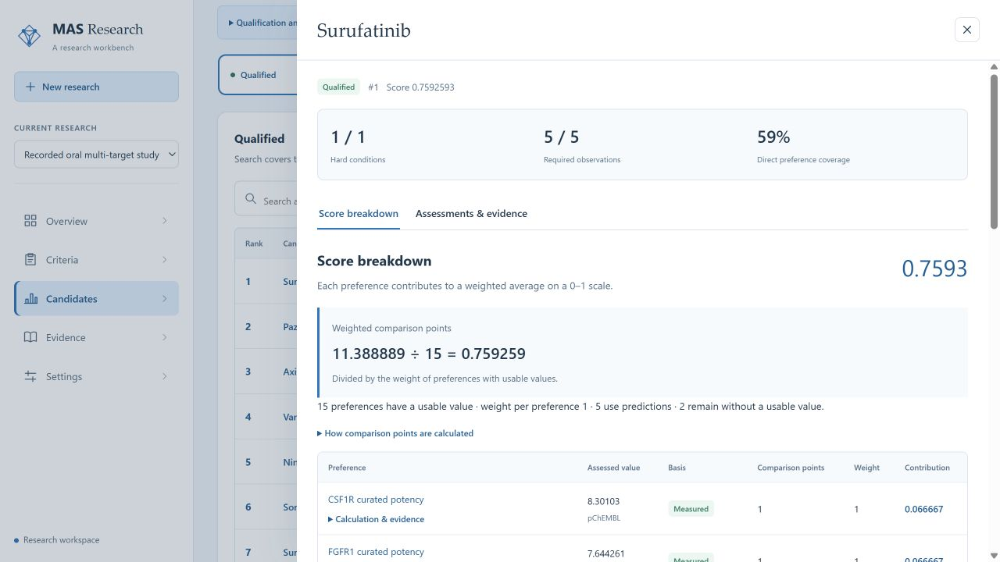

# MAS v1.1.0

v1.1.0 makes the published oral multi-target example usable from a fresh checkout. It adds an agent runner, a portable research capsule, practical component tutorials and a simpler workbench layout.

## Start with the result, then change the question

```sh
python scripts/agent_run.py replay --bootstrap --workspace var/agent-replay --open
```

This downloads the optional capsule, validates its hash, restores the selected records and recalculates qualification, preference scores and ranking. The workbench opens with the restored case. The [English](../agent-run.md) and [Chinese](../zh/agent-run.md) guides also cover fresh CQA generation, custom task JSON, candidate and measurement CSVs, model settings, resume and complete export. New investigations default to mid workload, four workers and a USD 10 cap.

The [component walkthrough](../component-walkthrough.md) follows all twelve component groups through the saved case. It explains each component's inputs, behavior and output, then gives executable inspections and examples of changing the objective, hard/soft requirements, data, evidence and tool bindings. A [Chinese edition](../zh/component-walkthrough.md) provides the same sequence.

## What changed in the workbench

The overview leads with the selected research objective and a single results action. Editing, copying the setup and changing data sit under Research options. Completed progress collapses into one status strip; the full stage record remains available. Criterion counts distinguish the 18 core rules from the 13 context observations.

Criterion details provide section navigation and readable cutoffs. Links between score contributions, criteria and source findings carry the selected task and saved evaluation. Opening a criterion's evidence starts with its literature; database and model observations have separate source tabs. Evidence collection metadata shows the source count, finding count and cutoff; extended metadata is expandable. Prepared evidence collections appear once in the source picker and do not clutter the research-task selector.







These screenshots were captured in the Windows in-app browser from an independent restored workspace. They show the recorded study and the prepared new-study form; opening that form did not start a model run.

## Reproduction data and meaning

Version note: this release records the original qualification fields. The [26 October reporting policy](../reference/system-alignment.md#classification-version) retains those fields and displays **10 Eligible, 1,305 Evidence incomplete and 1,862 Excluded**. Its 18 unique decision rules serve six admission requirements and 17 scoring criteria, with five shared target criteria. The release screenshots retain their original interface labels.

The optional release asset is `oral-multitarget-latest-v1.jsonl.gz`, 168,065,291 bytes, SHA-256 `1a9b068613a32178e4ea0e62ad48d3086f249d4b5e995041a5b671096dcce3fd`. The [manifest](../../examples/oral-multitarget/latest/reproduction/manifest.json) and [capsule documentation](../../examples/oral-multitarget/latest/reproduction/README.md) describe the exact inputs and exclusions. The source checkout remains separate from this download.

The capsule supplies 3,177 candidates, 98,487 recorded assessment cells, 31 frozen evaluation rules, 3,157 generation facts from 164 sources, 68,886 historical tool facts and the recorded descriptor/prediction caches. Original event identities, row order and record hashes are preserved. Full texts, model traces, credentials, evaluator-only material and the private source database are excluded. The earlier unranked snapshot remains a historical artifact; its unavailable original publication event is not reconstructed.

An independent source prepared from these facts starts with zero CQA. A new model investigation creates its own trajectory and result. Recorded replay instead checks the frozen assessments through the current production engine. It reproduces Surufatinib at rank 1 of 10 qualified candidates, score 0.7592592592592593 and direct preference coverage 10/17; the other 3,167 candidates remain pending evidence.

## Validation

The complete `agent_run.py replay` entry point was executed against a newly created Windows workspace. All 3,177 candidate entries and 98,487 assessment cells matched the saved result, with zero differences. The `plan` command then reused the import and confirmed 3,157 fixed facts, 164 sources, 68,886 tool facts and zero starting CQA. These commands made no model or retrieval calls.

Browser verification covered the overview, expandable completed progress, new-study setup, the prepared evidence selector, candidate score details and links from score to criterion to evidence. The capsule's [verification record](../../examples/oral-multitarget/latest/reproduction/verification.json) separately records the underlying import, input closure and engine replay checks. The complete new model investigation was not rerun for this release.

The offline suite passed **692 tests**, with **15 live tests deselected**. TypeScript checking and the production frontend build passed. Exporting the restored study produced 3,177 CSV rows matching the final snapshot. The publication check verified local documentation links, coordinated versions, capsule identity, all 28 frozen result files, comparison inputs and the presentation hash. The [validation record](v1.1.0-validation.json) separates these checks from the original research and the earlier capsule verification.

Linux CI exposed two existing tests that assumed an order among randomly generated criterion IDs. They now match complete group membership and bind revision decisions to the actual input criterion, while retaining the merge, withdrawal and refusal assertions. All 79 tests in the affected files passed locally. The scoring and derivation implementations were unchanged by this correction.

Package, frontend and documentation checks are also part of [CI](../../.github/workflows/ci.yml). Original research exports, the eleven-row CQA comparison and the presentation retain their validated hashes. The general component scope remains as documented in the [architecture](../architecture.md).
