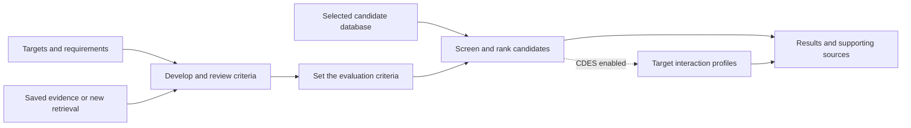

# Target-driven drug selection with optional CDES analysis

[中文](zh/target-workflow.md) · [User guide](user-guide.md) · [CDES results and interface](components/structure-predictions.md)

A study supplies a target profile, requirements and a candidate library. TRIAGE develops evaluation criteria from evidence, applies the task requirements, and compares eligible candidates. The target list, administration requirements and candidate population belong to that study.

The Proposer develops criteria, the Critic examines their relevance and evidence, and the Adjudicator resolves disagreements and compatible combinations. Administration-related research dimensions follow the stated requirements. A study without an oral requirement uses a general administration-suitability dimension; an explicit route requirement remains bound to its own meaning.

## Starting a study

1. Open **New research** and enter the targets and requirements. Additional objective text is optional when targets are supplied. The form shows the resulting task summary before launch.
2. Select a candidate database or library. Choose **Search and read new evidence** for a new retrieval study, or **Use saved or uploaded evidence** to use the selected collection. Uploaded-data studies use their supplied observations.
3. Choose whether to include **CDES target profiles**, then inspect the planned workflow.
4. Start the study. Criteria are developed, reviewed and fixed before candidate assessment. CDES appears as an additional progress stage only when enabled.

**Settings → CDES** controls the default for new drug studies. The initial default is off. Each study can override that choice and select its prediction collection. For a completed study with an attached collection, the **CDES analysis** page can turn its analysis view off and on while preserving the saved data.

## What CDES contributes

CDES supplies structure-based interaction scores for compound–target pairs. These profiles appear alongside recorded activity, the eligibility decision and the overall evaluation. The current implementation reads supplied result collections. Each collection exposes its available targets and compound population.

New studies pin the selected collection and bind it to their own targets and evaluation snapshot. Their measured values, units, scores and ranks come from that study. Only the requested targets are included. Missing target or compound coverage is reported with the module outcome. The main evaluation remains available when the optional collection cannot cover the study.

The CDES switch controls this target-profile module. Other criteria, including ADMET-related criteria, continue to use the sources defined in their evaluation framework. The current CDES module contributes a separate analysis; the fixed eligibility and weighted ranking retain their own definitions.

## Implementation and deployment boundary

- Study input adds `cdes_enabled` and `cdes_source_id`; the workflow pins the collection identity and checksum before starting.
- The optional `cdes` stage runs after screening and before result delivery. Its status and linked-pair count are stored with the workflow.
- Shared collection storage and snapshot binding live in the prediction adapter. The workbench reads these results through its existing task APIs.
- `InteractionScorer.predict_pairs()` accepts compound identity, SMILES, target UniProt and protein sequence. `SavedResultScorer` provides the current implementation. A deployed predictor can implement the same boundary later.

The saved oral multi-target example retains its original results. Its five targets, six eligibility requirements and 17 scoring uses describe that example; new studies develop their own evaluation framework.
