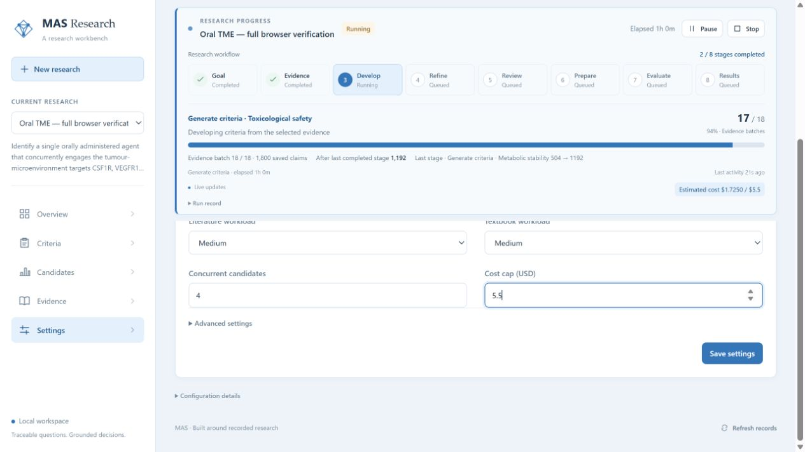
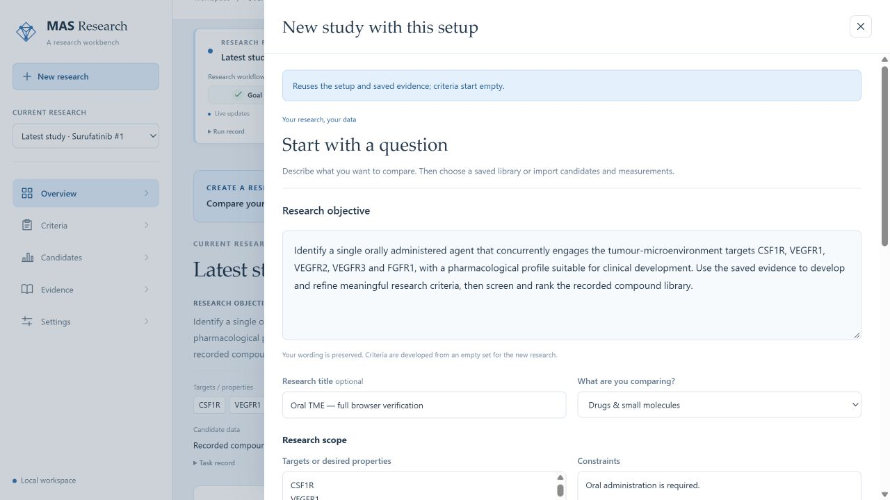
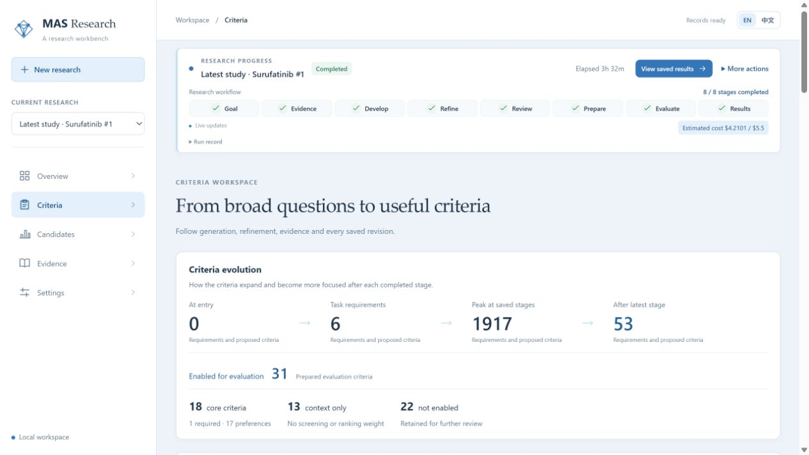
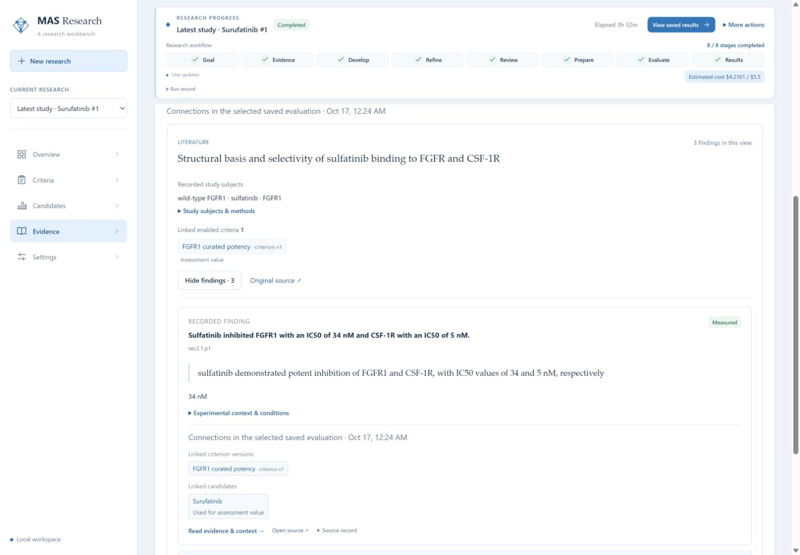
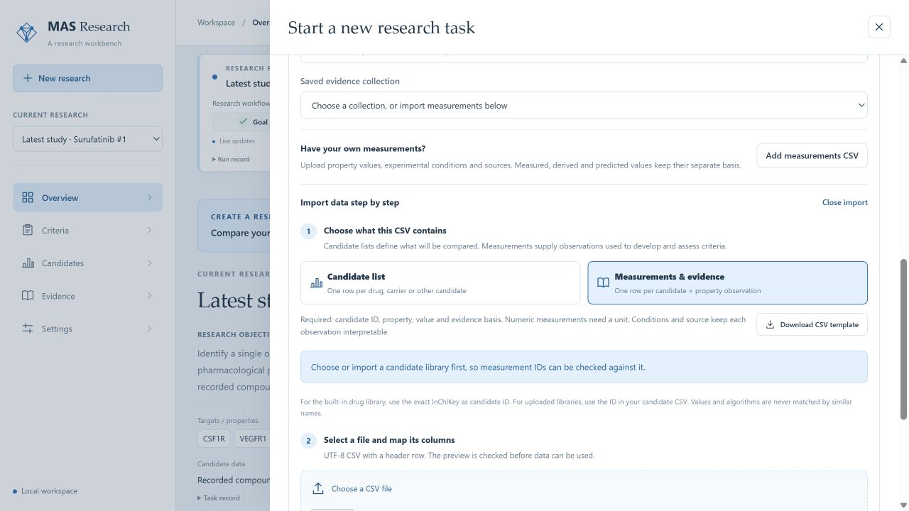

# Tutorial: from a research question to an inspectable result

[中文](zh/tutorial.md) · [Install](installation.md) · [Configuration](configuration.md) · [Published example](../examples/oral-multitarget/README.md)

This walkthrough follows the latest completed oral multi-target study: what the researcher enters, what each agent or tool does, and how the result can be inspected. The saved study developed **18 core rules** and ranked Surufatinib **first among 10 qualified candidates**, score **0.7592592592592593**. Its complete export contains **3,177 candidates**; **3,167 remain pending evidence**.

| Your starting point | Route through this tutorial |
|---|---|
| Fresh clone; inspect the example | Read frozen exports and screenshots. Step 0 needs only Python and makes no model requests. |
| Local workspace containing the original inputs | Inspect the saved study, or create a new study using its library and evidence collection. Steps 1–11 explain the recorded workflow and controls. |
| Fresh clone; conduct your own research | [Install and configure MAS](installation.md), initialize an empty workspace, then follow step 12 with your own CSV data. |

The repository contains frozen exports, not the approximately **5.5 GiB private SQLite research store**, its full literature inputs, credentials, or a restored live study. Copying result JSON into a workspace does not populate the workbench or recreate the inputs. The screenshots document the saved local study. A new model run is a new experiment and can produce different criteria and results.

## 0. Inspect the published result without starting a workflow

Open [report.md](../examples/oral-multitarget/latest/results/report.md), [task.json](../examples/oral-multitarget/latest/results/task.json), [candidates.csv](../examples/oral-multitarget/latest/results/candidates.csv), and [surufatinib.json](../examples/oral-multitarget/latest/results/surufatinib.json). The report is the recorded run export; this tutorial supplies the English explanation.

From the repository root, these PowerShell commands use Python's standard library:

```powershell
python -c "import csv,collections; from pathlib import Path; rows=list(csv.DictReader((Path('examples/oral-multitarget/latest/results')/'candidates.csv').open(encoding='utf-8-sig',newline=''))); print('Exported candidates:',len(rows)); print('Qualification:',dict(collections.Counter(r['qualification'] for r in rows)))"
python -c "import json; from pathlib import Path; r=json.loads((Path('examples/oral-multitarget/latest/results')/'surufatinib.json').read_text(encoding='utf-8'))['matches'][0]; print('Rank:',r['rank'],'Score:',r['score'],'Direct preference coverage:',r['preference_coverage'])"
```

The saved output is **3,177 rows**, `qualified: 10`, `pending: 3167`, rank `1`, score `0.7592592592592593`, and coverage `0.5882352941176471`. These commands inspect existing results; they do not screen candidates or restore the database.

## 1. Open Settings and record the run envelope

After completing [installation and provider configuration](installation.md), start your workspace:

```powershell
.\start_workbench.cmd -Store var\workspace\store -InitializeStore -Models var\workspace\store\models.toml -Config var\workspace\store\mas.toml -AllowOperations
```

This assumes the model/settings files have been copied and configured as described in the installation guide. Open [the workbench](http://127.0.0.1:8769/workbench/) and choose **Settings**. For an existing workspace, supply its actual store/configuration paths.

Set both workload controls to **Medium** (`mid`), concurrency to **4**, and choose **Save settings**. Current labels are **Literature workload** and **Textbook workload**; historical screenshots may use earlier workload wording. Settings apply to subsequent work; saved studies retain their original configuration.

| Setting | Latest saved study | New-task example/default |
|---|---:|---:|
| Workload | `mid` | `mid` |
| Concurrent candidates | 4 | 4 |
| Cost cap | **USD 5.50** | **USD 10.00** |
| Evidence mode | Saved evidence only | Select actual saved/uploaded inputs or explicit retrieval |
| Evaluation | Staged screening | Staged screening |

Use 5.50 to repeat the historical envelope with the same local inputs, or choose the budget appropriate to your new investigation. The saved workflow records **USD 4.2101472 estimated model cost**, not a final supplier invoice. Its historical model identity is `deepseek-v4-flash`; configuring a provider for new work does not change that identity.



This screenshot was captured during the historical run, not before launch. English / 中文 changes interface display; research records and source text retain their recorded language.

## 2. Create the task and state the decision precisely

Choose **New research**, select **Drugs & small molecules**, and use this exact saved objective when following the case:

```text
Identify a single orally administered agent that concurrently engages the tumour-microenvironment targets CSF1R, VEGFR1, VEGFR2, VEGFR3 and FGFR1, with a pharmacological profile suitable for clinical development. Use the saved evidence to develop and refine meaningful research criteria, then screen and rank the recorded compound library.
```

Enter these under **Targets or desired properties**, one per line:

```text
CSF1R
VEGFR1
VEGFR2
VEGFR3
FGFR1
```

Under **Constraints**, enter:

```text
Oral administration is required.
```

The saved title is `Oral TME — full browser verification`. Under **Evaluation options**, choose **Use saved or uploaded evidence**, **Staged screening**, and reference candidate `Surufatinib`. The reference is disclosed for outcome comparison and adds no ranking weight. The task records exposure; this study is not described as blind discovery.

The researcher defines the objective and requirements. The task-normalization role converts them into a versioned English task with explicit target identities and a route constraint. It does not require the researcher to supply the final CQA list. If an essential requirement cannot be bound to a property, unit or conditions, answer the focused clarification presented by the workflow.



This screenshot reopens the saved configuration. The completed-study background is expected; opening it did not launch another run.

## 3. Bind candidates and evidence separately

In **Candidates & evidence**, select the recorded library of **3,177 compounds** (`universe_chembl.json` in the historical workspace). Select the collection of **3,157 retained facts from 164 sources**, with displayed evidence cutoff **15 October 2026**. Its source task is `task_01M51AQ0JK0MYN47806ZD5XS1B`.


The library fixes who can be evaluated; the collection fixes which saved material informs criterion development. Collection names/descriptions are display metadata. The counts above refer to the fixed input manifest, not all historical tool observations used during candidate assessment.

The controller pins admitted facts and copies **no existing criteria**. In this run, generation excluded **136 facts explicitly naming the reference candidate**, leaving **3,021** proposal inputs. That exclusion applies to generation; candidate assessment later follows the common frozen policy. The reference identity remained disclosed.

In a fresh workspace, these selectors are empty until you provide inputs. Frozen exports are not an import bundle for the collection. With the original local workspace, keep its uploads, workflow records and source dependencies beside the store; choose **New study with this setup** to start a fresh task. Without those local inputs, use your own CSVs in step 12.

## 4. Start once and interpret progress

Check the population, evidence mode and cap, then choose **Start research**. This starts the configured workflow and can make paid provider requests. **Save draft** only saves the form.

The controller coordinates task understanding, evidence preparation, discovery, refinement, decision resolution, freezing, screening and publication. Existing-only evidence preparation reuses bound facts; it does not imply another literature search or full-text pass.

The **proposer** writes evidence-backed candidates. The **critic** challenges relevance, definitions, thresholds and counter-evidence. The proposer responds with revisions, and the **adjudicator** handles merges/disputed decisions under the recorded policy. The controller manages transitions and termination; tools supply recorded observations for assessment. Role separation does not by itself mean independent model providers.

Read the active phase, actor, batch progress, spend estimate and pause/stop controls. **17/18 batches** is local stage progress, not 94% of the research; **2/8 phases** is not 25% of elapsed time. Answer focused questions if they arise. The saved case has no outstanding question.

## 5. Follow expansion and three refinement rounds

Open **Criteria** and its stage/history views. The working-item trajectory was:

```text
0 → 6 task requirements → 293 → 504 → 1,192 → 1,917
  → 147 after round 1 → 68 after round 2 → 53 after round 3
```

The six starting requirements are the five target potencies and documented oral administration. Four proposal dimensions then expand target coverage, oral properties, metabolic stability and safety. These counts include registered items plus unregistered working proposals; they are not final scoring-rule counts.

| Stage | What agents do | Count after stage |
|---|---|---:|
| Bind task requirements | Preserve the five targets and oral condition | 6 |
| Propose target coverage | Expand target-related quantities | 293 |
| Propose oral properties | Expand absorption/exposure quantities | 504 |
| Propose metabolic stability | Expand disposition/interaction quantities | 1,192 |
| Propose safety | Expand safety quantities | 1,917 |
| Round 1: filter → distill → refine → merge | Check evidence, clarify quantities, respond to findings, merge duplicates | 1,373 → 1,337 → 291 → 147 |
| Round 2: same sequence | Revise support and consolidate | 109 → 97 → 78 → 68 |
| Round 3: same sequence | Address remaining definitions and duplicates | 63 → 62 → 53 → 53 |

Read each change's reason and parent records. A merge preserves its inputs; removal records why an item was withdrawn. [stages.json](../examples/oral-multitarget/latest/results/stages.json) and [source-cqa-history.json](../examples/oral-multitarget/latest/results/source-cqa-history.json) retain the actual transitions.



## 6. Open molecular weight and follow its lineage

Search **Molecular weight (Da)** in **Criteria**. Open **Lineage**, version history, the rule and linked evidence. In round 2, six proposals were merged because they measured the same structure-derived molecular weight through the same descriptor route and agreed on the lower-better direction. Da and g/mol describe the same molecular-mass scale here. The merged item retained six parents and median aggregation.

The round-3 critic challenged the counter-evidence support. The proposer added the Lipinski/small-molecule kinase-inhibitor discussion and recorded the interpretation of the **500 Da heuristic**. The working lineage is `cri_01M52KSFQBB9B84Y16HNPGBCM2@v1 → @v2 → @v3`, promoted to `attr_molecular-weight-da@v1` and `rule_molecular-weight-da@v1`.

The final rule is a **threshold preference, molecular weight ≤ 500 Da**. Meeting it gives its comparison point; exceeding it affects this preference but does not independently hard-reject a compound. Two compounds both below 500 Da do not receive different points from this threshold. Surufatinib's recorded value is **480.6 Da**, with a declared derived basis.

This connects six proposals, a merge, a criticism, a revision and an executable rule. The final criterion name alone would conceal the reasoning.

## 7. Freeze rules and separate core, context and unresolved items

Before screening, **Save evaluation rules** fixes versions, accepted routes, evidence scope and comparison policy. The final saved evaluation uses **`rules@v2`**.

| Final working population | Count | Use |
|---|---:|---|
| Enabled hard condition | 1 | Documented oral administration |
| Enabled preferences | 17 | Ranking, including five target potencies |
| Enabled exploratory context | 13 | Interpretation without ranking weight |
| Registered but deferred | 14 | Unresolved/non-executable rules withheld from evaluation |
| Unregistered pending proposals | 8 | Working items outside the registered evaluation set |

Therefore **53 = 18 core + 13 context + 22 not enabled**, while **31 = 18 + 13** enter assessment. The five unresolved reviews are a subset of deferred items, not five additional criteria. An unresolved logP range proposal is distinct from the enabled continuous RDKit logP preference.

Eligibility requires direct observations for all five required targets. This task did not add a common potency cutoff that every target must exceed. Predictions retain their basis and do not independently hard-exclude candidates or increase direct-evidence coverage.

## 8. Assess candidates and retain the first outcome

Open **Candidates**. Staged mode checks hard conditions first and records downstream skips after hard failure. The saved run had **no explicit hard failure**, **0 skipped-after-rejection cells**, and **98,487 records = 3,177 × 31**, including unknown states. A complete sweep does not mean every cell has evidence.

For Surufatinib, open **Evidence** and inspect qualification: oral condition **1/1 passed**, required targets **5/5 with direct observations**, and final direct preference coverage **10/17 = 58.82%**.

The first saved result had **6/17 = 35.29%** direct preference coverage, below the saved **50% ranking floor**, so Surufatinib had no rank. Investigation found existing facts were not fully reused, and four deterministic structural descriptors were classified as predictions: **RDKit logP, BRENK, NIH and PAINS alert counts**.

After correcting evidence reuse and basis classification, the system saved a new evaluation with **10/17** direct coverage. Cached facts were reused; this was not a new clinical experiment. Scientific thresholds, weights and coverage floors were retained. The eligible population was recomputed, so continuous preference points reflect the new qualified comparison set.

Snapshot `_1` (`rules@v1`) is the first outcome; `_2` (`rules@v2`) is the correction, linked by `parent_snapshot_id`. Their summaries remain in [overview.json](../examples/oral-multitarget/latest/results/overview.json). After a later data/implementation correction, re-evaluate into a new recorded result and retain the prior outcome.

## 9. Read the leaderboard and unpack the score

The qualified group contains **10 candidates**. Surufatinib ranks **1**, followed by Pazopanib and Axitinib. The remaining **3,167 are pending**, with **0 rejected** and **0 unassessed**. Missing from this leaderboard does not establish a hard-condition failure.


Click Surufatinib's **Score**. The drawer shows each value, basis, comparison point, weight and contribution:

```text
17 applicable preferences; 15 have values; weight 1 each
11.38888888888889 total comparison points ÷ 15 available weight
= 0.7592592592592593
```

Five target preferences, five structural calculations and five predictions supply the 15 values. Human measured oral F% and Tmax remain missing. Missing preferences are excluded from the score average but remain in the applicable coverage denominator: **15 for the score, 17 for coverage**. Predictions may contribute to score while contributing zero to the direct-coverage numerator.

Continuous preferences compare available values among qualified candidates, with better values receiving higher points and ties sharing the average position:

```text
d = [W + (E - 1)/2] / (N - 1)
```

N is the number with values, W counts worse values and E includes all ties, including this candidate. For BRENK, N=10, W=2, E=8, giving **0.611111** comparison points and `0.611111/15` total-score contribution. Threshold preferences use 1 when met and 0 when not met. Expand **Calculation & evidence** for the particular row's calculation.


## 10. Trace FGFR1 from score to source observations

From the FGFR1 score row choose **Open the evidence for this preference**, or select **FGFR1 curated potency** in candidate **Evidence**. Expand the grouped sources, individual findings and source context.

One linked paper reports **FGFR1 IC50 = 34 nM** at `sec2.1.p1`: *Structural basis and selectivity of sulfatinib binding to FGFR and CSF-1R*, DOI `10.1038/s42004-023-01084-0`. The saved record retains assay/construct details, including ADP-Glo kinase inhibition and the FGFR1 kinase domain, and unknown conditions such as ATP concentration.

| Recorded observation | Value used on the pChEMBL scale |
|---|---:|
| Literature IC50 34 nM | `-log10(34 × 10^-9)` = 7.46852108296 |
| GtoPdb interaction 9769 | 7.28000020981 |
| ChEMBL activity 26132415 | 7.82 |
| ChEMBL activity 26187720 | 7.82 |

Sort the four values and take the median: `(7.46852108296 + 7.82)/2 ≈ 7.64426054148`, the saved assessment. The single 34 nM result and four-record aggregate are different explanation levels. Four records do not by themselves establish four independent experiments; inspect underlying sources and conditions when judging pooling.



[surufatinib.json](../examples/oral-multitarget/latest/results/surufatinib.json) retains these assessment/evidence links for readers without the live workspace.

## 11. Export all candidates and retain the study identity

Choose **Export all candidates**. It covers the full population, not just the visible page or qualified ten. Confirm **3,177 CSV rows** and retain the snapshot reference. Step 0 checks the release's included export.

Keep [manifest.json](../examples/oral-multitarget/latest/results/manifest.json), [validation.json](../examples/oral-multitarget/latest/results/validation.json), [workflow.json](../examples/oral-multitarget/latest/results/workflow.json), [cqa.json](../examples/oral-multitarget/latest/results/cqa.json), and [source-cqa-history.json](../examples/oral-multitarget/latest/results/source-cqa-history.json). Preserve missing/conflicted cells and earlier outcomes when comparing later changes.

The final pin is task `task_01M52CBE5GYPK9F0MCZYBMPH84`, snapshot `lb_task_01M52CBE5GYPK9F0MCZYBMPH84_2`, run `run_01M52Q4VRB00T5Z3QJW08SSV96`. The [comprehensive study](../examples/oral-multitarget/comprehensive/results/) is separate: Surufatinib ranks fourth among ten under different frozen criteria.

The [original CQA comparison](reference/cqa-comparison.md) is a separate post-hoc description: two same-named endpoints with changed decisions, three related/unresolved rows and six absent endpoints. **B was not remeasured.** The original manuscript's screening list is not an input for a new criterion-generation task.

## 12. Start your own study with CSV inputs

In an empty workspace choose **Use own data**, then the appropriate type: drugs/small molecules, carriers/formulations, or other candidates. Fill the [candidate template](../config/examples/candidates.csv) and [measurement template](../config/examples/measurements.csv) with actual data; the supplied files contain headers only.

1. Import/paste the **candidate CSV**, map columns and validate. `candidate_id` must be unique. Choose **Use this candidate library**.
2. With that library selected, import the **measurement CSV**. Each row needs `candidate_id`, `property`, `value` and `basis`; numeric observations also need a unit. IDs match exactly, including leading zeros.
3. Declare `basis` as `measured`, `curated`, `predicted`, `simulated` or `derived` according to the observation. Include conditions and source identifiers. Distinct conditions stay distinct. Omit missing observations; observed zero and `false` are valid values.
4. Resolve mapping/validation issues and choose **Use these measurements**. Saving data does not launch research. Modified datasets receive new immutable identities.
5. State the objective, required observations, hard conditions and preferences, including units and relevant conditions. Choose optional saved evidence only if it actually exists in your workspace.
6. Check Settings, evidence/evaluation options and cap, then choose **Start research**. Follow the criterion, qualification, score and evidence checks above with your own recorded counts.



The generic upload path evaluates exact properties and conditions from your rows. The specialized recorded-drug-library path uses its declared drug capabilities and evidence routes. Your data create a new investigation: report its actual population, criteria, costs and outcomes. A fresh language-model run does not guarantee the historical 1,917 proposals, 53 working items or rank shown here.
