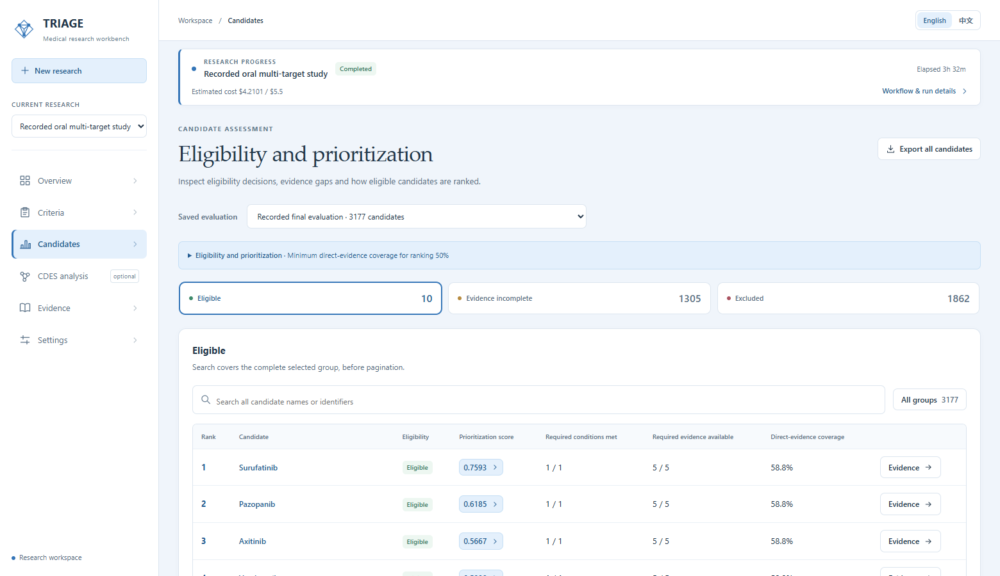
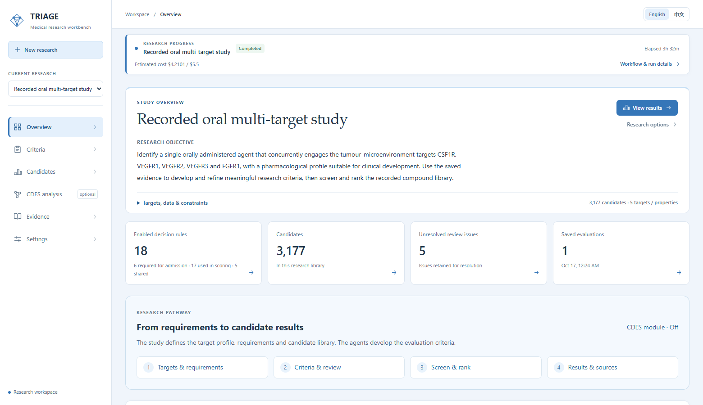
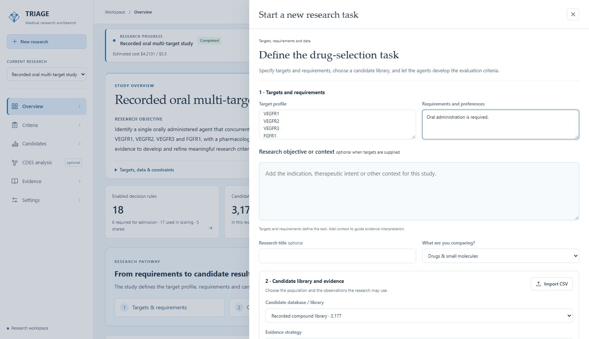
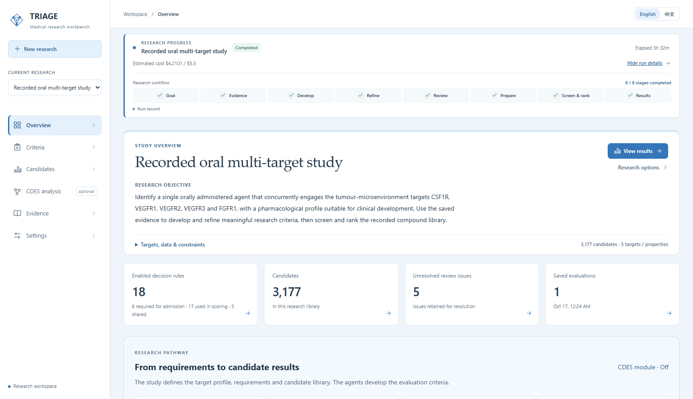
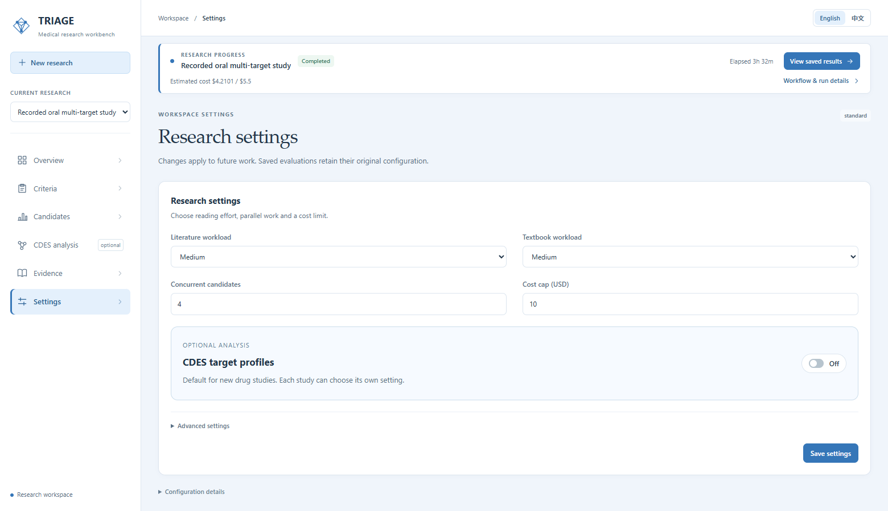
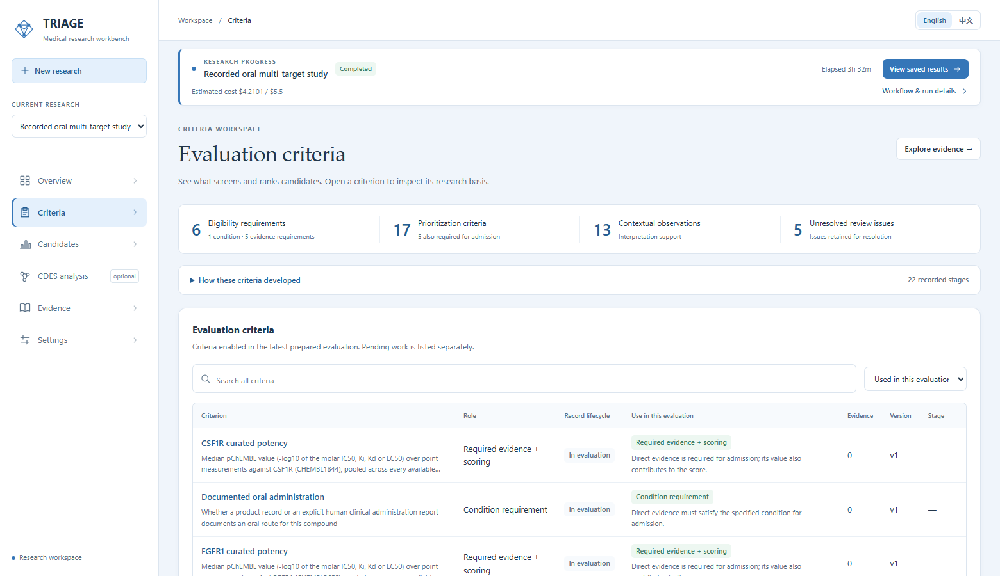
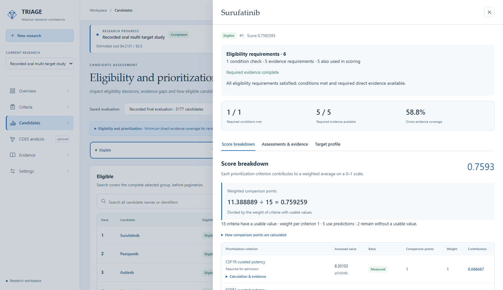
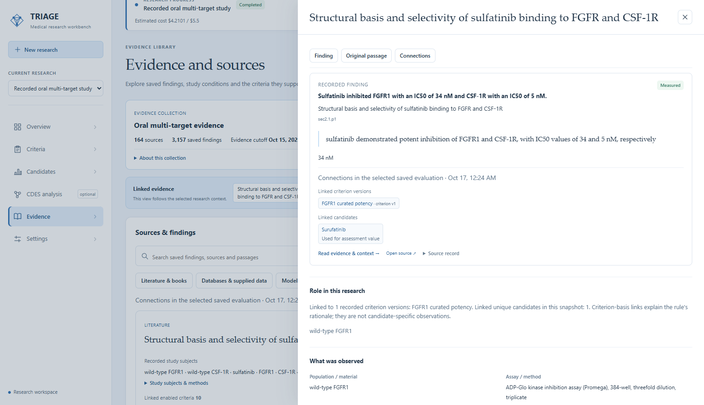
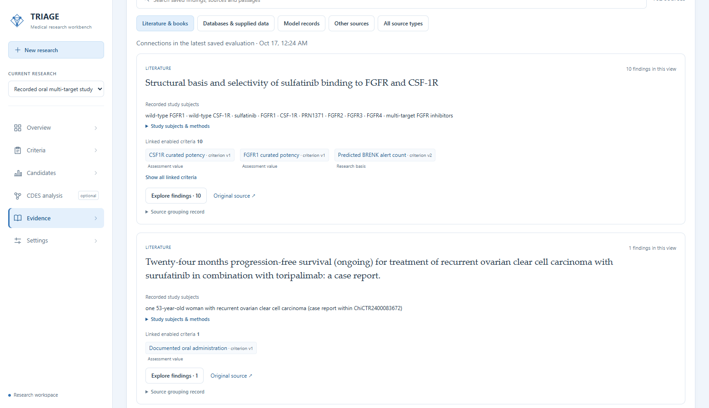

# 当前界面与结果

[English](../current-status.md) · [实操教程](tutorial.md) · [演示稿](../presentation/README.md) · [截图清单](../assets/current/manifest.json) · [核对数据](../reference/current-ui-validation.json)

本页截图于 **2026 年 11 月 2 日**在 Windows 的 Microsoft Edge 中实拍，使用更新后的 1.1.0 工作台、代码版本 `d81dd77`，展示已保存的公开案例和当前任务控件。本轮检查既有结果、预览任务与数据输入，并导出全部候选。

## 当前研究结果

| 内容 | 当前数量 |
|---|---:|
| 候选库 | 3,177 |
| Eligible／符合准入要求 | 10 |
| Evidence incomplete／准入证据不完整 | 1,305 |
| Excluded／已排除 | 1,862 |
| 准入要求 | 6 |
| 评分标准 | 17 |
| 准入与评分共享的标准 | 5 |
| 独立评价标准 | 18 |
| 解释性观察 | 13 |
| 保留但未进入本次评价的条目 | 22 |

六项准入要求包括口服给药条件和五个必需靶点的直接定量观测。五项靶点标准也参与评分，因此 **6＋17−5＝18 项独立标准**。最终保留 53 项条目，其中 31 项参与逐候选评估，包含 13 项解释性观察。

Surufatinib 在十个合格候选中排名第一，15 项可用评分值的平均分为 0.7592592593。直接证据覆盖单独计算，为 10/17（58.8%）：五项靶点观测加五项结构计算。五项 ADMET 预测参与评分，保留预测标识。

本例的 1,305 个 Evidence incomplete 候选已具备部分准入依据；1,862 个 Excluded 候选在完成必需评估后没有可用准入依据。[判定说明](decision-language.md)给出通用规则，包括明确违反必需条件时的排除方式。

[浏览器完整导出](../../examples/oral-multitarget/latest/selection/workbench-export.csv)包含 3,177 行，`selection_decision` 对应当前三个分组。文件同时保留早期字段供追溯原快照，当前结果报告使用该分类字段。

## 任务、进度与证据

概览连接研究问题、标准形成和候选结果。**新建研究**首先填写靶点与要求，再按需要补充背景、候选库和证据策略。**研究选项 → 按此设置新建研究**复用选中的输入，新研究从空标准集开始。

展开工作流详情，可以查看已保存的八个阶段。案例记录的耗时约为 3 小时 32 分钟，模型费用估计为 4.2101472 美元，原预算上限为 5.50 美元。当前 Settings 截图为后续研究设置 Medium、并发上限 4、预算 10 美元。

**CDES 靶点作用谱**是可选分析。Settings 提供新药物研究的默认开关；任务设置选择结果集合，并在筛选后增加分析阶段。当前实现读取已有预测，关联该研究自己的活性和排序，提供预测来源与完整导出。详见[靶点驱动流程](target-workflow.md)和 [CDES 组件](../components/structure-predictions.md)。

标准页面同时展示展开、提炼过程与最终用途。打开单条标准可以查看定义、变化、谱系和来源。

分数面板分别显示准入依据、得分贡献和证据覆盖。证据详情连接发现、标准和候选；文献卡片按来源组织发现，保留摘录、条件及原文链接。

其他画面：[证据选择](../assets/current/evidence-selection.png)、[文献发现](../assets/current/evidence-findings.png)、[标准谱系](../assets/current/criterion-lineage.png)、[标准变化](../assets/current/criterion-changes.png)、[候选证据](../assets/current/candidate-details.png)、[覆盖计算](../assets/current/score-coverage.png)、[证据不完整组](../assets/current/candidates-incomplete.png)、[排除组](../assets/current/candidates-excluded.png)、[中文界面](../assets/current/candidates-zh.png)、[CSV 预览](../assets/current/csv-import.png)。CSV 预览使用两条明确标注的合成载体记录，仅检查格式与映射。

## 当前响应时间

在 Windows、Python 3.14.2 下，使用已恢复的公开案例，查询索引就绪后对每项接口连续请求 20 次。计时包括本地 HTTP 响应与 JSON 解析；首次索引、浏览器绘制、研究与模型运行耗时分别计算。

| 查询 | 中位数 | P95 |
|---|---:|---:|
| 概览 | 56.41 ms | 69.99 ms |
| 标准，每页 50 条 | 189.98 ms | 233.79 ms |
| 合格候选，每页 50 条 | 22.21 ms | 32.79 ms |
| 文献来源，每页 20 条 | 7.10 ms | 21.59 ms |
| 候选评分明细 | 27.77 ms | 39.50 ms |

[核对记录](../reference/current-ui-validation.json)保存接口、样本数、候选数量和 CSV 校验值；[截图清单](../assets/current/manifest.json)保存图像来源地址、拍摄时间、尺寸和校验值。历史发布说明保留当时的验证结果，并统一链接到本页查看当前版本。
